If you have shipped a Vue component, you know the exact moment the abstraction stops helping: a computed value goes stale because you mutated a nested array, or a watcher fires twice for one change. The stack trace points into anonymous functions inside Vue itself, and every tutorial stops at "Vue tracks dependencies automatically." What that really means lives in `packages/reactivity/src/dep.ts` — a 397-line file where a dependency is a node in a doubly-linked list, and tracking is a two-pointer edge between a subscriber and a dep.

The same gap exists on the template side. You know Vue compiles templates into render functions, but the specifics — why static content gets hoisted, why patch flags exist at all — decide whether a ten-thousand-row list scrolls or stutters. Those specifics are particular functions in `packages/compiler-core/src` and one enormous closure in `packages/runtime-core/src/renderer.ts` that you can cite by line in code review.

This post is a source tour of the vuejs/core monorepo on the `main` branch; every file, symbol, and line number below was verified against a real checkout, not recalled from memory. Two diagrams anchor the walk: an overview and a 34-node detail graph. The goal is the thing tutorials skip: the actual contract between reactivity, compilation, and patching, so the next time reactivity bites you, you know exactly which file to open.

<em>The whole system on one canvas: the dependency-graph runtime on the left, the template compiler in the middle feeding a VDOM diff engine, and the DOM host layer on the right.</em>

The data path starts when a render function reads reactive state. Reading the overview from left to right:

- [Link, L32](https://github.com/vuejs/core/blob/main/packages/reactivity/src/dep.ts#L32) — the edge tying one subscriber to one dependency; both sides keep prev/next pointers, so cleanup is pointer surgery.
- [track, L262](https://github.com/vuejs/core/blob/main/packages/reactivity/src/dep.ts#L262) — the read path; links the active subscriber to the Dep for the key being read.
- [trigger, L294](https://github.com/vuejs/core/blob/main/packages/reactivity/src/dep.ts#L294) — the write path; bumps version counters and notifies subscribers in link order.
- [ReactiveEffect, L87](https://github.com/vuejs/core/blob/main/packages/reactivity/src/effect.ts#L87) — the subscriber class behind every render effect and watcher, driven by bit flags.
- [refreshComputed, L376](https://github.com/vuejs/core/blob/main/packages/reactivity/src/effect.ts#L376) — the lazy recompute walk keeping computed chains consistent without eager evaluation.
- [Tokenizer, L236](https://github.com/vuejs/core/blob/main/packages/compiler-core/src/tokenizer.ts#L236) — a character-code scanner (1,120 lines) firing callbacks instead of materializing a token list.
- [baseParse, L1035](https://github.com/vuejs/core/blob/main/packages/compiler-core/src/parser.ts#L1035) — assembles the source-located template AST from token events.
- [patch, L385](https://github.com/vuejs/core/blob/main/packages/runtime-core/src/renderer.ts#L385) — diff entry point inside the renderer closure built by `baseCreateRenderer`.
- [getSequence, L2633](https://github.com/vuejs/core/blob/main/packages/runtime-core/src/renderer.ts#L2633) — longest-increasing-subsequence routine minimizing DOM moves during keyed updates.

<em>The detail graph: every edge is a verified call or data flow between real symbols, including the scheduler and the keyed-children diff.</em>

## The reactivity core: Proxies with a linked-list dependency graph

The entry point is `reactive()` at [packages/reactivity/src/reactive.ts](https://github.com/vuejs/core/blob/main/packages/reactivity/src/reactive.ts#L85), which wraps a target in an ES Proxy and memoizes the result in `reactiveMap` (a WeakMap at line 26). The real decision happens in `createReactiveObject` (line 262): `targetTypeMap` (line 43) classifies the target as COMMON, COLLECTION, or INVALID. Plain objects get the full trap set from `mutableHandlers` in `baseHandlers.ts` (line 251) — get, set, deleteProperty, has, ownKeys. Map and Set take a different road: `mutableCollectionHandlers` in `collectionHandlers.ts` (line 298) instruments only the `get` trap, because collections store data internally and property traps never fire.

The bookkeeping is deliberately minimal. `targetMap` at [dep.ts line 240](https://github.com/vuejs/core/blob/main/packages/reactivity/src/dep.ts#L240) is a WeakMap from target to a per-key dep map, plus synthetic keys like `ITERATE_KEY` (line 242) so loops track the iteration itself. Effects live in `effect.ts`: the `ReactiveEffect` class (line 87) carries a `flags` field (line 101) with bits like ACTIVE, TRACKING, RUNNING, and DIRTY; `run()` (line 162) swaps itself in as the active subscriber, executes, and re-links its dep list — the linked list from `Link` makes that cheap.

Computed properties are just subscribers with discipline. `ComputedRefImpl` in `computed.ts` (line 47) implements the Subscriber interface, and `refreshComputed` in `effect.ts` (line 376) walks dep links checking DIRTY flags before recomputing. The trick that scales is versioning: every write bumps both `dep.version` and a module-level `globalVersion` ([dep.ts lines 168–169](https://github.com/vuejs/core/blob/main/packages/reactivity/src/dep.ts#L168)), so a computed short-circuits when the global snapshot has not moved. Scopes and watchers ride the same machinery: `EffectScope` (effectScope.ts, line 6) owns child effects for disposal, and `watch` (watch.ts, line 120) is a scheduler-wrapped effect in the same package.

## The compiler: from character codes to a render function

`baseCompile` at [compile.ts line 67](https://github.com/vuejs/core/blob/main/packages/compiler-core/src/compile.ts#L67) is the whole story in three calls: parse, transform with a preset from `getBaseTransformPreset` (line 32), generate. Parsing starts lower than you expect: the `Tokenizer` class in `tokenizer.ts` (line 236) is a character-code state machine with a `Sequences` match table (line 216) — the file is 1,120 lines and contains no regular expressions in the hot path. `baseParse` in `parser.ts` (line 1035) consumes those token callbacks and builds an AST where every node carries source locations.

Transformation is a visitor stack, not a rewrite phase. `transform()` (transform.ts, line 334) creates a context and enters the root; `traverseNode` (line 425) runs each transform's enter and exit hooks per node. `createStructuralDirectiveTransform` (line 488) is the factory behind the structural directives: `transformIf` (vIf.ts, line 44) turns conditions into branch-call chains, and `transformFor` (vFor.ts, line 52) rewrites loops into fragment-producing calls. `transformElement` (transformElement.ts, line 73) emits the vnode call with patchFlag hints — the compiler tells the runtime which prop groups changed — while `transformOn` (vOn.ts, line 29) and `transformBind` (vBind.ts, line 15) rewrite directives into props. Modifier handling stays at runtime: `withModifiers` (runtime-dom vOn.ts, line 52) and `withKeys` (line 91) wrap the emitted handler calls.

Code generation is a printer over the transformed AST. `generate()` in [codegen.ts line 283](https://github.com/vuejs/core/blob/main/packages/compiler-core/src/codegen.ts#L283) — the file is 1,118 lines — walks the AST and emits code, and `helperNameMap` in `runtimeHelpers.ts` (line 86) maps symbols like `CREATE_ELEMENT_BLOCK` (line 10) to their import names; imports are emitted only for helpers actually used. The compiler is written to be embedded: this codebase is authored end-to-end in [TypeScript](/typescript-source/), and `babelUtils.ts` (with `walkIdentifiers` at line 21 and `TS_NODE_TYPES` at line 543) reuses Babel's AST types for expression analysis rather than inventing a JavaScript parser.

## The renderer: shapeFlags, patchFlags, and the keyed diff

`renderer.ts` is 2,714 lines inside a single closure. `baseCreateRenderer` (line 341) receives host operations and closes over them; the exported factory `createRenderer` (line 324) is how `runtime-dom` builds its concrete instance. Inside, `patch` (line 385) dispatches on vnode type and shape flag: `processElement` (line 619), `processComponent` (line 1189), `unmount` (line 2190). Fresh nodes go through `mountElement` (line 673) — create, mount children, mount directives, insert. Existing nodes go through `patchElement` (line 849), where patchFlags earned at compile time pay off: `patchProps` (line 1043) skips whole prop groups the compiler marked unchanged.

Children get the famous treatment. `patchUnkeyedChildren` (line 1793) is the fast path — zip two arrays by index. `patchKeyedChildren` (line 1853) runs the full algorithm: sync matching heads, sync matching tails, build a key-to-index map for the middle, then call `getSequence` (line 2633) to compute the longest increasing subsequence of un-moved nodes, so `move` (line 2097) only relocates what genuinely moved. vnode.ts (949 lines) supplies the vocabulary: `_createVNode` (line 567) normalizes children and computes shape and patch flags, and `createBlock` (line 357) opens a block so dynamic descendants are collected flat for cheap updates.

None of it runs immediately. Rendering is scheduled: `queueJob` (scheduler.ts, line 110) deduplicates jobs into a pending queue, and `flushJobs` (line 283) drains it sorted by `getId` (line 280) so parent components update before children — the property that makes consistent snapshots observable. `nextTick` (line 67) is the promise a flushed job resolves, which is why awaiting it after a mutation reliably sees updated DOM.

## runtime-dom: the host contract filled in

`runtime-dom/src/index.ts` is where the abstract renderer meets a browser. `createApp` (line 104) configures DOM-specific renderer options and returns the app; `render` (line 96) and `hydrate` (line 100) are thin binds to a singleton renderer. The host contract has two halves. First, `nodeOps` ([nodeOps.ts line 44](https://github.com/vuejs/core/blob/main/packages/runtime-dom/src/nodeOps.ts#L44)): `createElement` (line 56) branches on the SVG namespace (`svgNS`, line 37), MathML (`mathmlNS`, line 38), and customized built-ins; `createComment` (line 75) exists because empty conditional branches compile to comment placeholders. Second, `patchProp` ([patchProp.ts line 25](https://github.com/vuejs/core/blob/main/packages/runtime-dom/src/patchProp.ts#L25)): it consults the per-module patchers (attributes via `patchAttr` in modules/attrs.ts line 16, classes via `patchClass` in modules/class.ts line 5, plus style and event modules), then falls back to a direct property set only when `shouldSetAsProp` (line 84) says the key is a genuine element property — one decision table encoding years of DOM quirks.

Directives built on this contract stay small: `vModelText` (directives/vModel.ts, line 61) wires input, composition, and change events into one directive, `vShow` (vShow.ts, line 12) stashes the original display value on the element, and `Transition` (components/Transition.ts, line 87) lives in runtime-dom rather than runtime-core precisely because it measures real CSS transitions with `getComputedStyle`.

## From targetMap WeakMaps to globalVersion counters: build facts you can check

- The monorepo holds 12 workspace packages — reactivity, runtime-core, runtime-dom, compiler-core, compiler-dom, compiler-sfc, compiler-ssr, server-renderer, runtime-test, shared, vue, vue-compat — wired by a [pnpm](/pnpm/) workspace file at the repo root; the public `vue` package is mostly re-exports.
- The dependency model fits in 397 lines: `Link` (line 32), `Dep` (line 67), `targetMap` (line 240), `track` (line 262), `trigger` (line 294). The write path bumps two counters — dep-local and `globalVersion` — at dep.ts lines 168–169.
- Both sides of the graph are doubly linked: each effect keeps a dep chain and each dep keeps a sub chain, so re-running an effect relinks only its own edges.
- Parsing and generation are nearly symmetrical in size: tokenizer.ts 1,120 lines, parser.ts 1,086 lines, codegen.ts 1,118 lines. The scanner avoids regexes in the hot path by comparing character codes against the `Sequences` table.
- The entire renderer is one 2,714-line closure ending with the LIS routine `getSequence` at line 2633; the reactivity package totals roughly 3,600 lines across 12 files — smaller than most people assume.
- The tracked tree at HEAD contains 704 entries — a monorepo small enough to read in a week.

## Honest Limits

- Line numbers were verified against `main` on 2026-11-24; vuejs/core ships releases continuously, so anchors can drift. Re-verify before quoting a line in a review.
- This tour checked out four source directories (reactivity, compiler-core, runtime-core, runtime-dom). compiler-sfc, compiler-ssr, and compiler-dom wrap these cores and were read only from the tree listing.
- Branches like `__DEV__` and `__SSR__` are compile-time constants injected by bundler flags; the source shows both paths, but each published build strips one side.
- The diagrams compress intentionally: watch(), v-model, Teleport, Suspense, and custom elements each deserve their own tour, and the scheduler's post-flush callbacks (`queuePostFlushCb`, scheduler.ts line 136) are only mentioned in passing.
- Performance claims here are directional, not measured; for contrast, direct-DOM manipulators like [D3](/d3/) patch elements immediately with no diff pass — the trade-off Vue's compiler plus keyed diff exists to avoid.

