Every web developer who has shipped a mobile app knows the moment of dread: the web build works in Chrome, then a native feature silently does nothing on a device, and there is no stack trace because the call disappeared into a WebView. Ionic's Capacitor exists precisely to make that crossing legible. It takes your web bundle, hosts it inside a system WebView on Android and iOS, and gives JavaScript a typed, promise-based doorway into native code. When you call a plugin method, a JSON envelope crosses a message channel, gets dispatched through a registry, and a native method runs — then the answer travels back the same way.

That doorway is the most interesting part of the codebase, and it is also the part most tutorials skip. If you have ever wondered why `addListener` returns a handle with `remove`, why Capacitor warns about "kept alive" calls leaking memory, or why the fetch patch exists at all, the answers are small, readable pieces of engineering in the repository. The current monorepo layout on `main` keeps the JS runtime in a top-level `core` folder, the Android runtime under `android/capacitor/src/main/java/com/getcapacitor`, and the iOS runtime as a Swift Package under `ios/Sources/Capacitor`, with the CLI in `cli/src`. Reading them side by side is a masterclass in designing a cross-language boundary with almost no moving parts.

This post tours that boundary end to end. The two diagrams below were generated from the real repository tree on branch `main`, so every node you see is a file you can open. We will follow one call from `Plugins.Camera.getPhoto()` all the way to Java reflection and an Objective-C selector, and back. Along the way you will meet a randomized callback counter, a regex that hunts for plugin annotations at sync time, and two very different ideas about what an "app server" should be.

<em>The overview traces the call path: the JS runtime hands work to the injected native bridge script, which posts JSON to whichever platform listener is wired up, and each native bridge dispatches into its plugin layer.</em>

Reading the overview from left to right:

- [createCapacitor, L16](https://github.com/ionic-team/capacitor/blob/main/core/src/runtime.ts#L16) builds the `Capacitor` global and wires `registerPlugin`, `isPluginAvailable`, and the exception type onto it.
- [the Proxy at L160](https://github.com/ionic-team/capacitor/blob/main/core/src/runtime.ts#L160) backs every plugin object: any property access becomes a method wrapper that resolves to web code or native code at call time.
- [toNative, L980](https://github.com/ionic-team/capacitor/blob/main/core/native-bridge.ts#L980) is the departure gate — it stores the pending callback in a `Map`, stamps a fresh callback id, and posts the envelope.
- [androidBridge.postMessage at L927](https://github.com/ionic-team/capacitor/blob/main/core/native-bridge.ts#L927) is the Android transport, while the iOS twin [webkit bridge at L937](https://github.com/ionic-team/capacitor/blob/main/core/native-bridge.ts#L937) posts to `WKScriptMessageHandler` with the same envelope shape.
- [postMessage, L55](https://github.com/ionic-team/capacitor/blob/main/android/capacitor/src/main/java/com/getcapacitor/MessageHandler.java#L55) receives that JSON on the Android side, registered either as a modern WebMessage listener or a legacy `addJavascriptInterface`.
- [callPluginMethod, L722](https://github.com/ionic-team/capacitor/blob/main/android/capacitor/src/main/java/com/getcapacitor/Bridge.java#L722) looks up the `PluginHandle` and pushes invocation onto a handler thread rather than the WebView callback thread.
- [PluginHandle.invoke, L105](https://github.com/ionic-team/capacitor/blob/main/android/capacitor/src/main/java/com/getcapacitor/PluginHandle.java#L105) finishes the trip with plain Java reflection: `Method.invoke(instance, call)` on an annotation-indexed method cache.
- [handleJSCall, L414](https://github.com/ionic-team/capacitor/blob/main/ios/Sources/Capacitor/CapacitorBridge.swift#L414) is the iOS mirror: resolve the class by plugin id string, build a selector, then `perform(selector, with:)` on a dedicated background queue.
- [fromNative, L1041](https://github.com/ionic-team/capacitor/blob/main/core/native-bridge.ts#L1041) closes the loop on the JS side — iOS injects a literal `window.Capacitor.fromNative(...)` script to deliver the result and settle the stored promise.

<em>The detail view expands each bridge: Android's local server and injector, the reflection-based plugin layer, iOS's script-message handler and selector dispatch, plus the CLI tasks that feed both.</em>

## One Codebase, Two Native Hosts

The unifying trick is that both platforms inject the same generated script, `core/native-bridge.ts` (compiled to `native-bridge.js`), into every page the WebView loads. Android goes the verbose route: `Bridge.getJSInjector()` concatenates `globalJS`, `bridgeJS`, `pluginJS`, and Cordova compatibility files into one string that `WebViewLocalServer` prepends to served documents (see [JSInjector fields at L16](https://github.com/ionic-team/capacitor/blob/main/android/capacitor/src/main/java/com/getcapacitor/JSInjector.java#L16) and the construction call at [L937](https://github.com/ionic-team/capacitor/blob/main/android/capacitor/src/main/java/com/getcapacitor/Bridge.java#L937)). iOS instead adds the script as a `WKUserScript` through `JSExport.exportCapacitorGlobalJS`, invoked during bridge init at [CapacitorBridge L193](https://github.com/ionic-team/capacitor/blob/main/ios/Sources/Capacitor/CapacitorBridge.swift#L193). Same script, opposite injection mechanics — which is exactly why the file starts with a comment warning that changes require rebuilding both platforms.

Once injected, the runtime in `core/src/runtime.ts` is deliberately tiny. `createCapacitor` installs a handful of functions on `window.Capacitor`, and `registerPlugin` returns a `Proxy` whose `get` trap manufactures method wrappers on demand. Plugin authors call `registerPlugin('Camera', { web: () => import('./web') })` and the runtime decides per call whether a native plugin header exists (fetched from `cap.PluginHeaders`, populated by the native side) or the web fallback should run. The web fallback itself derives from [WebPlugin at L9](https://github.com/ionic-team/capacitor/blob/main/core/src/web-plugin.ts#L9), a plain listener dictionary — so the same npm package works in the browser and on device with zero conditional imports in application code. This is the layer that pairs naturally with TypeScript tooling; the whole runtime is written in [TypeScript](/typescript-source/) and ships its own definitions from `core/src/definitions.ts`.

## Inside the Callback Map

The bridge is fundamentally a keyed mailbox. When JS calls a plugin method with a callback or expects a promise, `toNative` allocates an id and stores `{ pluginName, methodName, callback, resolve, reject }` in a `Map` (envelope assembled at [native-bridge L1007](https://github.com/ionic-team/capacitor/blob/main/core/native-bridge.ts#L1007)). The native side echoes the `callbackId` in its result, and `returnResult` looks it up, resolves or rejects, and deletes the entry — except for event listeners, which stay parked until `removeListener` arrives. Note the defensive detail at [L1090](https://github.com/ionic-team/capacitor/blob/main/core/native-bridge.ts#L1090): a `save: false` flag forces deletion even if the bookkeeping above missed, because a leaked callback closure leaks everything it captured.

Not every call deserves an id. Fire-and-forget calls get the sentinel `"-1"`, defined at [PluginCall L20](https://github.com/ionic-team/capacitor/blob/main/android/capacitor/src/main/java/com/getcapacitor/PluginCall.java#L20) as `CALLBACK_ID_DANGLING`; when one of those completes, Android fires `App.fireRestoredResult` instead of replying, so late results can be re-delivered to the next page load. The iOS counterpart is the `storedCalls` dictionary at [CapacitorBridge L110](https://github.com/ionic-team/capacitor/blob/main/ios/Sources/Capacitor/CapacitorBridge.swift#L110), a concurrent map that `keepAlive` calls are saved into. This asymmetry explains the classic Capacitor foot-gun: a listener you never `remove` keeps a native-side call object alive across navigation, which is why the JS layer explicitly deletes callbacks for `removeListener` and `removeAllListeners` before sending them (see [L987](https://github.com/ionic-team/capacitor/blob/main/core/native-bridge.ts#L987)).

## How a Plugin Method Is Found and Invoked

Discovery happens at build time, registration at run time — and the two platforms make opposite trade-offs. The CLI scans each Android plugin's `.java`/`.kt` sources with the regex at [update.ts L114](https://github.com/ionic-team/capacitor/blob/main/cli/src/android/update.ts#L114), which matches `@CapacitorPlugin` annotations plus the following class declaration, then writes the resulting classpaths into `capacitor.plugins.json` inside the app's assets ([writePluginsJson at L79](https://github.com/ionic-team/capacitor/blob/main/cli/src/android/update.ts#L79)). At app start, `PluginManager.loadPluginClasses` reads that manifest back and materializes classes with `Class.forName` ([L29](https://github.com/ionic-team/capacitor/blob/main/android/capacitor/src/main/java/com/getcapacitor/PluginManager.java#L29)) — no dex scanning, no annotation processing at runtime, just a generated list. Four built-ins — CapacitorCookies, WebView, CapacitorHttp, SystemBars — bypass the manifest and register directly at [Bridge L597](https://github.com/ionic-team/capacitor/blob/main/android/capacitor/src/main/java/com/getcapacitor/Bridge.java#L597).

iOS skips the manifest entirely. Plugin ids are the class names themselves: `handleJSCall` calls `NSClassFromString(call.pluginId)` at [CapacitorBridge L416](https://github.com/ionic-team/capacitor/blob/main/ios/Sources/Capacitor/CapacitorBridge.swift#L416), so linking the plugin into the binary is registration. Method lookup goes through `CAPPluginMethod`, which maps each exported method name to an ObjC selector, and the call is executed with `plugin.perform(selector, with: pluginCall)` at [L475](https://github.com/ionic-team/capacitor/blob/main/ios/Sources/Capacitor/CapacitorBridge.swift#L475) — on the dedicated `DispatchQueue(label: "bridge")` declared at [L117](https://github.com/ionic-team/capacitor/blob/main/ios/Sources/Capacitor/CapacitorBridge.swift#L117), so plugin work never blocks the main thread. Android's equivalent protection is `taskHandler.post(...)` at [Bridge L745](https://github.com/ionic-team/capacitor/blob/main/android/capacitor/src/main/java/com/getcapacitor/Bridge.java#L745). The CLI side of this contract lives in the copy task at [copy.ts L25](https://github.com/ionic-team/capacitor/blob/main/cli/src/tasks/copy.ts#L25), which also drops `capacitor.config.json` and your web bundle into the native projects — the same role `npm`-era tooling plays in any [Node](/node/) build setup.

## From Random Callback Counters to a 32 MB ID Space

One line rewards a second look: [native-bridge L911](https://github.com/ionic-team/capacitor/blob/main/core/native-bridge.ts#L911) initializes `callbackIdCount` to `Math.floor(Math.random() * 134217728)` — a random offset within 2 to the 27th. Why random? Because WebView reloads were reusing ids: a stale result from the previous session could resolve a fresh promise. Seeding the counter randomly makes a collision a one-in-134-million event rather than a guaranteed bug on hot reload. From there ids increment by one per call, and the surrounding design grew in the same defensive direction: the modern Android transport uses `WebViewCompat.addWebMessageListener` when available ([MessageHandler L39](https://github.com/ionic-team/capacitor/blob/main/android/capacitor/src/main/java/com/getcapacitor/MessageHandler.java#L39)), falls back to `addJavascriptInterface` otherwise, and can even answer through the legacy `evaluateJavascript("window.Capacitor.fromNative(...)")` route at [L115](https://github.com/ionic-team/capacitor/blob/main/android/capacitor/src/main/java/com/getcapacitor/MessageHandler.java#L115). iOS meanwhile hardened the receive side with a single named handler — `contentController.add(self, name: "bridge")` at [WebViewDelegationHandler L22](https://github.com/ionic-team/capacitor/blob/main/ios/Sources/Capacitor/WebViewDelegationHandler.swift#L22) — and per-frame main-frame checks. Even the HTTP layer followed this arc: the fetch patch at [native-bridge L475](https://github.com/ionic-team/capacitor/blob/main/core/native-bridge.ts#L475) preserves the originals as `CapacitorWebFetch`, routes non-GET bodies through `nativePromise('CapacitorHttp', 'request', ...)` at [L551](https://github.com/ionic-team/capacitor/blob/main/core/native-bridge.ts#L551), and special-cases GET/HEAD/OPTIONS through a proxy URL solely to dodge a Chromium user-agent stripping bug.

## The Invisible HTTP Server on Each Platform

Your app believes it is served from `https://localhost` (Android) or `capacitor://localhost` (iOS), but no server is listening. Android fakes it with `WebViewLocalServer`: `shouldInterceptRequest` at [L171](https://github.com/ionic-team/capacitor/blob/main/android/capacitor/src/main/java/com/getcapacitor/WebViewLocalServer.java#L171) intercepts every request to the virtual `https://{uuid}.androidplatform.net` host described at [L616](https://github.com/ionic-team/capacitor/blob/main/android/capacitor/src/main/java/com/getcapacitor/WebViewLocalServer.java#L616) and streams the matching asset, backed by `AndroidProtocolHandler`. iOS takes the scheme route through `WebViewAssetHandler`, and the bridge hands it the bundle path via `setAssetPath` during init. This is why relative fetches, service-worker-free routing, and secure-context APIs all behave like a real origin — and why the `server.url` config option that swaps in a dev server is so useful for live reload. For persistence needs beyond preferences (the iOS runtime ships a small `KeyValueStore.swift`), apps typically reach for native plugins backed by embedded engines such as [SQLite](/sqlite/), which slots into exactly this plugin-invocation machinery.

## Honest Limits

The bridge is JSON-only: `toNative` serializes envelopes with `JSON.stringify`, so typed arrays and streams cross as base64 strings, and the body-conversion helpers in `native-bridge.ts` exist mostly to paper over that. Reflection dispatch on Android means a renamed or removed `@PluginMethod` fails at call time, not build time; on iOS a missing `@objc` declaration produces the "does not respond to selector" runtime error the code explicitly anticipates. The legacy `addJavascriptInterface` path, still present as a fallback, is inherently less isolated than WebMessage listeners. Cordova compatibility adds real weight — `JSInjector` still concatenates Cordova shims, and `ios/Sources/Cordova` is a vendored compatibility layer. And because every result arrives via one injected script and one callback map, a single malformed native response can theoretically disturb unrelated pending calls — the code mitigates with per-callback deletion, but the mailbox is shared. Read the source with those constraints in mind; it is honest, heavily commented infrastructure, not magic.

