Every scientific Python codebase eventually hits the same wall: a loop that NumPy cannot vectorize, a data structure the interpreter insists on boxing, a parser that should take microseconds but takes seconds. The standard advice is to rewrite the hot path in C, and that advice quietly hides three months of pain: manual reference counting, GIL discipline, build-system archaeology, and a dozen ways to corrupt memory that Python never taught you to look for. Cython exists to delete that tax. You annotate Python with types, and you get a real C extension module — not a wrapper, not a foreign-function bridge, but compiled C that the interpreter loads natively.

What almost nobody realizes is that Cython itself is a compiler written in plain, readable Python. The entire compiler lives under `Cython/Compiler` in roughly forty-five modules, the current dev tree stamps itself as 3.4.0a0 (`__version__` in `Cython/Shadow.py`), and the repository carries 2,756 tracked files. There is a lexer, a hand-written recursive-descent parser, a forest of more than two hundred node classes, ordered analysis passes, and a code writer that literally prints C text with insertion points. You can read it the way you would read any application — no compiler-theory prerequisites, no generated parser tables to decode.

We walked the master tree end to end and mapped how a `.pyx` file becomes a `.c` file. Both diagrams below were built from the real repository structure, and every line number cited in this article was verified against the source. If you have ever shipped a Cython module and wondered what actually happened between your decorator and your `.so` file, the next two diagrams are the map.

<em>Cython compiler overview: compile() drives a lexer, a hand-written parser, ordered analysis and optimization passes, and a C writer that emits the extension module.</em>

Reading the overview from left to right:

- [compile(), L728](https://github.com/cython/cython/blob/master/Cython/Compiler/Main.py#L728) is the whole build in one call: options in, a `CompilationResult` out. The `Context` class at [L50](https://github.com/cython/cython/blob/master/Cython/Compiler/Main.py#L50) carries include paths, directives and parsed `.pxd` modules across the build.
- [make_lexicon(), L15](https://github.com/cython/cython/blob/master/Cython/Compiler/Lexicon.py#L15) defines the token grammar, including integer literals with underscore separators like `0x_1f`-style digit groups.
- [PyrexScanner, L308](https://github.com/cython/cython/blob/master/Cython/Compiler/Scanning.py#L308) subclasses the Plex `Scanner` and hands tokens to the parser while tracking compile-time symbol state.
- [p_module(), L4229](https://github.com/cython/cython/blob/master/Cython/Compiler/Parsing.py#L4229) is the top of a 4,252-line hand-written recursive-descent grammar — there is no parser-generator input file anywhere in the tree.
- [InterpretCompilerDirectives, L867](https://github.com/cython/cython/blob/master/Cython/Compiler/ParseTreeTransforms.py#L867) rewrites `@cython.*` decorators and directive comments into real node semantics; this pass is what makes pure-Python mode work at all.
- [AnalyseDeclarationsTransform, L2190](https://github.com/cython/cython/blob/master/Cython/Compiler/ParseTreeTransforms.py#L2190) declares every name into its scope — the moment a Python variable gains a C cname.
- [MemoryViewSliceType, L725](https://github.com/cython/cython/blob/master/Cython/Compiler/PyrexTypes.py#L725) models typed memoryviews as a first-class type with C- and Fortran-contiguity axis specs.
- [ConstantFolding, L4462](https://github.com/cython/cython/blob/master/Cython/Compiler/Optimize.py#L4462) folds arithmetic and string concatenation at compile time, before any C exists.
- [generate_c_code(), L584](https://github.com/cython/cython/blob/master/Cython/Compiler/ModuleNode.py#L584) walks the finished tree and drives the writer that emits the translation unit.

The detail view below goes one level deeper: entry points, the frontend, the transform stack, the type and symbol machinery, the optimization set, and the runtime utility files that get stitched into your C output on demand.

<em>Cython compiler detail: each node is a real class or function in Cython/Compiler, with the utility-side memoryview runtime that C emission pulls in only when needed.</em>

## The Frontend Is a Plex Lexer and a 4,252-Line Grammar

Cython does not use a parser generator. It carries its own lexer toolkit, `Cython/Plex` — fourteen files implementing the classic lexicon-to-DFA path (`Machines.py`, `DFA.py`, `Scanners.py`). On top of it, `Lexicon.py` defines the token set in pure Python, and `Scanning.py` wraps the resulting scanner in `PyrexScanner`, which also tracks compile-time bindings so `IF`/`DEF` conditional compilation works at tokenize time.

The grammar itself is `Parsing.py`, all 4,252 lines of hand-written recursive descent. The entry point `p_module` sits at line 4229, meaning essentially the whole file is grammar. `p_cdef_statement` at line 3488 parses the `cdef`/`cpdef` surface — visibility, `inline`, `extern`, structs and fused types — and `p_compile_time_expr` at line 2489 implements the tiny language used by compile-time constants. Hand-rolled parsers like this age well precisely because error messages can be written per production; Cython's diagnostics reputation rests on that choice. The C it emits targets the CPython C API, so the output is best read alongside a [CPython internals walkthrough](/cpython/) — same object model, same refcounting rules, no hidden VM.

## The Tree That Becomes C

After parsing, the compiler works on two parallel structures. The first is the node forest: `Nodes.py` holds 111 statement and declaration classes across 9,677 lines, and `ExprNodes.py` — the largest module in the compiler — holds 160 expression classes across 14,009 lines. The base classes are small: `Node` at line 173 of `Nodes.py` is essentially positional metadata plus declared child attributes, and `ExprNode` at line 334 adds `result_code`, a `type` slot, and the evaluation-code hooks the writer later calls.

The second structure is the symbol table. `Symtab.py` defines twenty classes: the generic `Scope` at line 349, `Entry` at line 67 (one declared symbol, with its C name, type and visibility), then specializations — `ModuleScope` at 1374, closure scopes for generators, `CClassScope` at 2408 for extension-type attributes and vtable slots, and `CppClassScope` at 2855 for C++ classes. Type reality lives in `PyrexTypes.py`: 58 classes across 5,595 lines, from `CType` at 2176 through `CFuncType` at 3588 with its exception-handling specification.

Transforms then walk this forest in a fixed order. `ParseTreeTransforms.py` alone ships more than thirty transform classes: `PostParse` normalizes sugar at line 144, `InterpretCompilerDirectives` lands directives at 867, `AnalyseDeclarationsTransform` at 2190 assigns types and cnames, `CreateClosureClasses` at 3589 hoists generators into closure structs, and `GilCheck` at 3791 audits `nogil` blocks so you cannot smuggle a Python call into freed-GIL code. When `infer_types` is enabled, `SimpleAssignmentTypeInferer` at line 389 of `TypeInference.py` narrows untyped locals to C types from their assignments.

## Typed Memoryviews Without the Copy Tax

Typed memoryviews are Cython's modern answer to NumPy-style zero-copy access, and the implementation is spread across exactly three layers. Parsing: `MemoryViewSliceTypeNode` at line 1253 of `Nodes.py` reads the `double[:, ::1]` syntax into axis specs. Typing: `MemoryViewSliceType` at line 725 of `PyrexTypes.py` models C- versus Fortran-contiguous axes, and the older buffer-protocol path remains beside it as `BufferType` at line 1250.

The compiler-side mechanics live in `MemoryView.py` (743 lines): `valid_memslice_dtype` at line 148 rejects object dtypes that cannot be laid out flat, `unellipsify` at line 371 normalizes indexing against the slice's dimensionality, and `MemoryViewSliceBufferEntry` at line 181 tracks the `shape`, `strides` and `data` fields each slice carries. Contiguity checks like `is_cf_contig` at line 677 decide when a slice can be handed to C code as a flat pointer.

The runtime half is generated on demand: `Cython/Utility/MemoryView.pyx` defines the `memoryview` class at line 356 and `memoryview_cwrapper` at line 708, kept as a Tempita template and pulled into your C file only when a memoryview is actually used. That lazy-injection mechanism — `UtilityCode` at line 544 of `Code.py` with its `TempitaUtilityCode` variant at line 911 — is why a "hello world" Cython build stays small despite the 43-file utility library. This is the same machinery that lets pyarrow hand NumPy views over Arrow buffers without copying, which we covered in our [Apache Arrow source tour](/arrow/).

## From 14,009-Line ExprNodes to Portable C: The Build Facts

The numbers tell the real story of where Cython's engineering effort went. The expression module is the giant: `ExprNodes.py` at 160 classes and 14,009 lines, followed by `Nodes.py` at 111 classes and 9,677. Optimization is a single 4,909-line module holding eleven top-level transform classes — `IterationTransform` at line 171 turns `for-in` loops over known containers into C loops, `SwitchTransform` at line 1275 rewrites `if/elif` chains into C `switch`, `OptimizeBuiltinCalls` at line 2285 specializes `len()` and friends into direct C calls, and `FinalOptimizePhase` at line 5261 makes the last cleanup pass before emission.

Emission itself is `Code.py`, 3,161 lines of writer infrastructure: `CCodeWriter` at line 2490 with `putln` at 2786 and `insertion_point` at 2584, which lets a node finish a function body while another node later injects declarations at a remembered offset. Every generated symbol carries the `__pyx_` prefix from `Naming.py` line 10. `generate_c_code` at line 584 of `ModuleNode.py` produces the `.c` file plus `.h`, `.pxi` and `_api.h` companions, and it wraps output in `AnnotationCCodeWriter` (line 590) so the HTML annotation report can highlight typed lines. One counterintuitive fact: the module named `CodeGeneration.py` is 26 lines — it only extracts pxd code, because emission lives in the nodes themselves. The same compiler that prints this C is what ships inside projects with hard real-time budgets, from Kivy's core to Arrow's bindings, as we documented in our [Kivy architecture review](/kivy/). And for developers who want the speed without C syntax, pure-Python mode closes the loop: `Shadow.py` provides `declare()` at line 334 and no-op decorators (`cclass`, `cfunc`, `ccall` at line 150), which `DecoratorTransform` at line 1875 rewrites into the same C-generating nodes.

## Honest Limits

Three caveats before you apply any of this. First, line numbers are pinned to the master tree at 3.4.0a0 on the day of writing; Cython moves quickly, and a released 3.x version may differ by dozens of lines in exactly these files. Second, the diagrams compress a genuinely order-sensitive build: the sequence of analysis and optimization passes is assembled at runtime by one orchestration module and has changed shape across releases, so treat the arrow order as the steady-state flow rather than a frozen contract. Third, coverage is partial by design — fused-type specialization, C++ template support and the C-only utility files (like `ModuleSetupCode.c` and `Optimize.c`) each deserve their own walkthrough, and the static diagrams cannot show runtime behavior such as exception propagation through `noexcept` boundaries. What the source does prove, though, is that "Python-to-C" is not a black box: it is a lexer, a grammar, a symbol table and a code writer, each small enough to read in an afternoon.

