Every Electron developer has hit the same wall. You ship what you believe is a small HTML app, and within a week it is running as a family of operating-system processes whose failures you cannot explain from your own code. A perfectly ordinary object comes back from an `invoke()` call with `Error: An object could not be cloned`. You flip one `contextIsolation` flag and your preload script silently loses half its globals. The whole app blinks out because the main process threw once and a dialog appeared titled "A JavaScript error occurred in the main process". And when you finally open DevTools on the main side, the stack traces point into files that are not in your repository at all — `lib/browser/ipc-main-impl.ts`, `shell/renderer/api/electron_api_ipc_renderer.cc` — as if Electron were gaslighting you.

Those files are real. This article walks the actual source tree on Electron's main branch and follows one message from `ipcRenderer.invoke()` inside your window to the `ipcMain.handle()` callback inside your app, and back. Every path, symbol, and line number below was verified against the live repository the day this was written, so you can open GitHub side by side and follow along. Nothing here is reconstructed from documentation; the fun of it is that the code says something slightly different from the docs.

The payoff is practical rather than academic. Once you see that every Electron API is a two-layer sandwich — a TypeScript shim wrapped around a native C++ class, joined by a value serializer and a per-frame mojo channel — the classic error messages stop being folklore. You can point at the exact line where "An object could not be cloned" is thrown, the exact line where a duplicate `handle()` registration is rejected, and the exact line that still supports synchronous IPC long after everyone told you it was gone.

<em>Overview of the split: the main process (left) boots through lib/browser/init.ts and a lazy module registry; each renderer (right side of the middle column) boots through lib/renderer/init.ts; the native layer at the far right carries every message over the ElectronApiIPC mojo contract.</em>

Reading the overview from left to right, the story is easier to trust when each hop is a real file you can open, with a real line number attached:

- [IpcMainImpl.handle, L15](https://github.com/electron/electron/blob/main/lib/browser/ipc-main-impl.ts#L15) — the main-side public `ipcMain` is an EventEmitter subclass whose `handle()` stores callbacks in a private `Map` and rejects a second registration for the same channel with `Attempted to register a second handler for '<method>'`.
- [ipcRendererInternal, L1](https://github.com/electron/electron/blob/main/lib/renderer/ipc-renderer-internal.ts#L1) — the entire "internal IPC" module used by Electron's own code is a single line: a re-export of a native object from the `electron_renderer_ipc` linked binding.
- [electron_renderer_ipc, L534](https://github.com/electron/electron/blob/main/shell/renderer/api/electron_api_ipc_renderer.cc#L534) — that binding is registered by a C++ macro call that builds the public `ipcRenderer` and the internal twin in one pass.
- [ElectronApiIPC, L100](https://github.com/electron/electron/blob/main/shell/common/api/api.mojom#L100) — the mojom contract every user message crosses: `Message`, `Invoke`, a synchronous `MessageSync`, and `ReceivePostMessage`, each carrying a `SerializedValue`.
- [electron_ipc_remote_, L211](https://github.com/electron/electron/blob/main/shell/renderer/api/electron_api_ipc_renderer.cc#L211) — the renderer side holds a mojo associated remote bound to that interface; this is the transport under every `send` and `invoke`.
- [ElectronApiIPCHandlerImpl::Message, L48](https://github.com/electron/electron/blob/main/shell/browser/electron_api_ipc_handler_impl.cc#L48) — in the browser process, one handler object exists per render frame, observes its WebContents, and dies with it.
- [ipc_dispatch::Message, L578](https://github.com/electron/electron/blob/main/shell/browser/api/electron_api_ipc_dispatch.cc#L578) — the native dispatch shim that finally hands a deserialized payload to the JavaScript emitters in the main process.
- [SerializeV8Value, L333](https://github.com/electron/electron/blob/main/shell/common/v8_util.cc#L333) — every argument you pass crosses the process boundary through Blink's V8 value serializer; this is the function that throws "An object could not be cloned".
- [BrowserWindow.prototype._init, L6](https://github.com/electron/electron/blob/main/lib/browser/api/browser-window.ts#L6) — the TS side does not own the class; it patches the prototype of the native `BrowserWindow`, freezing `id` and forwarding focus and blur events to `app`.

<em>The detail view expands the picture to 33 files across seven groups, including the IPC JavaScript glue (ipc-dispatch, ipc-main-impl, ipc-main-internal) and the gin binding kit that makes C++ objects look like Node classes.</em>

## Every Electron module is a two-layer sandwich

Open [lib/browser/api/module-list.ts](https://github.com/electron/electron/blob/main/lib/browser/api/module-list.ts) and you find the registry that decides what `require('electron')` returns in the main process: 40 alphabetized entries, some loading TypeScript files like `require('./app')`, others pointing straight at native bindings such as `process._linkedBinding('electron_browser_notification')`. The JavaScript layer is authored in TypeScript and compiled at build time (the same language behind the [TypeScript compiler source](/typescript-source/), though Electron uses its own bundling), and its job is mostly to decorate: `browser-window.ts` is 233 lines of prototype patching over a class whose constructor lives in C++.

The native half is bigger. `shell/browser/api/` contains 61 `.cc` binding files, and the largest, `electron_api_web_contents.cc`, is 7,082 lines of Chromium glue. Supporting them is a small framework called gin_helper — 23 `.cc` and 35 `.h` files under `shell/common/gin_helper/` — that provides `Wrappable` bases, Node-style EventEmitter prototypes, promise helpers, and option-parsing dictionaries. When you subclass a native object, register a destructor, or get a promise back from C++, it is this kit doing the work.

## The life of an invoke() call

Call `ipcRenderer.invoke('db:query', arg)` in a window and this is the verified path. First, `invoke` is not a JavaScript method at all: it was defined on the emitter's prototype by `EmitterMethods::Invoke` and registered in the emitter factory at lines 492–498 of `electron_api_ipc_renderer.cc`, alongside `send`, `sendSync`, `sendToHost`, and `postMessage`. The method serializes your arguments with `SerializeV8Value` into a `SerializedValue` — a mojo `BigBuffer` plus a `uint64` size, per the struct at lines 37–40 of `api.mojom` — then calls `Invoke` on the associated remote.

In the browser process, `ElectronBrowserClient` has already registered a binder for every render frame (the registration lives around lines 1921–1938 of `electron_browser_client.cc`), so `ElectronApiIPCHandlerImpl` receives the call, builds an `IpcMainEvent` via `MakeIPCEvent`, and routes through `ipc_dispatch::Invoke`. The dispatch lands on the `IpcMainImpl` instance exported by `ipc-main.ts` — the same class whose duplicate-handler guard you met above — and your handler runs on the main process event loop. Two details deserve attention. If the session or WebContents has died mid-flight, the handler still resolves the pending call: the comment says "We must always invoke the callback if present" and it calls `ReplyChannel::SendError` rather than leaking the promise. And when your handler throws, the error crosses back and is re-thrown renderer-side with the familiar prefix `Error invoking remote method '<channel>': ...` — assembled at lines 453–455 of the renderer binding file.

Electron's own traffic uses reserved channel names so your app cannot collide with it: a `const enum` in `lib/common/ipc-messages.ts` declares exactly nine of them, such as `BROWSER_PRELOAD_ERROR` and `GUEST_VIEW_MANAGER_CALL`.

## From JS EventEmitters to native emitters

The most instructive refactor in this area is visible in the code's own comments. The renderer emitter used to be a JavaScript `class IpcRenderer extends EventEmitter`; the factory comment at lines 475–477 of `electron_api_ipc_renderer.cc` explains that the native replacement still mirrors that shape "so the methods stay off the instance (contextBridge copies own properties only)". The move matters because contextBridge deep-copies objects across isolated worlds: instance-own methods would be copied per context, prototype methods would not.

The engineering details are worth stealing for your own bindings. The native emitter attaches a data object with exactly two internal fields — the `MethodData` enum names them `kTransport` and `kInternal` — so every method call unpacks its transport and its internal flag from the data slot instead of a closure. That is why `const { send } = ipcRenderer` works unbound, a property the old JS closures lost. Transports are polymorphic: a window gets `IPCRenderFrame`, tied to a `RenderFrameObserver` with a pre-finalizer for cleanup, while service-worker threads get `IPCServiceWorker`, keyed off a main-thread id constant of zero at line 60.

Preload scripts got a similar treatment. The `PreloadScriptData` struct in `api.mojom` (lines 10–23) ships each preload's source plus an optional V8 code cache: the first renderer to compile a preload persists it under `userData/Code Cache/electron-preload/`, and later windows receive the cached compilation only when the recorded source hash matches. That is a shift from eager per-window compilation to shared code caching, invisible from the API surface. One relic survives on purpose: the `[Sync]` annotation on `MessageSync` at line 119 keeps synchronous IPC available for `sendSync`, decades-old advice notwithstanding.

## What the process split buys you

The directory names are the process matrix. `lib/browser/` runs in the main process with Node's full surface and 40 modules; `lib/renderer/` runs inside sandboxed renderers, where the bootstrap patches `Module.wrapper` so `process` and `global` survive context resets, and where the `vm` module is explicitly unsupported — loading it prints a warning about crashes from line 12 of `lib/renderer/init.ts`. `lib/worker/`, `lib/utility/`, `lib/isolated_renderer/`, and `lib/webview/` cover the remaining execution sites. For work that should not sit in the main process at all, `utilityProcess` in the module list forks dedicated child processes.

The webview system shows the split in miniature. The main side owns guests through `guest-view-manager.ts`, which dispatches events to embedders with `GUEST_VIEW_INTERNAL_DISPATCH_EVENT`; the renderer side listens in `guest-view-internal.ts` on channel names suffixed with the view instance id, and creates or detaches guests through internal `invoke` calls. A heavy Electron app such as [Joplin](/joplin/) builds its entire window and plugin model on these same channels, which is why IPC discipline scales with app size rather than with framework maturity. And because the main process embeds Node itself — the same codebase dissected in the [Node.js source walkthrough](/node/) — its module table is a superset of what each renderer sees.

## Honest Limits

This tour covers the IPC and API spine only. It is based on a sparse checkout of `lib/`, `shell/browser/`, `shell/renderer/`, and `shell/common/`; it does not cover the GN build system, the `patches/` directory where Electron carries dozens of Chromium patches, platform-specific files such as the `.mm` and `_win.cc` variants, or Chromium's own browser internals. Line numbers come from the main branch on 2026-11-25 and will drift with every commit — the architecture survives longer than any individual line number, so re-grep before citing. The "could not be cloned" explanation is a structural claim about Blink's structured-clone serializer, not a measured benchmark; and the claim that sync IPC survives for legacy reasons is inferred from the code, not from maintainer statements. Finally, `SerializeV8Value` handles values, not identities: sending a function or a DOM node is rejected by design, and no amount of architecture reading will change that — only your payload design will.

