Every React Native developer eventually hits the same wall: you need to change something inside the native project — a manifest permission, an entitlement, one line of the Gradle build — and the managed workflow tells you there is no `android/` or `ios/` folder to edit. Forking the native folders works, but it's a trap: you own them forever, merge every upgrade by hand, and lose the reason you chose a managed workflow in the first place. Expo's answer is continuous native generation — the native folders become build artifacts, regenerated from a single JSON config whenever you run one command.

The machinery behind that promise lives inside the `expo/expo` monorepo, and it is far more concrete than the docs make it sound. This is a [pnpm](/pnpm/) workspace monorepo (`pnpm-workspace.yaml` at the root, driven by `turbo.json`) whose `packages/` directory holds 125 top-level entries across the `@expo` and `@unimodules` scopes, with roughly 24,000 tracked files at HEAD. Inside it, three subsystems cooperate: the TypeScript CLI in `packages/@expo/cli`, the config-plugin and mod compiler in `packages/@expo/config-plugins`, and the resolution layer in `packages/@expo/prebuild-config`, with the dev client packages (`expo-dev-client`, `expo-dev-launcher`, `expo-dev-menu`) consuming the same plugin interface.

Reading the source is worth it for anyone who has ever stared at an error like "Config plugin could not be resolved" at 11pm before a release. The whole native-generation story — where the template comes from, in what order your plugins run, why a mod can see another mod's output, what `--clean` actually deletes — is a few thousand lines of very readable [TypeScript](/typescript-source/). The diagram below maps the flow from the `expo` binary down to the dev client plugin chain.

<em>From one lazy-loaded CLI binary through prebuild orchestration and config resolution into the mod compiler and the dev client plugin chain.</em>

Reading the overview from left to right:

- [`prebuildAsync`, L49](https://github.com/expo/expo/blob/main/packages/@expo/cli/src/prebuild/prebuildAsync.ts#L49) — the documented five-step entry point: clean native folders, create native projects from a template, install node modules, apply config, then install CocoaPods or set up Swift Package Manager.
- [`configureProjectAsync`, L14](https://github.com/expo/expo/blob/main/packages/@expo/cli/src/prebuild/configureProjectAsync.ts#L14) — prompts for a bundle identifier and Android package when missing, then resolves the prebuild config and compiles all mods at L37–L50.
- [`getPrebuildConfigAsync`, L12](https://github.com/expo/expo/blob/main/packages/@expo/prebuild-config/src/getPrebuildConfig.ts#L12) — the resolution layer that scans autolinked modules and stacks versioned, legacy, and per-platform default plugins onto your `app.json` config.
- [`getAutolinkedPackagesAsync`, L12](https://github.com/expo/expo/blob/main/packages/@expo/prebuild-config/src/getAutolinkedPackages.ts#L12) — loads autolinking through the *project's own* `expo` package, so the CLI never imposes its bundled autolinking version on your project.
- [`ConfigPlugin`, L95](https://github.com/expo/expo/blob/main/packages/@expo/config-plugins/src/Plugin.types.ts#L95) — the entire plugin contract: a function from config and props to config.
- [`ModConfig`, L116](https://github.com/expo/expo/blob/main/packages/@expo/config-plugins/src/Plugin.types.ts#L116) — the typed registry of native file slots: thirteen Android mods (manifest, resources, three Gradle files, Gradle properties, activities) and eight iOS mods (Info.plist, entitlements, `xcodeproj`, AppDelegate, Podfile properties).
- [`compileModsAsync`, L69](https://github.com/expo/expo/blob/main/packages/@expo/config-plugins/src/plugins/mod-compiler.ts#L69) — attaches base mod providers per platform and hands the config to `evalModsAsync`.
- [`evalModsAsync`, L126](https://github.com/expo/expo/blob/main/packages/@expo/config-plugins/src/plugins/mod-compiler.ts#L126) — sorts mods by precedence (`dangerous` first, `finalized` last), asserts every mod has a provider, and executes them in order.
- [`withDevClient`, L22](https://github.com/expo/expo/blob/main/packages/expo-dev-client/plugin/src/withDevClient.ts#L22) — the dev client's own plugin composes dev-menu and dev-launcher plugins, then registers generated URL schemes for both platforms.

The detail diagram expands each of those boxes into the actual files, including the guards that make `--clean` safe and the fallback logic that lets third-party plugins fail resolution gracefully.

<em>The same architecture one level deeper: prebuild guards, config stacking, static plugin resolution with unversioned fallbacks, and the provider-based base mods.</em>

## One binary, twenty commands, zero eager imports

The CLI is not a framework — it is a router. `packages/@expo/cli/src/index.ts` starts with the classic `#!/usr/bin/env node` shebang, defines `defaultCmd = 'start'` at L17, and then declares a flat object mapping command names to functions that dynamically `import()` their implementation on demand: `run`, `run:ios`, `run:android`, `start`, `prebuild` at L32, `config`, `export`, `install`, `customize`, `lint`, and the auth commands. Nothing loads until argv names it, so `npx expo --version` never parses a single command module. That laziness matters because the CLI is the most-installed package in the monorepo — `@expo/cli` ships as version 58.1.15 while the `expo` package itself sits at 58.0.19 — and startup latency is user-visible on every CI run.

The command surface itself encodes Expo's architecture opinions. `expoPrebuild` (defined at L10 of `packages/@expo/cli/src/prebuild/index.ts`) defaults `clean` to the *opposite* of `--no-clean`, meaning prebuild is destructive by design and regenerative by contract: if native folders exist, they are artifacts, and the honest move is to delete and regenerate rather than mutate. The help text also documents automatic package-manager detection from lockfiles — npm when `package-lock.json` exists, yarn, bun, or pnpm likewise — which is why `npx expo prebuild` rarely needs a flag for your package manager.

## Prebuild: native folders as build artifacts

`prebuildAsync` is the orchestrator, and its doc comment at L40–48 is the best specification of the flow anywhere in the repo: step 0 attempts to clean project folders, step 1 creates native projects, step 2 installs node modules, step 3 applies config, step 4 installs CocoaPods or SwiftPM. The cleaning path is where the real caution lives. With `--clean`, the code first checks whether native folders exist, then refuses to proceed if the git working tree is dirty (`maybeBailOnGitStatusAsync`, L94), refuses if the target project looks like a native module rather than an app (L98), and only then calls `clearNativeFolder`, which does `fs.promises.rm` with `recursive: true, force: true` on the platform folders. Deleting someone's hand-written native code without those guards would be a data-loss bug; with them, regeneration is safe.

Two engineering details deserve attention. First, platform filtering: if your app config declares an `expo.platforms` array, requested platforms outside it are filtered out at L74–86, with a warning when the filter empties the request. Second, the iOS dependency path is forked at L114: `isSwiftPMEnabled` decides between the classic CocoaPods installation (`installCocoaPodsAsync` at L210) and `setupSwiftPMAsync` at L205 — a marker-checked alternative that skips Pods entirely. The function ends by returning a `PrebuildResults` struct (L27–38) with flags for whether new project files were created, whether pods were installed, and which platforms were prebuilt.

## Config plugins: pure functions over one mutable config

The entire plugin system rests on the type at L95 of `Plugin.types.ts`: `ConfigPlugin<Props> = (config: ExpoConfig, props: Props) => ExpoConfig`. No classes, no registration API, no lifecycle — a plugin is a function that takes your app config and returns a modified copy. Third-party plugins are strings in `app.json`; the string gets resolved to a function by `withStaticPlugin` (L50 of `withStaticPlugin.ts`), which resolves the module from the project root, and on failure falls back to an "unversioned" built-in copy while attaching the original error as `_resolverError` for diagnostics (L120–128). The error taxonomy is refreshingly honest: `isUnexpectedTokenError` specifically detects `Unexpected token` and `Cannot use import statement` messages, because the most common third-party plugin failure is a package that ships untranspiled syntax to [Node.js](/node/).

Two wrappers polish the model. `createRunOncePlugin` (from `withRunOnce.ts`) deduplicates plugin application by package name and version, which is how the dev client plugin can be safely applied by both explicit config and automatic detection. And `withStaticPlugin` distinguishes between a plugin that is missing (fall back) and one that resolved but crashed (propagate), so a typo in `app.json` fails loudly instead of silently running nothing.

## From versioned defaults to unversioned fallbacks

The resolution layer is where Expo's SDK versioning becomes real engineering rather than documentation. `getPrebuildConfig` (L28 of `getPrebuildConfig.ts`) calls `getConfig` with `isModdedConfig: true`, then stacks plugin families in a strict priority order — the comment at L55–56 says it plainly: built-in plugins first because they take priority over unversioned ones — `withVersionedExpoSDKPlugins` at L57, `withLegacyExpoPlugins` at L58, then `withIosExpoPlugins`/`withAndroidExpoPlugins` with normalized identifiers. If your config never specified one, the iOS bundle identifier and Android package default to `com.placeholder.appid` (L62–63 and L73), which is why fresh projects get prompted before prebuild writes anything.

The autolinking scan is equally deliberate. `getAutolinkedPackagesAsync` (L12) resolves autolinking exports through the project's own dependency tree — the comment at L31–33 explains the CLI deliberately uses the same `expo-modules-autolinking` version the project's `expo` package uses, instead of its own copy — and scans per platform, deduplicating and sorting the result (L56–62). That list then feeds `shouldSkipAutoPlugin` (L64): if a plugin's package is not in the autolinked set, it is skipped automatically, with exactly one carve-out at L69–71 — `expo-dev-client` is never skipped, with the honest comment that it "doesn't use expo modules".

Inside the compiler, ordering is data, not convention: the `precedences` table at L111–119 of `mod-compiler.ts` assigns iOS `dangerous: -2`, `xcodeproj: -1`, `finalized: 1`, because many plugins read the Xcode project and must run after it is parsed but before final writes. Every executed mod receives a frozen `modRawConfig` — `getRawClone` at L105 does `Object.freeze(JSON.parse(JSON.stringify(config)))` — so a mod can always inspect the user's original intent, and a missing provider throws the typed `MISSING_PROVIDER` error at L179 rather than silently writing nothing.

## The dev client: three packages, one plugin

The dev client is where the plugin system eats its own food. `packages/expo-dev-client` exposes `app.plugin.js`, a one-liner that re-exports `plugin/build/withDevClient`, and `withDevClient` (L22) chains the dev-menu plugin, the dev-launcher plugin, and two generated-scheme plugins — `withGeneratedAndroidScheme` and `withGeneratedIosScheme` — unless the user opted out via `addGeneratedScheme: false` (the default is true, L26). Those schemes are how the launcher deep-links into the right project from a list of apps on one device. Meanwhile the CLI side detects the setup at startup: `hasDirectDevClientDependency` (L5 of `detectDevClient.ts`) checks package.json, and `canResolveDevClient` (L10) resolves `expo-dev-launcher` rather than `expo-dev-client` — the comment explains someone might install only the launcher. The launcher package itself carries a custom Gradle plugin (`expo-dev-launcher-gradle-plugin/`) and a CocoaPods podspec, which is exactly why it needs mods in the first place.

## Honest Limits

- The flow assumes the happy path holds together: your plugin runs against whatever `expo` version the project pins, and if a versioned plugin's assumptions drift from the unversioned fallback, the `_resolverError` diagnostics are all you get.
- `--clean` deletes generated folders after checking git status, but uncommitted native changes inside a dirty tree are your problem — the guard asks, it does not diff.
- There is a naming trap in the results struct: `prebuildAsync` returns `podInstall: !podsInstalled` (L232), so the flag is true when CocoaPods were *skipped* — the exact opposite of the `PrebuildResults` doc comment at L34–35.
- Introspection mode (`withIntrospectionBaseMods`, L29) can only predict mods marked `isIntrospective`; anything regex-editing an AppDelegate or `.pbxproj` still requires the real files to exist on disk.
- Windows users hit a hard platform wall: `ensureValidPlatforms` at L110 warns when prebuilding iOS where the platform cannot be built, but it warns, not blocks.
- Everything here is generated from source at HEAD; line numbers will drift as the monorepo moves, though the file layout has been stable across the 58.x series.

