Every Flutter developer eventually meets a frame budget they cannot explain. The profiler says `setState` cost nothing, yet three frames were skipped; the build phase looks clean, but raster time doubled after one innocent `Opacity` wrapper. The instinctive fix is to sprinkle `const` constructors and hope, because the machinery between "I called setState" and "pixels moved" lives in a different language and a different directory than the widgets you write.

The flutter/flutter repository makes that machinery readable, if you know where to look. A `Widget` is not a drawing instruction; it is an immutable configuration object. Between the widget tree and the screen sit three more structures: a mutable element tree that remembers which configurations are stale, a render tree that solves layout as a one-pass negotiation, and a retained layer tree that the C++ engine rasterizes on a thread your Dart code never touches. Confusing these layers is why "rebuild" optimizations so often fail to move real frame times: the expensive work usually happens downstream, and each layer has its own dirty-flag protocol.

This post walks the path a frame actually travels, from a dirty element enrolled for rebuild to a composited scene handed to the GPU, using the real code at `master` (16,370 tracked files at HEAD). The framework side lives in `packages/flutter/lib/src`; the engine side lives in `engine/src/flutter/shell/common`. Everything below is grep-verified against that tree: every symbol, file path, and line number in the links is real, so you can open each one next to this article and read along.

<em>Overview of flutter/flutter: widget configurations inflate into an element tree, the scheduler phases drive the render tree, and the C++ shell owns vsync and rasterization.</em>

Reading the overview from left to right:

- [Element, L3592](https://github.com/flutter/flutter/blob/master/packages/flutter/lib/src/widgets/framework.dart#L3592) — the mutable instantiation of a widget; every tree position in your app is one of these.
- [BuildOwner, L2936](https://github.com/flutter/flutter/blob/master/packages/flutter/lib/src/widgets/framework.dart#L2936) — owns the dirty-element list that turns `markNeedsBuild` calls into scheduled rebuilds.
- [RenderObject, L2010](https://github.com/flutter/flutter/blob/master/packages/flutter/lib/src/rendering/object.dart#L2010) — the layout-and-paint base class; the render tree does no widget bookkeeping at all.
- [layout, L2816](https://github.com/flutter/flutter/blob/master/packages/flutter/lib/src/rendering/object.dart#L2816) — the single-pass layout contract: constraints come down, sizes flow up, `parentUsesSize` controls relayout scope.
- [RenderBox, L1577](https://github.com/flutter/flutter/blob/master/packages/flutter/lib/src/rendering/box.dart#L1577) — the 2D box model: `BoxConstraints` in, `Size` out.
- [RenderFlex, L412](https://github.com/flutter/flutter/blob/master/packages/flutter/lib/src/rendering/flex.dart#L412) — Row and Column are one 1,382-line file with one carefully staged `performLayout`.
- [ContainerLayer, L1076](https://github.com/flutter/flutter/blob/master/packages/flutter/lib/src/rendering/layer.dart#L1076) — painting emits a retained layer tree, not pixels; containers append children and build scenes.
- [drawFrame, L1582](https://github.com/flutter/flutter/blob/master/packages/flutter/lib/src/widgets/binding.dart#L1582) — the fixed frame phases: build, layout, compositing bits, paint, semantics.
- [Shell::Create, L221](https://github.com/flutter/flutter/blob/master/engine/src/flutter/shell/common/shell.cc#L221) — the C++ shell that pins engine work to platform, UI, raster, and IO task runners.

The detail map below expands each of those stations into the methods that implement them, including the engine-side callbacks that begin and end a frame.

<em>Detail view: BuildOwner's dirty list, the SchedulerBinding phases, PaintingContext splicing layers, and the shell's task-runner plumbing.</em>

## The widget layer is a bookkeeping system, not a drawing system

`framework.dart` is 7,502 lines long, and most of it is bookkeeping rather than drawing. An `Element` is created by `mount` (L4363) and carries identity across configuration changes: when a parent rebuilds, widgets are compared, not re-instantiated. A `StatefulElement` (L5935) is what keeps your `State` object alive while new widget configurations stream in, and its `unmount` (L6063) is the `dispose` you have learned to fear leaking.

The dirty-flag protocol is deliberately cheap. `markNeedsBuild` (L5374) on an element just enrolls it in the owner's list and requests a frame; nothing rebuilds immediately. `BuildOwner` (L2936) processes that list in `rebuild` (L5538) during the build phase, and a `ComponentElement.performRebuild` (L5583) inflates the child configuration returned by `build`. This is why a rebuild is cheap until proven otherwise: enrolling costs almost nothing, and the actual work happens once, in one pass, in a fixed phase.

The entry point into this world is tiny. `RenderObjectToWidgetAdapter` (adapter.dart, L23) is the root widget that has a render object instead of an element child, and `attachRootWidget` (widgets/binding.dart, L1718) mounts your app under it. Frame phases are declared once: `SchedulerBinding` (scheduler/binding.dart, L252) distinguishes transient callbacks (animations), persistent callbacks (the actual frame), and post-frame callbacks, and scheduling is explicit phase-driven work — a design closer to [Bevy](/bevy/)'s system scheduling than to a run loop in a game framework like [Godot](/godot/).

## Layout is a one-pass negotiation under BoxConstraints

The render tree solves the problem CSS took decades to untangle with a single rule: layout is one pass, depth-first, with no measure-then-layout second round. `RenderObject` (object.dart, 6,900 lines) defines `layout` (L2816): a parent hands a child immutable constraints; the child computes its size; if the parent passed `parentUsesSize: true`, changes to that size invalidate the parent too, and relayout boundaries cut the propagation as high as possible via `markNeedsLayout` (L2682).

`RenderBox` (box.dart, L1577, 3,415 lines) specializes the contract to two dimensions: `constraints` (L2563) is the incoming `BoxConstraints`, `hasSize` (L2243) guards the computed size, and subclasses override `performResize` (L2874) or `performLayout` (L2881). The best way to internalize the algorithm is to read `RenderFlex` (flex.dart, L412): Row and Column allocate flexible space in one 1,497-line file whose `performLayout` (L1308) first lays out inflexible children, then distributes remaining space to flex children, then resolves cross-axis alignment. Padding, the classic "why is my box off by eight pixels" case, is just `RenderPadding` (shifted_box.dart, L126) shifting a child inside its own constraints.

Because layout is negotiated downward, expensive subtrees are fenced with repaint and relayout boundaries rather than memoized. That is a different philosophy from retained scene-graph renderers like [PixiJS](/pixijs/), which recompute display-list structure eagerly; Flutter instead re-executes cheap constraint math and caches only what lands in the layer tree.

## Paint produces a retained layer tree, not pixels

Painting never writes pixels directly. `markNeedsPaint` (object.dart, L3344) walks up to the nearest repaint boundary, and the paint phase hands each render object a `PaintingContext` (L96). When a child should be recorded separately, `pushLayer` (L506) splices a new layer into the tree and recurses; otherwise drawing commands append to the current canvas.

The result is `layer.dart` — 3,017 lines of retained scene structure. A `Layer` (L144) is a node that can survive across frames and re-record independently; `PictureLayer` (L824) carries the recorded `ui.Picture` commands; `OffsetLayer` (L1458) roots a translated subtree and is what repaint boundaries hand back for reuse; `ContainerLayer` (L1076) composes children, maintaining an ordered child list through `append` (L1217) and translating everything into an `ui.SceneBuilder` in `buildScene` (L1117). At the root, `RenderView` (view.dart, L134) calls `compositeFrame` to build and submit the Scene.

This retained layer tree is the contract with the engine: the Dart side owns the tree, the C++ side consumes it. The engine does not know widgets exist, and the framework does not know which GPU backend will execute the pictures — only that a Scene was produced.

## Inside the engine shell: four task runners, one frame

The C++ shell is where the threading model becomes concrete. `Shell` (shell.h, L113, `final`) is created by `Shell::Create` (shell.cc, L221) which spawns the shell on the platform thread via `CreateShellOnPlatformThread` (L252); the `Shell` constructor (L509) wires four task runners — platform, UI, raster, IO — declared by `TaskRunners` (engine/src/flutter/common/task_runners.h, L15). Violate that pinning and the engine tells you immediately, because every subsystem assumes its own queue.

The frame handshake crosses that boundary twice. `VsyncWaiter` (vsync_waiter.h, L23) declares pure-virtual `AwaitVSync` (L53); platform implementations call back through `FireCallback` (vsync_waiter.cc, L48), which lands in the shell's `OnAnimatorBeginFrame` (shell.cc, L1480) on the UI thread and reaches `handleBeginFrame` (scheduler/binding.dart, L1229) to drain animation callbacks, then `handleDrawFrame` (L1341) to run the persistent frame callbacks — the phases we saw in `drawFrame`. When painting finishes, `OnAnimatorDraw` (shell.cc, L1532) hands the submitted Scene to the `Rasterizer`, whose `DrawToSurfaces` (rasterizer.cc, L644) and `DrawToSurfaceUnsafe` (L765) execute the layer tree on the raster thread into surface textures.

Input travels the opposite direction on the platform thread: `PlatformView::DispatchPointerDataPacket` (platform_view.cc, L33) forwards touch data into the UI thread's gesture arena. And before any of this runs, `Engine::Run` (engine.cc, L215) loads the run configuration and calls `LaunchRootIsolate` (L259) — the moment your `main()` starts existing on the UI task runner.

## From a 7,502-line framework.dart to an 89-file shell: build facts

Some concrete numbers from the tree that put the two halves in scale:

- The monorepo lists 16,370 tracked files at HEAD; `packages/flutter/lib/src/widgets` alone is 187 files, and `engine/src/flutter/shell/common` is 89.
- The framework core: framework.dart 7,502 lines, object.dart 6,900, box.dart 3,415, layer.dart 3,017, widgets/binding.dart 2,218, flex.dart 1,497, scheduler/binding.dart 1,473.
- The engine core: shell.cc 2,644 lines, rasterizer.cc 1,253, engine.cc 687.
- Transient frame callbacks are stored as `Map<int, _FrameCallbackEntry>` (scheduler/binding.dart, L565) and drained wholesale at the start of `handleBeginFrame` — an integer-keyed map, not an array, because callbacks can be re-registered during a frame.
- The dirty-element design means a frame with zero enrolled elements skips build work entirely; the cost of an idle Flutter app is mostly the vsync wait itself.

## Honest Limits

This tour deliberately stops at the shell's edge. The platform embedders — how Android, iOS, and desktop provide surfaces, platform channels, and pointer events below `PlatformView` — are outside `shell/common` and were not read here. The GPU backends (Skia and Impeller, below the `Rasterizer`) are separate projects and untouched; `gestures/` and `semantics/` got only passing treatment; and text layout lives in its own libraries. Line numbers are from the commit cloned on 2026-11-25 and will drift as the tree moves, though the symbols linked above have been stable for years. Treat the diagrams as a map of responsibilities, not a dependency graph: every arrow is a call or a hand-off that exists in the code, but real frames take shortcuts (cached layers, empty phases) that no static diagram can show.

