Every Python developer has typed `%timeit`, ended a line with `?`, or pasted a block that began with `In [1]:` and watched it just work. Almost nobody asks how. The question stops being academic the first time you embed IPython inside your own program, write an extension that hooks cell execution, or debug a notebook session whose kernel went silent. At that moment you need the real control flow — which object owns the loop, where magics are dispatched, what turns an expression result into `Out[n]` — not folklore from blog posts about IPython 0.x.

The tree on `main` (version 9.20.0.dev, per `IPython/core/release.py`) is leaner than its reputation. It requires Python 3.11 or newer, pins `prompt_toolkit>=3.0.41,<3.1.0` for the terminal layer, leans on `jedi`, `stack_data` and `traitlets`, and contains the console entry point `ipython = "IPython:start_ipython"`. The surprise for most readers: there is no kernel code in this repository at all. The zeroMQ kernel that powers every notebook is a separate package, `ipykernel`, which imports its application plumbing straight from this repo. One execution engine, two frontends, twenty-plus years of cleanup.

This tour follows the real code, not the changelog. Both maps below were generated from the actual commit on `main`, and every symbol link goes to a verified line number. We start at the app bootstrap, walk into `run_cell`, then zoom into the transformer layer, the magic registry and the display formatter table — the four subsystems that make the shell feel like magic while remaining ordinary Python underneath.

<em>IPython overview: the terminal app builds a shell, the shell runs each cell, and results flow through the display layer. Generated from the repo tree on <code>main</code>.</em>

Reading the overview from left to right:

- [TerminalIPythonApp, L182](https://github.com/ipython/ipython/blob/main/IPython/terminal/ipapp.py#L182) — the traitlets application behind the `ipython` command; `initialize()` and `start()` wire config, profile and shell together.
- [TerminalInteractiveShell, L203](https://github.com/ipython/ipython/blob/main/IPython/terminal/interactiveshell.py#L203) — the terminal frontend class; subclasses the core engine and adds prompt_toolkit, themes and autosuggestions.
- [InteractiveShell, L345](https://github.com/ipython/ipython/blob/main/IPython/core/interactiveshell.py#L345) — the 4,237-line singleton engine holding namespaces, transformers, compiler, magics, events, history and completion.
- [run_cell, L3202](https://github.com/ipython/ipython/blob/main/IPython/core/interactiveshell.py#L3202) — the public entry point executed once per cell; tees output, then hands off to the async runner.
- [TransformerManager, L704](https://github.com/ipython/ipython/blob/main/IPython/core/inputtransformer2.py#L704) — the token-based rewriter that turns IPython syntax into plain Python before compilation.
- [EscapedCommand, L537](https://github.com/ipython/ipython/blob/main/IPython/core/inputtransformer2.py#L537) — finds a leading `%foo` or `!foo` escape and substitutes a `run_line_magic` / `run_system` call.
- [MagicsManager, L413](https://github.com/ipython/ipython/blob/main/IPython/core/magic.py#L413) — the registry of line and cell magics that sixteen `Magics` classes register into at startup.
- [DisplayHook, L23](https://github.com/ipython/ipython/blob/main/IPython/core/displayhook.py#L23) — installed as `sys.displayhook`; prints the `Out[n]` prompt and formats the expression result.
- [DisplayFormatter, L88](https://github.com/ipython/ipython/blob/main/IPython/core/formatters.py#L88) — the mime-type formatter table that produces rich output for notebooks and terminals alike.

<em>The detailed map: input transformers and the legacy prefilter feed the execution engine; magics, events, history, completion and tracebacks hang off the shell core.</em>

## One engine, two frontends

The bootstrap reads like a textbook traitlets application. `TerminalIPythonApp` combines `BaseIPythonApplication` with `InteractiveShellApp`; `initialize()` parses arguments, loads the profile directory and merges configuration, then `start()` instantiates the shell and calls `mainloop()`. If you want a shell inside your own program instead, `IPython.embed()` builds an `InteractiveShellEmbed` — same engine, one-shot REPL at the call site.

`TerminalInteractiveShell` is deliberately thin: its interesting additions are `init_prompt_toolkit_cli()` at L809, which assembles the key-binding and filter stack, and `prompt_for_code()` at L960, which returns one submitted cell of text. A small adapter class, `PtkHistoryAdapter` at L166, bridges prompt_toolkit's history interface onto IPython's SQLite-backed store so the two libraries never disagree about what was typed. GUI event-loop integration lives in ten small modules under `IPython/terminal/pt_inputhooks/` — asyncio, qt, tk, gtk3, gtk4, wx, osx, pyglet and friends — letting `%gui qt` run the right event loop while the prompt waits.

Everything else happens in `IPython/core/interactiveshell.py`. `run_cell()` at L3202 is the contract every frontend uses: it wraps stdout and stderr with `_tee()` at L3158, builds an immutable `ExecutionInfo` at L241, then awaits `run_cell_async()` at L3364 — the async heart that checks `should_run_async()` at L3324 for top-level await support and calls `run_ast_nodes()` at L3662 to execute the parsed AST. Compilation goes through `CachingCompiler` at L73 in `compilerop.py`, a subclass of `codeop.Compile` — if you have read our [CPython internals tour](/cpython/), that base class is exactly the familiar compile machinery. When execution fails, `showtraceback()` at L2219 delegates to `FormattedTB` at L1103 in `ultratb.py`, which renders colorized tracebacks with variable inspection via `stack_data`. Before and after each cell, `EventManager` at L29 in `events.py` fires `pre_run_cell` and `post_run_cell` callbacks that extensions register.

## From InputSplitter to TransformerManager

If you learned IPython internals a decade ago, forget the class names: there is no `inputsplitter.py` left in the tree. The modern rewrite layer is `IPython/core/inputtransformer2.py` — 950 lines that turn IPython-flavored text into compilable Python. `TransformerManager.transform_cell()` at L771 runs two stages. First, cleanup transforms such as `PromptStripper` at L51 delete pasted `In [1]:` and `>>>` prefixes. Second, line transforms scan the tokenized source: `MagicAssign` at L350 rewrites `x = %time f()` into a proper call, `SystemAssign` at L383 handles `x = !cmd`, and `EscapedCommand` at L537 finds the leading escape character of a line and substitutes the corresponding `run_line_magic()` or `run_system()` invocation through a small dispatch table. `HelpEnd` at L591 converts trailing `obj?` and `obj??` into `pinfo` calls and intentionally carries priority 5 — it must run before `EscapedCommand` so that `%magic?` still inspects the magic itself. Compilation is wrapped by `MaybeAsyncCompile` at L937, which detects async syntax so `await` works at the top level of a cell.

The older per-line dispatcher survives as a legacy subsystem. `IPython/core/prefilter.py` (706 lines) still ships `PrefilterManager` at L77 with seven checkers — `EmacsChecker`, `MacroChecker`, `IPyAutocallChecker`, `AssignmentChecker`, `AutoMagicChecker`, `PythonOpsChecker`, `AutocallChecker` — and five handlers that decide whether a line is a macro, an autocall or an automagic. The two layers coexist: tokens handle the syntax rewrites, the prefilter preserves line-oriented behaviors that tokenization cannot express.

## The magic registry: one manager, sixteen Magics classes

`IPython/core/magic.py` (1,056 lines) defines the vocabulary early: `magic_kinds` at L52 is literally `("line", "cell")`. `MagicsManager` at L413 keeps the registry, resolves names through `MagicAlias` at L1009, and supports `LazyMagic` at L349 — a placeholder that imports its module only when first invoked, keeping startup fast. Magics themselves subclass the `Magics` base at L827 and decorate methods; `run_cell()` dispatches through `run_line_magic()` and `run_cell_magic()` at L2604.

The shipped magics are organized into sixteen `Magics` classes under `IPython/core/magics/`: the heavyweight is `ExecutionMagics` at L176 inside the 1,723-line `execution.py` (`%run`, `%time`, `%timeit`, `%prun`, `%debug`), followed by `OSMagics` at L32 in the 701-line `osm.py` (`%cd`, `%ls`, `%mkdir`). `BasicMagics` at L86 hosts the everyday introspection commands, with `AsyncMagics` at L716 as its async sibling, and `UserMagics` at L50 is the landing zone where user-defined magics created with `@register_line_magic` are stored at runtime. This registry design is one reason the scientific stack standardized on the shell — plotting magic such as `PylabMagics` at L38 and the helpers in `pylabtools.py` let numerical libraries hook straight into cell execution, the same workflow that made the [SciPy](/scipy/) ecosystem so productive.

## The display layer: Out[n], mime bundles and formatter tables

An expression result never touches plain `print()`. IPython installs `DisplayHook` as `sys.displayhook`; its `__call__()` at L273 writes the output prompt via `write_output_prompt()` at L120, formats the result, and hands the mime dictionary to `write_format_data()` at L167 before printing `Out[n]:`. The formatting decisions live in `formatters.py` (1,097 lines). `DisplayFormatter` at L88 owns a table of per-mime `BaseFormatter` subclasses at L355: `PlainTextFormatter` at L638, `HTMLFormatter` at L782, `MarkdownFormatter` at L799, `SVGFormatter` at L813, `PNGFormatter` at L830, `JPEGFormatter` at L848, `LatexFormatter` at L866, `JSONFormatter` at L883, `JavascriptFormatter` at L921, `PDFFormatter` at L937, plus `IPythonDisplayFormatter` at L954 and `MimeBundleFormatter` at L995, which calls an object's `_repr_mimebundle_` so any class can supply its own mime types. The module-level helper `format_display_data()` at L1064 ties it together for library callers.

The same contract powers the public API: `display()` at L84 and `clear_output()` at L356 in `display_functions.py` publish through the active publisher, and the terminal flavor of the hook is `RichPromptDisplayHook` at L115 in `terminal/prompts.py`. This is why a Plotly figure or a pandas frame renders differently in a notebook than in the terminal — the object advertises mime bundles, and the frontend picks what it can show. It is also the seam where the shell stops being terminal-bound at all.

## From IPython.kernel to ipykernel: the ZeroMQ split

The most consequential change in this codebase is one you verify by absence. For years the kernel lived here as `IPython/kernel`; in the current tree — 511 tracked paths on `main` — there is no `IPython/kernel` directory at all. The kernel moved to the separate `ipykernel` package, and the dependency direction is recorded in a comment in `IPython/__init__.py` at L47: ipykernel imports `BaseIPythonApplication` from `IPython.core.application` directly. This repository's `pyproject.toml` only lists `ipykernel>6.30` in its `test_extra` extra, purely so integration tests can exercise the split.

The architecture doc that remains in-tree, `docs/source/development/how_ipython_works.rst`, states the contract plainly: all notebook-style frontends talk to "a separate process" using "JSON messages sent over ZeroMQ sockets", and "the core execution machinery for the kernel is shared with terminal IPython". Read the code and that sentence becomes concrete: `ipykernel` is a socket session wrapper whose handler ultimately calls the same `run_cell()` at L3202 that the prompt loop calls. A frontend like JupyterLab is just a client of that protocol — which is why our [JupyterLab source tour](/jupyterlab/) and this one keep meeting at the same boundary. The payoff of the split is historical as well as technical: because the kernel interface was language-neutral, wrapper kernels and native kernels in other languages could adopt the same message spec, turning a Python shell's plumbing into the foundation of the notebook ecosystem.

## Honest limits

This tour is terminal-shaped, and so is the repo: the only shipped frontend is the prompt_toolkit REPL, and everything notebook-side belongs to other packages. Completion intelligence depends on `jedi`, imported defensively at L257 of `completer.py`, so inference can lag brand-new Python syntax; the 4,036-line completer compensates with its own matcher API (`completion_matcher()` at L758, `MatcherAPIv2` at L700) and dict-key matchers. History assumes SQLite — without the module, `history.py` degrades to a `DummyDB` at L124 and you silently lose persistence. Platform quirks are quarantined in `IPython/utils/_process_win32.py`, `_process_posix.py` and `_process_emscripten.py`. Tests live in a top-level `tests/` directory rather than inside the package, and the type-migration story is candid: `pyproject.toml` still carries a lenient mypy override for `interactiveshell.py`. Finally, the tree examined here is version 9.20.0.dev on `main`; line numbers will drift, the architecture will not soon.

