Every JupyterLab extension developer eventually hits the same wall: you copy a plugin snippet, call a service you never declared, and it just works. Someone handed you `ILayoutRestorer` out of thin air, and nobody explained where that object lives, who constructed it, or why the function you registered got called at all. Six months later your extension breaks after an upgrade, and the stack trace points into a package you never opened.

The other wall is navigation. You clone jupyterlab/jupyterlab expecting an app, and you land inside a yarn workspaces monorepo whose `packages/` folder holds 103 packages, 51 of which end in `-extension` and mostly look like empty glue. Which one owns the left sidebar? Which one talks to the kernel server? Where does the Python side end and the TypeScript side begin? The file tree does not volunteer any of this.

The third wall is the build. A cold build of the full app compiles 877 TypeScript source files under `packages/` into one browser bundle, and the tooling has recently migrated to rspack, so half the tutorials online no longer match the repo. This article is the map we wish we had: two diagrams, every claim checked against the real `main` branch, every line number verified in the file.

<em>Overview: the JupyterLab application core extends a Lumino Application, exposes service Tokens to plugins, drives the shell and document registry, and reaches the server through a single ServiceManager.</em>

Reading the overview from left to right:

- [JupyterFrontEnd, L42](https://github.com/jupyterlab/jupyterlab/blob/main/packages/application/src/frontend.ts#L42) — the abstract application base; it extends Lumino's `Application<T>` and owns the `serviceManager` every plugin ends up using.
- [JupyterLab, L23](https://github.com/jupyterlab/jupyterlab/blob/main/packages/application/src/lab.ts#L23) — the concrete subclass `JupyterLab extends JupyterFrontEnd<ILabShell>`, the actual running app.
- [LabShell, L375](https://github.com/jupyterlab/jupyterlab/blob/main/packages/application/src/shell.ts#L375) — `LabShell extends Widget implements JupyterFrontEnd.IShell`, the layout engine with its top, left, right, main, and down areas.
- [IConnectionLost, L16](https://github.com/jupyterlab/jupyterlab/blob/main/packages/application/src/tokens.ts#L16) — one of the app's exported Lumino `Token` values; plugins `require` it and another plugin `provides` it.
- [ILayoutRestorer, L24](https://github.com/jupyterlab/jupyterlab/blob/main/packages/application/src/layoutrestorer.ts#L24) — the token whose implementation, `LayoutRestorer` at line 110, replays your last workspace layout at startup.
- [KernelConnection, L45](https://github.com/jupyterlab/jupyterlab/blob/main/packages/services/src/kernel/default.ts#L45) — the client object for one running kernel: statuses, futures, and comm channels.
- [KERNEL_SERVICE_URL, L55](https://github.com/jupyterlab/jupyterlab/blob/main/packages/services/src/kernel/restapi.ts#L55) — the constant `api/kernels`, the REST root every kernel request joins.
- [RenderMimeRegistry, L47](https://github.com/jupyterlab/jupyterlab/blob/main/packages/rendermime/src/registry.ts#L47) — the ranked registry that turns MIME bundles into visible widgets.

<em>Detail view: plugin activation and tokens, the kernel and session REST clients, the document and MIME rendering layers, the StateDB and SettingRegistry pair, and the Python server package that serves the bundle.</em>

## Why 103 Packages Live in One Repo

The root `package.json` declares workspaces as a list of globs: `dev_mode`, `examples/*`, `packages/*`, `buildutils`, `galata`, and several test folders. That single block is the whole monorepo strategy — there is no separate lerna config, just yarn 3.5.0 (run locally as `jlpm`) resolving all of them into one dependency graph. Counting the tree: 103 package directories under `packages/`, of which 51 are `*-extension` wiring packages and 52 are libraries, plus 877 TypeScript source files.

The two-layer naming convention is the key to reading the codebase. A library package like `docregistry` or `rendermime` exports classes and interfaces with no side effects. Its sibling wiring package, `docmanager-extension` or `rendermime-extension`, contains one `index.tsx` full of plugins that instantiate those classes and hand them to the application. When you wonder "where is the feature implemented," the answer is almost always in the library; when you wonder "who decided to build it into the app," look in the `-extension` twin. This split is exactly what makes the codebase friendly to the TypeScript patterns described in our [/typescript-source/](/typescript-source/) tour — everything is typed against interfaces, and the implementation sits one package over.

Not every directory holds a product. `packages/testing` and `packages/testutils` support jest suites, `packages/nbconvert-css` ships only stylesheet conversions, and `packages/metapackage`, which used to re-export everything from one index, has shrunk to a six-line stub while still declaring its dependency list. The 103 number counts these too, so treat it as a workspace count, not a feature count.

## Plugins, Tokens, and the Service Manager

The plugin contract is a single type alias. `JupyterFrontEndPlugin<T>` at [frontend.ts L25](https://github.com/jupyterlab/jupyterlab/blob/main/packages/application/src/frontend.ts#L25) is just Lumino's `IPlugin<JupyterFrontEnd, T>`: an object with an `id`, a list of required and optional service ids, and an `activate` function that receives whatever it asked for. The application base class at [frontend.ts L42](https://github.com/jupyterlab/jupyterlab/blob/main/packages/application/src/frontend.ts#L42) extends Lumino's `Application`, so plugin activation, dependency ordering, and failure handling all come from that framework rather than from JupyterLab's own code.

Services are addressed by string id, and the objects behind those ids are exported as Lumino `Token` constants. In `packages/application/src/tokens.ts` you find `IConnectionLost` (line 16), `ILabStatus` (line 40), and `IRouter` (line 89) — each a `Token<SomeInterface>` carrying a description for docs. A plugin that `provides: IConnectionLost` supplies the dialog shown when the server dies; a plugin that `requires: ILayoutRestorer` gets the restorer instance injected. The restorer token lives at [layoutrestorer.ts L24](https://github.com/jupyterlab/jupyterlab/blob/main/packages/application/src/layoutrestorer.ts#L24) and its class restores widgets by querying the StateDB for saved layout records. Deeper in the stack, `JupyterPluginRegistry` in `packages/coreutils/src/pluginregistry.ts` (line 12) wraps registration itself, and the newer Plugin Manager UI (`PluginListModel`, line 127 of `packages/pluginmanager/src/model.ts`) can enable and disable entries at runtime.

The server-facing half is `ServiceManager` ([manager.ts L50](https://github.com/jupyterlab/jupyterlab/blob/main/packages/services/src/manager.ts#L50)), constructed in the app constructor and exposed as `serviceManager` at [frontend.ts L117](https://github.com/jupyterlab/jupyterlab/blob/main/packages/application/src/frontend.ts#L117). It aggregates three managers — `sessions` at line 135, `kernels` at line 140, `contents` at line 160 — so a plugin asks for `ServiceManager.IManager` and never builds its own HTTP client. That indirection is why extension code rarely imports `fetch` directly.

## From 103 Packages to One rspack Bundle

Here is the build-facts ledger, checked file by file. The deliverable starts at `dev_mode`, whose package.json builds with `rspack --config webpack.config.js` (line 7) — the repo moved from the classic JS bundler to rspack 2.0.2, which is also pinned in the root resolutions block. The production build of the Python package happens one directory over: `jupyterlab/staging/package.json` is a private app whose `dependencies` block pins exactly 53 `@jupyterlab/*` packages (lines 154 through 206) — almost all of them `-extension` wiring packages, plus `coreutils`. Its `jupyterlab.extensions` map (line 237) lists the same ids so the Python side knows which npm packages contribute labextensions, and its engines block demands `node >= 20` (line 232).

Two supporting facts make the numbers add up. First, the wiring packages are the only ones the bundle needs directly: a `-extension` package pulls its library twin transitively, which is why 53 bundle dependencies cover 103 workspace packages. Second, the bundle uses `@module-federation/runtime-tools` (a staging devDependency at line 211), the mechanism behind federated third-party labextensions that load their own chunks at runtime.

Orchestration lives in the root scripts. `npm run _each` is a `workspaces foreach --topological-dev` command, so package builds respect the inter-package dependency order; `npm run integrity` executes `buildutils/lib/ensure-repo.js`, the script that validates package.json fields, dependency versions, and cross-package consistency before anything compiles. The version stamped everywhere is 4.7.0-beta.2, and the whole Python-side build entry — `LabBuildApp` in `jupyterlab/labapp.py` (line 155) plus `Builder`/`BuildHandler` in `jupyterlab/handlers/build_handler.py` (lines 24 and 155) — exists to run that staging bundle when a server-side rebuild is requested.

## The Widget Tree Inside the Shell

The layout is plain Lumino widgets, not React's reconciler. [LabShell, L375](https://github.com/jupyterlab/jupyterlab/blob/main/packages/application/src/shell.ts#L375) extends `Widget`, and its area types (`ILabShell.Area`, line 93) enumerate `main`, `left`, `right`, `top`, `menu`, `down`, and `header`. The `ILayout` interface (line 224) describes what persists: a `mainArea`, a `downArea`, plus `leftArea`, `rightArea`, and `topArea` records, each holding widget modes, sizes, and visibility. Internally, two `Private.SideBarHandler` instances (line 2220) manage the left and right tab bars, including rank ordering and the side-pinned widgets introduced in recent releases.

The main area is a dock panel subclass: `OptimizedDockPanelSvg extends DockPanelSvg` at `packages/application/src/dockpanel.ts` (line 23), which caches SVG icon rendering across tabs. Widgets enter the shell through `lab.add(widget, area, options)` and leave through the focus tracker, not through React state. React does appear inside individual widgets — `packages/ui-components` builds React function components that are mounted inside Lumino `Widget` shells, and `application-extension`'s entry point is literally `index.tsx` — which is why our [/react/](/react/) notes on component composition map onto the palette, status bar, and settings editor implementations. The rule of thumb: Lumino owns layout and focus; React renders leaf components it is handed.

Persistence closes the loop. `LayoutRestorer` serializes area contents into `StateDB` (`packages/statedb/src/statedb.ts`, class at line 13, `save()` at line 135), a namespaced key/value store whose connector writes through to the server's `/api/workspaces` endpoint on the Python side. On reload, plugins call `restorer.restore(widget, name)` and the shell re-attaches them where they were.

## Kernel Messaging on the Wire

Sessions and kernels are separate REST resources, and the frontend models both. `SessionConnection` (`packages/services/src/session/default.ts`, line 23) holds one named session; renaming it or switching kernels issues `PATCH` requests through its private `_patch` (line 393), and the `_kernelChanged` signal (line 58) notifies the UI. The kernel REST root is the constant [KERNEL_SERVICE_URL, L55](https://github.com/jupyterlab/jupyterlab/blob/main/packages/services/src/kernel/restapi.ts#L55) — `api/kernels` — joined against the server's base URL for list, create, interrupt, and restart calls.

Execution itself is not request/response REST. [KernelConnection, L45](https://github.com/jupyterlab/jupyterlab/blob/main/packages/services/src/kernel/default.ts#L45) maintains a WebSocket per kernel; `sendShellMessage` (line 359) queues an execute_request on the shell channel and returns a `KernelMessage.IFuture` whose `done` promise resolves when the matching reply arrives. Incoming frames funnel through `_handleMessage` (line 1612), which matches reply headers to pending futures, updates `_statusChanged` (line 1896), and emits `iopub` payloads for the output area. That future object — with `onReply`, `onIOPub`, and `onStdin` hooks — is the actual data structure every notebook cell awaits, and the backends it talks to are usually CPython processes, covered separately in our [/cpython/](/cpython/) deep dive.

The Python package mirrors this: `LabApp` (line 427 of `jupyterlab/labapp.py`) extends the jupyter-server app to mount the built assets, `build_handler.py` exposes the build API, and `jupyterlab/extensions/manager.py` resolves third-party packages for the extension manager UI.

## Honest Limits

This tour skips whole subsystems that deserve their own articles: the debugger and LSP integrations, real-time collaboration over shared models, the translation packages, the 40-odd theme and viewer extensions, and the galata Playwright harness in `galata/`. The 103-package count also includes internal support packages, so "103" is a workspace fact, not a claim about shipped features.

Line numbers were verified against `main` at the time of writing (version 4.7.0-beta.2); this branch moves quickly, so treat them as anchors to search for rather than permanent addresses. We sampled `packages/` and the Python package through a sparse checkout and confirmed structures by reading the cited files directly, but we did not execute the full build, so build timings and bundle sizes are out of scope. Finally, the diagrams compress a 3,147-file tree into 32 boxes; if you extend JupyterLab for a living, the highest-leverage next step is opening `packages/application/src/frontend.ts` and the two token files in parallel — the entire plugin contract fits on one screen once you have seen it.

