Every Kivy developer eventually hits the same wall: a property changes, a touch lands, and you have no idea where the redraw actually happens. With Qt or GTK you can blame a C++ engine behind the bindings; with Kivy there is no hiding place. The entire desktop-and-mobile framework is that Python package you imported — and when your canvas flickers, when a `on_touch_move` fires on the wrong widget, or when a `GridLayout` seems to relayout the world on every frame, the answer is buried in the framework's own source, not in your app code.

The source is more approachable than most people expect. At HEAD on master, `kivy/kivy` carries 1,296 tracked files and bills itself as version 3.0.0.dev0 (`kivy/_version.py` has `MAJOR = 3`), and the interesting half of the tree is split into four packages: `kivy/uix` holds the widget tree, `kivy/graphics` is almost entirely Cython `.pyx` modules, `kivy/input` implements pluggable touch providers, and `kivy/core` wraps window, text, image, audio and video backends. Above them sit a handful of small root modules that matter more than their size suggests: `kivy/base.py` is the frame pump, `kivy/clock.py` plus `kivy/_clock.pyx` schedule the frames, and `kivy/_event.pyx` plus `kivy/properties.pyx` — also Cython — are the event dispatcher and the property machinery everything else inherits from.

Reading that source is worth the evening, because it answers the questions the docs wave at: who calls `do_layout` and when, why touching one widget repaints the whole window, what a "grab" really buys you, and why the graphics layer compiles anything at all for a scene that did not change. The overview below maps the flow from `App.run()` down to the compiled vertex batches; the detail diagram opens each box into the actual files.

<em>From the App entrypoint through the EventLoop frame pump and input providers into the widget tree and the Cython graphics compiler.</em>

Reading the overview from left to right:

- [`EventLoopBase`, L107](https://github.com/kivy/kivy/blob/master/kivy/base.py#L107) — the frame-pump class, instantiated exactly once as `EventLoop = EventLoopBase()` at L487; its `run()` at L458 is literally `while not self.quit: self.idle()`.
- [`runTouchApp`, L547](https://github.com/kivy/kivy/blob/master/kivy/base.py#L547) — the static main that `App.run()` delegates to: it prepares a window, adds your root widget, and starts the loop. No window, no dispatching — which is why an app with zero listeners exits itself.
- [`idle`, L376](https://github.com/kivy/kivy/blob/master/kivy/base.py#L376) — one frame in five steps: `Clock.tick()`, `dispatch_input()`, `Builder.sync()`, `Clock.tick_draw()`, then `window.dispatch('on_draw')` and `on_flip` only when `window.canvas.needs_redraw`. If nobody listens, it logs "No event listeners have been created" and calls `exit()`.
- [`post_dispatch_input`, L256](https://github.com/kivy/kivy/blob/master/kivy/base.py#L256) — the touch fan-out: fires `on_motion` to every listener, then walks the touch's `grab_list` of weak references, re-bases coordinates with `transform_motion_event_2d`, pushes the widget's context (sandbox included) and dispatches `on_touch_move`/`on_touch_up`.
- [`Widget.walk`, L956](https://github.com/kivy/kivy/blob/master/kivy/uix/widget.py#L956) — the documented traversal generator that visits the tree in forward layout order, with `restrict` and `loopback` switches.
- [`BoxLayout.do_layout`, L303](https://github.com/kivy/kivy/blob/master/kivy/uix/boxlayout.py#L303) — the layout contract in practice: `Layout.do_layout()` at L78 of `kivy/uix/layout.py` is re-run on size/pos changes, and this subclass distributes children along a single orientation.
- [`GraphicsCompiler.compile`, L66](https://github.com/kivy/kivy/blob/master/kivy/graphics/compiler.pyx#L66) — the quiet hero: tracks context state per `RenderContext` in a `cs_by_rc` dict, special-cases `BindTexture` for the `texture0` slot, and marks now-redundant instructions with the `GI_IGNORE` flag so they skip re-applying on the next frame.
- [`MotionEvent.grab`, L382](https://github.com/kivy/kivy/blob/master/kivy/input/motionevent.py#L382) — exclusive or shared grabbing; the companion `push`/`pop` pair at L505/L513 maintains the coordinate transformation stack that makes cross-widget dispatch correct.
- [`Property.dispatch`, L609](https://github.com/kivy/kivy/blob/master/kivy/properties.pyx#L609) — the Cython observer runner behind every `widget.x = 5`; `bind()` at L476 is where observers are collected.

The detail diagram expands each of those boxes into real files — including the Cython modules the overview deliberately compresses.

<em>One level deeper: clock behaviors, provider lifecycle, grab-list dispatch, the layout contract, instruction groups and GL resources.</em>

## One frame inside EventLoop.idle

Everything starts at `runTouchApp` (L547 of `kivy/base.py`), which `App.run()` in `kivy/app.py` calls after the `on_start` dance. `EventLoopBase` is an `EventDispatcher` — the Cython base at L148 of `kivy/_event.pyx` that gives every Kivy object its uid, `bind()` and `dispatch()` — and it holds the three lists that define the loop's shape: `postproc_modules`, `input_providers` and `event_listeners` (L118–123). `EventLoop.idle()` at L376 is the entire rendering story. The clock ticks first so scheduled events run before anything is read, then providers are polled, then the Builder is synced — `Builder.sync()` at L718 of `kivy/lang/builder.py` flushes queued canvas operations from kv rules — and only then comes the draw tick, `Clock.tick_draw()`, followed by `on_draw`/`on_flip` on the window, and only when `window.canvas.needs_redraw` says so.

That ordering explains a common misreading: Kivy does not redraw every frame. `idle()` dispatches `on_draw` conditionally, so an idle UI without animations or touches costs essentially nothing. There is also an `async_idle()` twin that swaps the blocking loop for `await Clock.async_tick()`, which is how Kivy 3.0 can ride inside an external asyncio loop instead of owning the thread.

## Input: providers, postproc and grab lists

`kivy/input` is a clean strategy pattern. `MotionEventProvider` (L15 of `provider.py`) defines the `start()`/`stop()` lifecycle; `MotionEventFactory` (L11 of `factory.py`) is the registry with `register()`, `list()` and `get()`. Ten providers ship in `kivy/input/providers`: `mouse`, `mtdev`, `probesysfs`, `tuio`, `hidinput`, `linuxwacom`, `mactouch`, `leapfinger`, `wm_pen` and `wm_touch`. The window provider is itself an input provider — `window_sdl3.py` defines both `WindowSDL` at L150 and an `SDL3MotionEventProvider` at L118 that synthesizes mouse and touch from [SDL](/sdl/) events, which is why a desktop Kivy app "just works" without any input config.

Between providers and widgets sit six post-processing modules in `kivy/input/postproc`: `calibration`, `dejitter`, `doubletap`, `ignorelist`, `retaintouch` and `tripletap`. They run inside `dispatch_input()` (L323) — each module's `process()` rewrites the event queue before real dispatch. The grab machinery in `post_dispatch_input` (L256) is the subtle part: widgets register into a touch's `grab_list` (weak references, dead ones are pruned on the spot), events reach grabbed widgets through `transform_motion_event_2d`, and a `sandbox` context wraps dispatch when the widget demands it. If you ever saw an `on_touch_move` arrive on an inner widget while the finger left it — that is grab, not hit-testing; hit-testing happens once, in `on_touch_down` (L1796 of `kivy/core/window/__init__.py`), which iterates `children[:]` until a widget returns True.

## The widget tree and its layout contract

`Widget` (L295 of `kivy/uix/widget.py`) is deliberately thin: a canvas, position hints, and child management via `add_widget` (L619) and `remove_widget` (L708). Every widget owns a canvas — created lazily at L360 — and geometry converters `to_window`/`to_local` (L1111/L1141) plus `collide_point` (L477) that the window's hit-test leans on. `walk()` (L956) is the documented iterator, and its docstring example is worth memorizing: it visits children in the order layouts display them, not creation order.

Layouts are a one-method contract. `Layout` (L63 of `kivy/uix/layout.py`) adds `do_layout()` (L78) and binds it to size/pos changes; `BoxLayout` (L82) implements it at L303, `GridLayout` (L120) at L574. The contract's cost shows in the numbers: `kivy/uix/scrollview.py` is the package's biggest UI module at 144,804 bytes, and `textinput.py` follows at 142,012 — both are widgets whose correctness depends on this layout pass, which is why `ScrollView` (L483) subclasses `StencilView` rather than a layout: clipping plus effects, not distribution.

## Canvas, RenderContext and the graphics compiler

The whole graphics layer is Cython. `Instruction` (L53 of `kivy/graphics/instructions.pyx`) carries the GI_* flag bits defined in `opcodes.pxi` — nine of them, from `GI_NOOP` (`1 << 0`) to `GI_NO_REMOVE` (`1 << 8`); `InstructionGroup` (L149) is the ordered container; `Canvas` (L600) is what every widget owns as `.canvas`; and `RenderContext` (L793) extends Canvas with a shader — it builds a default `Shader(vs_src, fs_src)` at L811 — and with its own compiler instance: `self.compiler = GraphicsCompiler()` at L172.

`GraphicsCompiler.compile()` (L66 of `compiler.pyx`) is the reason Kivy does not thrash GL state. It walks a group, collects only instructions flagged `GI_CONTEXT_MOD`, tracks which state each `RenderContext` already has in `cs_by_rc`, special-cases `BindTexture` (which writes the `texture0` slot directly), and marks anything provably redundant with `GI_IGNORE` so the next apply skips it. Geometric instructions feed this from below: `Rectangle` (L791) and `Ellipse` (L1132) in `vertex_instructions.pyx`, `Line` (L37 of `vertex_instructions_line.pxi`) triangulating thick polylines through `Tesselator` (L121 of `tesselator.pyx`), all landing in `VertexBatch` (L138 of `vbo.pyx`) over a raw `VBO` (L41). Global state — textures (`Texture`, L626 of `texture.pyx`), shaders, batches — lives in `Context` (L37 of `context.pyx`), which is what makes GL-context loss survivable.

## From Python classes to Cython batches

The build facts worth knowing before you profile anything. First, the split: five Cython modules sit at the top of the `kivy` package itself (`_clock`, `_event`, `_metrics`, `properties`, `weakproxy`), and `kivy/graphics` adds twenty more `.pyx` files — the hot paths never stay in Python. Second, the property system: `kivy/properties.pyx` defines `Property` at L288 plus twelve concrete `cdef` subclasses — `NumericProperty` (L629), `StringProperty` (L782), `ListProperty` (L896), `DictProperty` (L1020), `ObjectProperty` (L1064), `BooleanProperty` (L1123), `BoundedNumericProperty` (L1134), `OptionProperty` (L1326), `ReferenceListProperty` (L1391), `AliasProperty` (L1524), `VariableListProperty` (L1707), `ColorProperty` (L2222) — each compiled to C that calls straight into the [CPython](/cpython/) API, which is why observer dispatch costs nanoseconds instead of attribute-lookups.

Third, the clock: `ClockBase` (L952 of `kivy/clock.py`) is a thin shell of interrupt behaviors over `CyClockBase` (L241 of `_clock.pyx`), with `_max_fps` read from `Config.getint('graphics', 'maxfps')` at L620. Fourth, the scheduling surfaces you actually touch day to day are built the same way: `Animation` (L93 of `kivy/animation.py`) is just a clock event with transition functions (`AnimationTransition`, L561), and the kv Builder — `BuilderBase` at L244 — queues canvas mutations until the next `sync()`. Together these explain the framework's economics: Python defines the scene, Cython replays it.

## Honest Limits

This tour follows master (3.0.0.dev0), where the frame flow differs from Kivy 2.x — `idle()` dispatches `on_draw` events rather than calling window draw methods directly, and `async_idle` exists; older release branches move several of these line numbers. The line numbers above were verified against the exact master tree at writing time and will drift as the code evolves. Coverage is also selective: `kivy/core` wraps many backends we only glanced at — text via SDL3, Pango or PIL behind `LabelBase` (L164 of `kivy/core/text/__init__.py`), video through `video_gstplayer.py` on [GStreamer](/gstreamer/) or `video_ffpyplayer.py`, audio through `ffpyplayer`, image loading through SDL3 or PIL — and the graphics backends under `cgl_backend` and `egl_backend` (ANGLE, Metal, GLES) got one sentence. Finally, the property/observer and compiler hot paths are Cython, so reading the `.pyx` sources tells you the semantics but not the generated C — for allocation questions you need the build output, not the source tree.

