Every Python developer eventually meets the error that starts a fight: `Argument 1 to "load" has incompatible type "list[str]"; expected "list[str | None]"`. The annotation looked right, the runtime code worked, yet CI turned red because a static checker disagreed. That checker is mypy — the reference implementation of Python's gradual typing story, the tool that gates countless repositories, and the reason your IDE dares to autocomplete the right attribute. Most engineers experience it purely as a verdict machine: run it, read the verdict, fight the verdict. Few have opened the machine.

That is a shame, because mypy's source tree is one of the most instructive compiler codebases in the Python ecosystem. A single call to `build()` in `mypy/build.py` performs parsing, semantic analysis, and type checking for a program *and all of its imported modules, recursively* — a sentence lifted verbatim from its docstring. The checker proper spans two enormous files: `mypy/checker.py`, at 9,045 lines, walks statements and function bodies, while `mypy/checkexpr.py`, at 6,578 lines, guesses the type of every single expression you wrote. If you have ever wondered why mypy takes a few seconds to warm up but is instant on a daemon (`dmypy`), the answer is architecture, not magic, and it is all readable.

There are practical payoffs for reading it. Plugin authors who intercept inference need to know where `infer_constraints` gets called and what a `TypeMap` means. Tool builders who want mypy's speed inside an editor process need the fine-grained dependency machinery in `mypy/server/`. And anyone shipping a large typed codebase that mypy itself compiles with [CPython](/cpython/)-targeting native extensions — via mypyc — will find the whole self-hosting story sitting in plain sight in a subdirectory. This post walks the real tree of the `python/mypy` repository at version `2.5.0+dev` on `master`, with every claim pinned to a line you can open.

<em>The mypy source tour from left to right: the command line drives a module build graph, parsing feeds an AST that semantic analysis binds, the type checker and its expression checker do inference against a shared type model, and the checked output feeds mypyc, the compiler that compiles mypy itself.</em>

Reading the overview from left to right:

- [`parse`, L187](https://github.com/python/mypy/blob/master/mypy/fastparse.py#L187) — the single entry point in `mypy/fastparse.py` that turns source text into a `MypyFile`; its `visit_Call` converter at [L1617](https://github.com/python/mypy/blob/master/mypy/fastparse.py#L1617) maps each `ast.Call` node into mypy's own `CallExpr`.
- [`ExpressionChecker`, L290](https://github.com/python/mypy/blob/master/mypy/checkexpr.py#L290) — the class that owns inference for every expression; it keeps a `type_context: list[Type | None]` stack so that each sub-expression is checked against what its parent expects.
- [`infer_function_type_arguments_both_sides`, L2237](https://github.com/python/mypy/blob/master/mypy/checkexpr.py#L2237) — the bidirectional inference step whose docstring says it combines *outer and inner contexts*: arguments push constraints up, the expected return type pushes them down.
- [`infer_constraints`, L279](https://github.com/python/mypy/blob/master/mypy/constraints.py#L279) — converts "actual argument vs formal parameter" pairs into `Constraint` objects (subtype, supertype, exact) in `mypy/constraints.py`.
- [`solve_constraints`, L42](https://github.com/python/mypy/blob/master/mypy/solve.py#L42) — the solver that joins lower and upper bounds per type variable; `apply_generic_arguments` at [L88](https://github.com/python/mypy/blob/master/mypy/applytype.py#L88) then substitutes the winners into the callee.
- [`narrow_declared_type`, L118](https://github.com/python/mypy/blob/master/mypy/meet.py#L118) — the function computing "declared type meets narrowed type" so that `if x is None:` really changes what `x` means on each branch.
- [`ConditionalTypeBinder`, L144](https://github.com/python/mypy/blob/master/mypy/binder.py#L144) — the frame machine in `mypy/binder.py` that stores those narrowed leaves and pops them when a branch ends; the checker's `find_isinstance_check` at [L6696](https://github.com/python/mypy/blob/master/mypy/checker.py#L6696) decides which bindings each `if` or `assert` contributes.
- [`build_ir`, L59](https://github.com/python/mypy/blob/master/mypyc/irbuild/main.py#L59) — the mypyc entry point that lowers *modules that have been type-checked by mypy* into register-based IR, the first step of compiling Python — including mypy itself — to C.

One detail worth pausing on: the type model that all of this manipulates lives in `mypy/types.py`, 3,905 lines defining `Type` (L292), `Instance` (L1641), `CallableType` (L2269), and even `PartialType` (L3550) for the "this variable's type is not fully known yet" state. Nothing in the checker manipulates Python objects; everything is this algebra.

<em>The detail graph adds the satellite modules: member, pattern, and printf-string checkers around the main checker; the constraint, solve, apply, expand, and erase family of the type model; the daemon's fine-grained updater and dependency mapper; and mypyc's IR builder, ops, and C emitters.</em>

## Parsing: One AST, Translated Once

mypy does not invent its own parser from a grammar table. `mypy/fastparse.py` (2,015 lines) walks the standard library's `ast` module output and translates it, node by node, into mypy's AST classes in `mypy/nodes.py` — 4,645 lines of plain dataclass-like nodes. The mapping is mechanical and therefore easy to audit: `NameExpr` and `MemberExpr` (L2448, L2471) represent references, `CallExpr` (L2532) represents calls, `ExpressionStmt` (L1843) wraps statements that exist only for their effect, and `FuncDef` (L1096) is a function with its own body statement list. The cost of this design is a full extra tree walk per file; the benefit is that every downstream stage operates on nodes with exactly the fields inference needs, such as `CallExpr.analyzed` slots reserved for special-cased calls, or `RefExpr.kind` distinguishing variables from functions from type aliases.

The parsing stage is also where user-visible ergonomics are implemented cheaply: `type: ignore` tags are parsed once in `fastparse` and attached to the tree, and type comments go through a dedicated `TypeConverter` near the end of the file. The team tests this translation against 162 unit `.test` files under `test-data/unit`, each one a mini-language of `--name` cases and expected error blocks — a format the entire checker test suite shares.

## The Expression Checker and Its Type Context

`checkexpr.py` is where mypy earns its reputation. Its central object, `ExpressionChecker`, receives a `TypeChecker` and a `MessageBuilder` and holds the `type_context` stack mentioned above. Inference for a generic call proceeds in passes: `infer_function_type_arguments_using_context` (L2151) first unifies the callable's *return* type with the ambient context — its docstring gives the exact example of a `set[t]` return checked against a `set[int]` context, yielding `t = int`. If argument-side constraints then resolve differently, `infer_function_type_arguments_both_sides` (L2237) re-runs `infer_constraints_for_callable` (mypy/constraints.py, L110) over the actual argument types and merges both directions, calling the solver repeatedly via `infer_function_type_arguments_pass2` (L2489). This is the honest machinery behind what docs casually call "bidirectional type inference."

The solver itself is small and precise: `solve_constraints` gathers the bounds that constraints accumulated per type variable, `solve_iteratively` (L191) cycles until fixes for variables that depend on each other stabilize, and `solve_one` (L263) joins candidate bounds. Substitution then happens in `apply_generic_arguments` (mypy/applytype.py, L88) through `expand_type` (mypy/expandtype.py, L61), with `erase_type` (mypy/erasetype.py, L41) wiping metavariables that must not leak into results. Structural judgement calls live in `mypy/subtypes.py` — `is_subtype` (L131), `is_proper_subtype` (L199), and `is_equivalent` (L238) — and in `mypy/meet.py` (1,224 lines). The same architecture reappears across the ecosystem: TypeScript's checker is the closest cousin in spirit, and it is worth skimming as a contrast after reading this one ([TypeScript source tour](/typescript-source/)).

Special-cased call sites get their own modules instead of contaminating the main flow: `mypy/checkmember.py` (1,409 lines) resolves attribute access against `TypeInfo` members, `mypy/checkpattern.py` (790 lines) handles `match/case` structural patterns, and `mypy/checkstrformat.py` (995 lines) verifies `%`-format and `.format` string specs against their arguments. Partial types — the mystery of `x = []` followed by `x.append(3)` — are represented by `PartialType` in the type model and hunted by `find_partial_types` (mypy/checker.py, L8182) with a fast path at `checkexpr.py` L4072.

## Narrowing: The meet() and binder() Machine

Flow-sensitive narrowing is what makes `if x is not None:` actually eliminate errors, and mypy implements it as a collaboration between two small files. `mypy/meet.py` provides `narrow_declared_type` (L118), which computes the intersection of a variable's declared type with the narrowed one — including recursive corners such as union members narrowed item by item (L166) and upper bounds refined recursively (L176). `mypy/binder.py` (616 lines) provides `ConditionalTypeBinder` (L144), a stack of `Frame` objects pushed with `push_frame` (L223): each branch records literal-hashed variable leaves mapped to narrowed types, and the binder unions sibling frames when branches merge. The checker drives this through `find_isinstance_check` (mypy/checker.py, L6696), whose helper decides, for a conditional expression, the `TypeMap` pair — what each variable becomes if the condition is true, and if false. There is also `refine_parent_types` (L7388), which narrows the types of *enclosing* expressions when an inner pattern has already pinned down a member access. The binder's taste for precision comes from its imports: `is_same_type` and `is_subtype` from `subtypes`, `make_simplified_union` from `mypy/typeops.py`, and `remove_instance_last_known_values` from `erasetype`. Typing-driven frameworks such as FastAPI live or die by this exact precision, which is why their docs recommend running a strict checker over your route handlers ([FastAPI source tour](/fastapi-source/)).

## From Strict Self-Check to a Compiled mypy

The build-facts here are the story's best twist: mypy checks itself with itself, under stricter settings than most projects use. `mypy_self_check.ini` enables `strict = True`, `allow_redefinition_new = True`, `local_partial_types = True`, and `warn_unreachable = True` against a `python_version = 3.10` floor. The `mypy/` top level holds 115 modules that all pass this gate, and `mypy/version.py` reports `2.5.0+dev` for the checkout we toured.

Compilation of that codebase is mypyc, and it is enabled at packaging time rather than inside the interpreter: `setup.py` flips `USE_MYPYC` only when you pass `--use-mypyc` or set the `MYPY_USE_MYPYC` environment variable (L68–73). From there the flow reads exactly like a textbook native compiler. `mypyc/codegen/emitmodule.py` drives two functions, `compile_modules_to_ir` (L378) and `compile_modules_to_c` (L601); `mypyc/irbuild/main.py`'s `build_ir` (L59) lowers the *already type-checked* AST into basic blocks, with the docstring promising later insertions of refcount handling. The IR is register-based: `mypyc/ir/ops.py` defines `BasicBlock` (L72), `Register` (L168), `Call` (L632), and `LoadLiteral` (L855), and `mypyc/irbuild/builder.py` (1,872 lines) walks the typed AST to emit those ops, with `mypyc/irbuild/prepare.py` (1,117 lines) pre-conditioning classes and methods. Because compiled code needs cheaper runtime queries than the checker does, mypyc keeps runtime-only variants such as `mypyc/rt_subtype.py` and `mypyc/rt_expandtype.py` — the same relations, stripped of checker-only machinery. The result is that the `mypy` wheel you pip-install is mypyc-compiled mypy: the checker is the product of its own compiler, dogfooding taken to the level of machine code. That is a self-hosting bet native compilers have always made, and here it is made in Python.

## The Build Graph and the Daemon

`build()` (mypy/build.py, L333) is the orchestrator: it takes `BuildSource` items and `Options`, parses and binds everything reachable through imports, and returns a `BuildResult`. Module ordering comes from `load_graph` (L4328), and cache reuse from `mypy/cache.py`, whose `CacheMeta` (L82) is the serialized metadata format that lets unchanged modules skip re-checking. `mypy/typestate.py` (`TypeState`, L43) sits above this, tracking protocol implementations and subtype caches shared across the whole build.

The daemon path skips cold-start costs instead. `mypy/dmypy_server.py` hosts long-lived state, and `mypy/server/update.py` defines `FineGrainedBuildManager` (L171), which re-checks only the targets affected by an edit. The affected set is computed by `mypy/server/deps.py`'s `get_dependencies_of_target`, imported at L159 of `update.py` — a dependency map from every checked expression to the things that would become stale if it changed. `mypy/api.py` exposes the clean surface: `run` (L68) and `run_dmypy` (L77) for embedding mypy in tools.

## Honest Limits

This walk covers the spine, not everything. Semantic analysis — `mypy/semanal.py` (`SemanticAnalyzer`, L380) plus `semanal_pass1` — was mentioned but not toured, and it is the stage where names, member types, and decorators get resolved; several inference edge cases are actually decided there. Protocol structural subtyping, overload resolution order, plugin APIs, and the type-checker fast paths for `_arg_infer_context_cache` all deserve their own articles. The version we read is `2.5.0+dev` on `master`: line numbers drift as the tree evolves, and mypy's team refactors aggressively — files that were directories in older releases (`typeops`) are single modules today, so re-verify anything you cite. Performance claims are architectural, not benchmarked here. Finally, static checking cannot certify runtime behavior: for soundness-relevant code, property tests and runtime validation — as those FastAPI-style typed boundaries practice — still carry the last mile.

