Every cross-platform mobile developer has hit the same wall. You write one TypeScript codebase, and then a `Label` clips its text on iOS, or an Android `TabView` loses its selected color, and you are suddenly debugging across two worlds at once: your code, and a Java or Objective-C class you have never opened. Web-based frameworks dodge this by shipping a browser in a box. NativeScript never did. Its promise is that your JavaScript module *is* the native widget — and the price of that promise is a bridge that has to be airtight.

That bridge is not hidden. The `NativeScript/NativeScript` repository on GitHub, default branch `main`, is an nx-managed monorepo whose root `package.json` declares the name `nativescript` at version 9.0.0 and wires every package through nx scripts. What it does *not* contain is just as important: the actual JavaScript engine bindings live in sibling repos. The README is refreshingly blunt about this — the iOS and visionOS runtime is "written in a mix of C++, Objective-C, and Swift", the Android runtime is "a mix of C++, Java and Kotlin", and the `ns` command line is a separate `nativescript-cli` project. This repo holds the layer your app code actually imports: `@nativescript/core` (currently 9.1.5-next.7), the hand-written native widget library, the generated API typings, and the build tooling.

And that layer is genuinely readable. The whole bridge surface is a few hundred TypeScript files, generated declaration files, and roughly a hundred Java and Objective-C widget classes. There is no magic step. Every property assignment in a NativeScript app resolves through one `Property` class, one `nativeViewProtected` handle, and a symbol-keyed dispatch trick worth understanding on its own terms.

<em>Overview: the nx workspace feeds <strong>@nativescript/core</strong>, whose ViewBase reaches native widgets on both platforms, typed by generated declarations and bundled by the vite plugin.</em>

Reading the overview from left to right, each box below is pinned to a real line in the current tree, so you can open the source and verify every claim as you go:

- [Property, L327](https://github.com/NativeScript/NativeScript/blob/main/packages/core/ui/core/properties/index.ts#L327) — the typed property engine: `export class Property<T extends ViewBase, U> implements TypedPropertyDescriptor<U>`. Each property gets its own `setNative` symbol (L358) that pushes a value straight onto the native peer.
- [nativeViewProtected, L383](https://github.com/NativeScript/NativeScript/blob/main/packages/core/ui/core/view-base/index.ts#L383) — the load-bearing line of the whole framework: `public nativeViewProtected: any;` on `ViewBase`. The [nativeView getter and setter](https://github.com/NativeScript/NativeScript/blob/main/packages/core/ui/core/view-base/index.ts#L604) wrap it.
- [FrameBase, L55](https://github.com/NativeScript/NativeScript/blob/main/packages/core/ui/frame/frame-common.ts#L55) — `export class FrameBase extends CustomLayoutView implements FrameDefinition`. Even the navigation container is itself a view; `navigate()` lands at [L253](https://github.com/NativeScript/NativeScript/blob/main/packages/core/ui/frame/frame-common.ts#L253).
- [onActivityResult, L1070](https://github.com/NativeScript/NativeScript/blob/main/packages/core/ui/frame/index.android.ts#L1070) — `Frame extends FrameBase` (L67) marshals Android activity results back into JavaScript, tracing through `NativeScriptActivity.onActivityResult`.
- [run, L607](https://github.com/NativeScript/NativeScript/blob/main/packages/core/application/application.android.ts#L607) — the concrete Android `run(entry?: string | NavigationEntry)`. The platform-neutral version in `application-common.ts` deliberately throws "run() Not implemented." until a platform fills it in.
- [parse, L150](https://github.com/NativeScript/NativeScript/blob/main/packages/core/ui/builder/index.ts#L150) — `parse(value: string | Template, context?): View` turns XML markup into live view trees, with `loadCustomComponent` right below at L208.
- [GridLayout, L20](https://github.com/NativeScript/NativeScript/blob/main/packages/ui-mobile-base/android/widgets/src/main/java/org/nativescript/widgets/GridLayout.java#L20) — the native side is hand-written Java: `public class GridLayout extends LayoutBase`, with `onMeasure` at L311 and `measureChild` at L965.
- [GridLayoutBase, L152](https://github.com/NativeScript/NativeScript/blob/main/packages/core/ui/layouts/grid-layout/grid-layout-common.ts#L152) — the JS mirror: `class GridLayoutBase extends LayoutBase implements GridLayoutDefinition`, built on `ItemSpec` (L79). One contract, two implementations.
- [android.d.ts, L1](https://github.com/NativeScript/NativeScript/blob/main/packages/types-android/src/lib/android.d.ts#L1) — the entire typed bridge surface starts as one triple-slash reference to `android-21-37-merged.d.ts`: Android API levels 21 through 37 merged into a single declaration file.

<em>Detail: from the globals boot through application lifecycle, frame navigation and the property engine, down to the Java and Objective-C widget classes and the vite HMR client.</em>

## The repo is not the runtime

The first architectural fact is the split itself. This monorepo is private at the npm level — its root `package.json` is `"private": true` — and publishes the pieces separately. The README's package list names `@nativescript/core` as the "primitives" layer, `@nativescript/types-ios`, `@nativescript/types-android` and `@nativescript/types-minimal` as the typed bridge surfaces, and `@nativescript/ui-mobile-base` as the "UI mobile base native classes used by core". The runtime repos — NativeScript/ios and NativeScript/android — are where JavaScriptCore and V8 get taught to allocate Java and Objective-C objects. The CLI drives builds and livesync. Knowing which repo owns which problem saves hours of misdirected debugging: a segfault inside the V8 bindings will never be fixed by patching this tree.

Integration with the CLI still lives here, though. `@nativescript/core`'s own `package.json` registers a `postinstall` script and, more interestingly, a native-side hook entry: `"name": "nativescript-core", "type": "before-checkForChanges"` — the package injects itself into the CLI's change-detection phase so livesync knows which core modules were rebuilt.

## One property engine under every widget

The heart of the framework is `packages/core/ui/core/properties/index.ts`, and it is a study in typed dispatch. The `Property` class implements `TypedPropertyDescriptor<U>`, so declaring `public myProp = new Property<Widget, string>(...)` literally installs a JavaScript getter/setter pair on the view class. Inside the constructor it mints a fresh `Symbol(propertyName + ':setNative')` — one unforgeable dispatch key per property — and stores `nativeValueChange` as a closure for the reverse direction.

The value-resolution model is explicit. A `ValueSource` enum (L34) orders every value as `Default`, `Inherited`, `Css`, `Local`, or `Keyframe`, so a style cascade can never silently fight a local assignment. The hot paths are hand-optimized: unit-parsing regexes like `DIP_RE` are hoisted to module scope "to avoid re-allocation", and an unresolved CSS `var()` is stood in for by a `'\u0000'` sentinel on the reasonable argument that a NUL byte never occurs in real CSS. `ViewBase` holds `nativeViewProtected` as `any` — the one deliberate `any` in an otherwise strict codebase, because that slot must accept whatever object the platform runtime allocates. When JavaScript writes a property, the property's `setNative` symbol fires into the native peer; when native code mutates state, `nativeValueChange` calls back into JavaScript. Same channel, both directions, all typed.

If you want to see how the language that makes this possible is itself built, the [TypeScript compiler source tour](/typescript-source/) covers the compiler behind those declaration files.

## From XML markup to native measure passes

NativeScript still lets you write views as XML, and the builder is small enough to read in one sitting: `parse()` at L150, `parseMultipleTemplates` at L159, and `loadCustomComponent` at L208, which resolves a component namespace into an instantiated module. The `XmlStringParser` class (L336) feeds the same event-based parser that `XmlParser` exposes publicly.

Layout is where the two-sided implementation becomes concrete. The JavaScript `GridLayoutBase` tracks `ItemSpec` rows and columns; the Java `GridLayout` re-implements the same semantics against Android's `View` system, with `onMeasure` at L311 fanning out into `measureChild`, `measureChildFixedColumns`, and `measureChildFixedRows` variants across L821–L944. Child measurement delegates to `CommonLayoutParams.measureChild`, a shared static that translates the JS layout model into Android `MeasureSpec` values. On iOS the asymmetry flips: instead of layout managers, the Objective-C side patches behavior into UIKit classes — `TNSLabel.m` overrides `textRectForBounds:limitedToNumberOfLines:` and, between L14 and L36, subtracts border and padding insets, asks UIKit for the text rect, then adds the insets back so a bordered label neither clips nor overflows. `UIView+PropertyBag.m` attaches an associated-object dictionary to any `UIView` so JavaScript-side state can ride along on Apple's own classes. File counts make the asymmetry visible: the Android widget tree carries 87 files, the iOS side just 29, because Android demands custom layouts, drawables, and transition helpers where iOS leans on UIKit categories.

## From 311 view files to two widget libraries

The numbers tell the design story. `packages/core` holds 745 tracked entries, of which `ui/` alone is 311 — Button, Label, Switch, TabView, each in its own folder with `index.android.ts` and `index.ios.ts` siblings when the platforms diverge. The `application/` folder is only 24 files, because it mostly maps platform callbacks onto one event surface: `launch` (L71), `ready` (L76), `suspend` (L88), `resume` (L93), `exit` (L101), plus `lowMemory` and `uncaughtError` — all declared with typed payloads in `application-common.ts`.

The `platforms/` directory inside core is easy to misread as source: it is actually 170 entries of *prebuilt binaries shipped inside the npm package*, including `TNSWidgets.xcframework` slices for `ios-arm64`, the simulator, Mac Catalyst — and `xros`, Apple's visionOS platform, which core's `index.ts` acknowledges with an exported `isVisionOS` flag. There is also a small experimental `packages/winter-tc` (38 files) implementing the WinterTC minimum-common-API crypto surface natively on both platforms: a Java `Crypto.java` and an Objective-C `NSCCrypto.m`. On the typing side, `@nativescript/types-android` (v9.1.0) merges API levels 21–37 into one declaration file and ships `org.nativescript.widgets.d.ts`, which types the hand-written Java widgets so `javaObject.setColumnCount(3)` from JavaScript is a checked call, not a guess. Device persistence follows the same pattern — apps reach for the platform's native SQLite build rather than reimplementing storage in JS, which is why the [SQLite source tour](/sqlite/) pairs well with this one.

## The vite era of the build

The second-largest package in the monorepo is not a widget library — it is `packages/vite`, 402 files of build tooling at version 8.0.24. Its `configuration/base.ts` reads like a table of contents for the whole build: it imports the `NativeScriptPlugin` resolver, platform CSS plugins, worker loaders, `getHMRPlugins` from the hmr server, and a `createNativeClassTransformerPlugin` — the pass that rewrites native-class decorators into runtime-ready code. The HMR design is framework-agnostic: `framework.ts` exports `registerFrameworkFlavor` (L10), and each UI framework — Angular, Vue, Solid, Svelte, React — ships a flavor pairing a dev-server strategy with a device-side client, published through the package export map at `"./hmr/client/framework"`. The older webpack5 package (95 files) is still in-tree, but the direction is clear from where the investment went. All of it is orchestrated by the Node-based CLI; if you want to see how that kind of tooling is built from the inside, the [Node source tour](/node/) is the natural next stop.

## Honest Limits

This tour comes with boundaries, stated plainly. The JavaScript engine bindings — the actual V8 and JavaScriptCore integration that makes `new android.widget.Button()` or an Objective-C class allocation possible — are *not* in this repository; they live in NativeScript/ios and NativeScript/android. The `ns` CLI is `nativescript-cli`. The demo and automation suites under `apps/` (over a thousand entries across `apps/ui` and `apps/automated`) were outside the window here. The generated declaration files are machine output, so citing line numbers inside them would be meaningless — the only line referenced from `android.d.ts` is its L1 reference to the merged file. And the checkout behind the diagrams covered four of the repo's top-level directories plus the root config, chosen for architecture over coverage. What this layer *does* give you is the complete, readable contract between your code and the platform runtimes on both sides of the bridge — and, on mobile, that contract is where almost every real bug actually lives.

