Every data scientist has hit the same wall twice. First, the day you build a dependency graph and realize that the one-liner `nx.shortest_path(G, a, b)` does far more work behind the scenes than the docs let on. Second, the day you pass `backend="cugraph"` to that same call and it suddenly runs on a GPU without changing a line of algorithm code. Both beg the same question: what does the code inside NetworkX actually look like, and how can one library serve a laptop and a GPU cluster with the same API?

The honest answer is that NetworkX is two libraries in one. The visible one is a pile of graph algorithms — hundreds of them, from betweenness centrality to community detection — written in plain, readable Python. The invisible one is a thin but strict contract: a graph object that is really a pair of nested dicts, a layer of read-only views protecting those dicts, and a decorator that silently routes every public function to whichever backend can run it.

This post walks the real tree (978 tracked files, version 3.7.1rc0.dev0 in `networkx/__init__.py`) and points at the exact lines where each mechanism lives. Everything cited below was checked against the current source on `main`.

<em>Overview: the Graph/DiGraph core, the view layer, the backend dispatch decorator, and two representative algorithm families.</em>

Reading the overview from left to right:

- [Graph, L70](https://github.com/networkx/networkx/blob/main/networkx/classes/graph.py#L70) — the base class every other graph type builds on.
- [add_edge, L916](https://github.com/networkx/networkx/blob/main/networkx/classes/graph.py#L916) — the mutation path that inserts nodes, neighbors, and edge data into three nested dicts at once.
- [DiGraph, L87](https://github.com/networkx/networkx/blob/main/networkx/classes/digraph.py#L87) — the directed subclass that keeps a second, reversed adjacency structure for predecessors.
- [AdjacencyView, L66](https://github.com/networkx/networkx/blob/main/networkx/classes/coreviews.py#L66) — the read-only Mapping that exposes the raw dicts without letting callers mutate them.
- [NodeView, L269](https://github.com/networkx/networkx/blob/main/networkx/classes/reportviews.py#L269) — the set-like view behind `G.nodes`; its edge counterpart lives in the same file.
- [_dispatchable, L215](https://github.com/networkx/networkx/blob/main/networkx/utils/backends.py#L215) — the decorator wrapped around hundreds of public functions to enable backend routing.
- [shortest_path, L43](https://github.com/networkx/networkx/blob/main/networkx/algorithms/shortest_paths/generic.py#L43) — the public router that picks an engine based on the `weight` argument.
- [dijkstra_path, L82](https://github.com/networkx/networkx/blob/main/networkx/algorithms/shortest_paths/weighted.py#L82) — the weighted engine, driven by an inner multisource loop using `heapq`.
- [louvain_communities, L15](https://github.com/networkx/networkx/blob/main/networkx/algorithms/community/louvain.py#L15) — the modularity-based community detector, the best-read entry point into that package.

<em>Detail view: every class and module cited here, plus the shared utilities the algorithms lean on.</em>

## The Graph class is a dict of dicts wearing a friendly API

Open `networkx/classes/graph.py` and the first surprise is how little magic there is. `Graph.__init__` builds three plain dictionaries: `self.graph` for graph-level attributes, `self._node` for node attributes, and `self._adj` for the adjacency structure, each created through factory hooks at lines 381–383. The adjacency layout is the classic dict-of-dicts: `_adj[u][v]` holds the attribute dict of edge `(u, v)`. The whole library bets on this structure, and it works because the underlying hash tables — the same ones that power the [CPython](/cpython/) interpreter — give cheap inserts, cheap membership tests, and cache-friendly iteration over keys.

`add_edge` at line 916 is about forty lines of executable code after its enormous docstring, but it encodes the library's core policy: endpoints are added automatically if missing, edge attributes are merged on re-addition, and nothing is validated beyond hashability. There is no edge object anywhere; an edge is just a key in a neighbor dict. Data lives in dicts, not objects — which is why graphs serialize trivially, why attribute-heavy graphs stay memory-hungry, and why algorithms read like textbook pseudocode: a loop over `G._adj[node].items()` is literally a loop over adjacent pairs.

`DiGraph` at line 87 of `digraph.py` doubles the structure: `_succ` and `_pred` are mirror-image adjacency dicts, exposed through the `succ` and `pred` cached properties at lines 413 and 434. `G.adj` on a directed graph simply aliases `succ`. The multigraph variants add one more dict level, keyed by an edge key, so parallel edges can coexist without changing any algorithm signature. Subclassing, not configuration, is how NetworkX grows: all four classes descend from `Graph`, and free-standing helpers in `classes/function.py` like `degree` (line 73) accept any of them.

## Views: read-only armor over mutable dicts

The second layer in `classes/` exists because returning raw dicts would let callers break internal invariants. `coreviews.py` defines `AtlasView` (line 23) and `AdjacencyView` (line 66), thin `Mapping` wrappers over the inner dicts: iteration and lookup go straight through, but assignment is impossible. When you write `G.adj[3][2]["color"] = "blue"`, you are reading through views and mutating only the edge data dict — the structure deliberately allows that one mutation while blocking structural ones like adding a neighbor directly.

`reportviews.py` is the heaviest file in the layer, with 23 view classes covering nodes, degrees, and edges in all four graph flavors. `NodeView` (line 269) is both a Mapping and a Set, which is why `G.nodes` supports `len()`, `in`, and attribute access simultaneously. The edge family is split by direction and multiplicity: `OutEdgeView` at line 1232, `EdgeView` at 1399, `InEdgeView` at 1495. These are the types behind every `for u, v in G.edges:` loop.

The cleverest piece is `graphviews.py`: `subgraph_view` at line 135 builds a live view backed by the same `_adj` dicts but filtered through predicate objects from `classes/filters.py`. No data is copied; the view evaluates the filter on the fly. This is why induced subgraphs are cheap to create and why mutating the parent graph is visible through an existing subgraph — documented, intentional, and regularly surprising.

## One decorator sends every algorithm to the right backend

`networkx/utils/backends.py` is the least-known and most consequential file in the package. At import time, `_get_backends` (line 45) scans installed packages via `importlib.metadata.entry_points` in the `networkx.backends` group (line 69), builds a registry, and — a detail that answers a common Stack Overflow question — silently removes the `nx_loopback` entry (line 95) because that backend only exists for NetworkX's own tests. `_load_backend` (line 202) lazily imports a backend module on first use and gives it default `can_run`/`should_run` hooks when it defines none.

The router itself is `_dispatchable` (line 215), a decorator class whose `__new__` (line 218) records which parameters hold graphs, which edge attributes matter, and whether the function mutates input or returns a graph. Nearly every public algorithm carries this decorator: a scan of the non-test files in `classes/` and `algorithms/` counts 314 `@nx._dispatchable` occurrences across 105 files. At call time the wrapper inspects the graph arguments; if a backend such as the GPU-oriented nx-cugraph is installed, prioritized through `nx.config.backend_priority` (the `Config` dataclass in `utils/configs.py`), and able to run the call, the call is converted and forwarded — the conversion cache around lines 1989–2096 avoids re-converting the same graph repeatedly. `doc/backends.md` lists four working backends: nx-parallel, nx-cugraph, nx-arangodb, nx-neptune.

The design point worth stealing: the fallback path is always the pure-Python original. Dispatch is opportunistic, not mandatory, so a missing or broken backend degrades gracefully to code you can read here. If you need out-of-core or cluster-scale execution rather than single-call offload, you reach for something like [Dask](/dask/) alongside — NetworkX deliberately stays out of that game.

## Shortest paths: a router over three engines

The `algorithms/shortest_paths/` package shows the dispatch contract from the algorithm side. `generic.py` exposes the user-facing `shortest_path` (line 43) and `shortest_path_length` (line 182); both take a `method` argument that defaults to `"dijkstra"` and switches to `"bfs"` for unweighted graphs. The engines are separated cleanly: `weighted.py` holds the Dijkstra family — `dijkstra_path` at line 82, with the core loop in `_dijkstra_multisource` at line 784 pushing `(distance, count, node)` tuples onto the standard-library heap — and the Bellman-Ford family for negative weights (`bellman_ford_path`, line 1514). `unweighted.py` holds the BFS side, including the bidirectional variant at line 227 that searches from both endpoints and meets in the middle. Two specialists complete the set: `astar.py` for heuristic search (`astar_path`, line 13) and `dense.py` for Floyd-Warshall (line 401).

This structure explains a common performance complaint. Calling `nx.shortest_path(G, s, t)` on an unweighted graph still runs Dijkstra by default unless you pass `method="bfs"` or a falsy `weight` — the router's default is the safe one, not the fastest one. The source shows exactly where that choice is made.

## From dict-of-dicts to GPU offload: build facts

The numbers in the tree tell the engineering story of a library that grew an accelerator contract without changing its shape. The current codebase ships as version 3.7.1rc0.dev0; the tree carries 978 tracked files across `classes/`, `algorithms/`, `generators/`, `drawing/`, `linalg/`, `readwrite/`, and `utils/`. The view layer alone spans 23 classes in one file because every graph flavor × attribute dimension needs its own view type — a combinatorial cost the maintainers pay so user code never has to. The dispatch layer wraps 314 call sites in the classes and algorithms trees, the honest measure of how much API surface the backend contract covers; the implementation is a single, 2000-plus-line `backends.py` with a registry, a conversion cache, and a config system in one place.

Algorithm-wise, the community package is the best study in modernization: `louvain.py` keeps the classic two-phase loop — node moves by modularity gain in `_one_level` (line 237), then graph aggregation in `_aggregate_graph` (line 346) — while `leiden.py` at line 18 adds the refinement step (`_move_nodes_fast` at 570, subset merging at 616) that fixes Louvain's disconnected-community pathology, and `infomap.py` at line 850 contributes the map-equation alternative. Partition quality funnels through one `modularity` function in `quality.py` at line 475, which both detectors import directly. Nothing in these files touches NumPy; the only linear-algebra escape hatch is the separate `linalg/` package. If you outgrow in-memory storage entirely — adjacency lists that exceed RAM, or a need for Cypher-style queries — that is where a persistent graph store like [Neo4j](/neo4j/) takes over, and NetworkX's conversion layer hands graphs off rather than compete.

## Honest Limits

Reading the source also shows the cracks. The dict-of-dicts design pays a real memory tax: attribute dicts per node and per edge mean a ten-million-edge graph costs far more than its structural minimum, and there is no compact integer remapping of node keys as in CSR-based libraries. Algorithm code is pure Python, so the fallback path is interpreter-bound; the cutover to C-speed happens only when a backend takes the call, and coverage is partial — a call a backend cannot run silently runs the slow original instead, hiding a 100x performance cliff behind an innocuous keyword argument. The `_dispatchable` wrapper adds per-call overhead, the conversion cache can be defeated by in-place mutation patterns, and `bidirectional_shortest_path` in `unweighted.py` (line 227) raises for directed graphs where the two searches cannot meet. The community detectors are seeded heuristics — different partitions across runs unless you fix `seed`. None of these are bugs; they are the visible costs of the decisions that make the library pleasant. Read the source with those trade-offs in mind and NetworkX stops being a black box — it becomes a reference implementation you can borrow from.

