Every desktop developer has felt this pain: you need a small GUI for a utility — a config editor, a log viewer, a form over a script — and the "easy" answer is Electron. The result ships a full Chromium plus a complete JavaScript runtime to every user, so a 200 KB tool becomes an 85 MB installer that patches itself every few weeks. Our tour of the [Node](/node/) source shows how much machinery rides along inside it.

Neutralino takes the opposite bet: ship almost nothing. A small C++ binary embeds an HTTP and WebSocket server, the OS's own webview renders the UI, and a strict JSON protocol carries the native API — no bundled browser, no bundled JavaScript engine, no Rust toolchain. The runtime measures a few megabytes, small enough to read in an afternoon.

This post walks that C++ side as it exists today — version 6.11.0, C++17 — from boot in main.cpp, through the websocketpp server core, into the 127-method dispatch table, and into the resources.neu archive that replaces Electron's asar. Every claim and line number was checked against the real tree.

<em>Boot wires config, resources, tokens and permissions in order; the single-port server core then splits traffic into HTTP asset serving and WebSocket native-method calls.</em>

Reading the overview from left to right: boot initializes five subsystems in order, starts the server only if config asks, and the server core fans out into validation, dispatch and asset serving. The nodes worth clicking into:

- [`switch(settings::getMode())`, L79](https://github.com/neutralinojs/neutralinojs/blob/main/main.cpp#L79) — the four boot modes (window, chrome, browser, cloud) chosen from `neutralino.config.json`.
- [`websocketserver` typedef, L29](https://github.com/neutralinojs/neutralinojs/blob/main/server/neuserver.cpp#L29) — the entire server core is a `websocketpp::server` over standalone asio, no TLS.
- [`hostAddress`, L143](https://github.com/neutralinojs/neutralinojs/blob/main/server/neuserver.cpp#L143) — the server binds `127.0.0.1` unless cloud mode opts into `0.0.0.0`.
- [`router::executeNativeMethod`, L208](https://github.com/neutralinojs/neutralinojs/blob/main/server/neuserver.cpp#L208) — each WebSocket frame becomes a `{id, method, accessToken, data}` JSON call.
- [`authbasic::verifyConnectToken`, L309](https://github.com/neutralinojs/neutralinojs/blob/main/server/neuserver.cpp#L309) — the upgrade handshake rejects any URL without a valid connect token.
- [`methodMap`, L43](https://github.com/neutralinojs/neutralinojs/blob/main/server/router.cpp#L43) — 127 string-to-function entries forming the whole native API surface.
- [`verifyToken` gate, L199](https://github.com/neutralinojs/neutralinojs/blob/main/server/router.cpp#L199) — every native call must carry the access token issued at startup.
- [`partial_content`, L422](https://github.com/neutralinojs/neutralinojs/blob/main/server/router.cpp#L422) — the asset path answers HTTP Range requests with real 206 responses.
- [`postject_find_resource`, L102](https://github.com/neutralinojs/neutralinojs/blob/main/resources.cpp#L102) — resources can live inside the executable itself, discovered at runtime.

<em>The detail graph expands boot fallbacks, connection tracking, permission gates, API module families and the three resource-loading modes.</em>

## Why the runtime is a server, not a browser

The design center of Neutralino is `server/neuserver.cpp`, and the whole thing is one class instantiation: `typedef websocketpp::server<websocketpp::config::asio> websocketserver` at line 29. Five handlers — message, HTTP, open, close and validate — are registered between lines 117 and 135; that is the complete surface the webview ever talks to.

The startup routine `neuserver::init()` at line 109 shows the pragmatic choices. The port comes from config, and port 0 yields an ephemeral one: line 154 reads the real port out of `get_local_endpoint()` and line 158 writes it into settings so the runtime agrees where it lives. The navigation URL is assembled at line 161 as `http://127.0.0.1:<port>`, and line 143 defaults the bind host to `127.0.0.1` — only `cloud` mode, which serves a UI to other machines, switches to `0.0.0.0`.

Static serving gets full treatment rather than a stub. `router::serve()` at line 442 URL-decodes paths and strips query strings, then special-cases two magic URLs: anything ending in `neutralino.js` gets global variables prepended, and `__neutralino_globals.js` is synthesized entirely from settings (lines 452 to 464). Under that, `getAsset()` carries a hand-written MIME table of about fifty types, a `singlePageServe` fallback that rewrites misses to `index.html` for SPAs (line 392), and — the detail toy servers skip — HTTP Range handling returning `206 Partial Content` with correct `Accept-Ranges` and `Content-Range` headers (lines 411 to 428), which is why seeking works when a webview plays a local video.

Our tour of the [Express source](/express-source/) shows the contrast: instead of middleware chains and route stacks, Neutralino keeps one flat function per concern and a plain map for dispatch — less flexible, dramatically cheaper, right for a process that lives exactly as long as one window.

## Four boot modes and the fallback chain

`settings.h` line 47 defines the whole deployment story in one line: `enum AppMode { AppModeWindow, AppModeBrowser, AppModeCloud, AppModeChrome }`. The entry point is genuinely cross-platform — Windows uses `wWinMain` (main.cpp line 249) while Linux, macOS and FreeBSD use plain `main` (line 257) — and both converge on the same sequence: `__initFramework`, cleanup handlers, `__startServerAsync`, logger, extensions, `__startApp`.

`__initFramework` (line 192) runs in load-bearing order: resources first (so the config itself can come from a bundle), then settings, tokens, permissions, storage, and only then configured `systemEnvs` reach the environment. A config JSON that fails to parse shows a native dialog and exits — no silent fallback.

`__startApp` (line 72) implements graceful degradation. Window mode tries to create a webview — Edge WebView2 on Windows, WebKitGTK on Linux — with error dialogs naming the missing library. If `tryFallbackModes` is set, a failed window mode mutates into chrome mode (attaching an installed Google Chrome), and a failed chrome mode opens the system browser at the local URL. Cloud mode opens nothing: it logs that the app is available and parks the main thread in a `__wait()` loop sleeping 20 seconds per iteration (`NEU_APP_WAIT_INTERVAL_MS`, line 31).

One lifecycle rule lives in the server. `__exitProcessIfIdle()` (neuserver.cpp line 99) starts a detached thread that sleeps 10 seconds and calls `app::exit()` if `appConnections` is still empty; it fires after the last client disconnects in browser or chrome mode, where the "window" is external — when the tab closes, the process should too.

## From Electron's asar to Neutralino's resources.neu

Electron packages app files into asar; Neutralino arrived at the same shape with `resources.neu`, simple enough to parse by hand in under a hundred lines. The constants atop resources.cpp (lines 15 and 16) name its two homes: a `/resources.neu` file beside the binary, or a `NEUTRALINOJS_RESOURCES_NEU` payload stitched into the executable.

The layout: the first 8 bytes hold a size header, read at line 137 with the blunt `*(unsigned int *)(sizeBuf + 4) - 8`; the archive seeks to byte 16 for the header (line 143), a JSON tree whose leaves each carry a `size` and string-encoded byte `offset`. `__seekFilePos()` (line 27) walks path segments down that tree to the leaf.

Reading never unpacks the archive. `__getFileFromBundle()` opens `resources.neu` with an `ifstream` and jumps to `asarHeaderSize + uOffset + pos` (line 85), reading only the requested span. The embedded variant does the same arithmetic against the pointer from `postject_find_resource` (line 102) — how a single-file `.exe` works with no adjacent data file.

`resources::init()` (line 218) resolves the mode as a fallback chain: embedded first, demoted to bundle if the postject probe fails, then to plain directory mode when neither archive exists — how development against a live folder stays possible. The same reader powers the `resources.*` API for extracting files back out at runtime.

## The JSON contract and the 127-method dispatch table

The IPC protocol fits in one sentence: every WebSocket message is JSON with `id`, `method`, `accessToken` and `data`, and every response repeats `id` and `method` plus `data` (neuserver.cpp lines 205 to 227). There is no schema negotiation or versioning — the client library in the separate `neutralinojs/neutralino.js` repo speaks this shape, and the server injects its secrets through `__neutralino_globals.js` so a fresh page authenticates on first call.

`executeNativeMethod()` in server/router.cpp (line 193) gates everything: `authbasic::verifyToken` (line 199) against the startup token, `permission::hasAPIAccess` (line 203) honoring the `enableNativeAPI` flag, and `permission::hasMethodAccess` (line 207) consulting allow and block lists. Only then does the `methodMap` lookup happen — 127 entries by count in this tree, from `app.exit` through `window.snapshot` to `filesystem.chown` (lines 43 to 187).

Two conditionals in the dispatcher reveal platform realities. Lines 214 to 219 discard every `window.*` call outside window mode — a browser tab cannot maximize your native window. On macOS, lines 224 to 237 wrap UI-touching methods — `os.showMessageBox`, `os.setTray`, the `window.*` and `computer.*` families — in `dispatch_sync(dispatch_get_main_queue(), ...)` because AppKit forbids UI work off the main thread; the response JSON is `__block` to survive the hop.

The permission engine is `auth/permission.cpp`. `nativeAllowList` and `nativeBlockList` entries expand wildcards like `os.*` into module-level rules (the `.*` suffix test at line 30); when both lists are absent everything is allowed (line 155). Filesystem calls get finer treatment: `filesystemScopes` maps directories to `read`, `write` or `read-write`, candidate paths are normalized with `weakly_canonical` (line 42) and must sit inside a scope directory (line 47). `os.execCommand` is further filtered through `commandAllowList` globs (line 165). The event system rides the same sockets: `events::dispatch` fires `clientConnect` and its app/extension twins with live counts (neuserver.cpp lines 259 to 292), and `app.broadcast` fans JSON to every client — an in-process pub/sub covering what small apps otherwise reach for [Redis](/redis/) to provide.

## Tokens: 96 characters, one dot, one read

The security model is short enough to read precisely. `helpers::generateToken()` (helpers.cpp line 50) builds a 96-character string from a 64-symbol alphabet, seeded by `random_device` into `mt19937`, hard-coding a `.` at index 47 (line 67). The dot is the mechanism: `authbasic::init()` splits on it so the second half becomes the WebSocket `connectToken` (authbasic.cpp line 29) — one secret, two credentials.

The handshake in `handleValidate()` runs three checks: the Host header must be `localhost` or `127.0.0.1` unless cloud mode (line 300), the URL must carry a matching `connectToken` (lines 304 to 311), and extension URLs must name an already-loaded extension. Native calls present the full access token, verified by string equality (line 72).

The elegant part is `tokenSecurity: "one-time"`, the default. `getToken()` (authbasic.cpp line 56) hands out the token exactly once, then returns an empty string — so the `__neutralino_globals.js` blob leaks the secret only to the first page load, and a second page on the same origin cannot mint sessions. Cloud mode's opt-in `exportAuthInfo` instead writes `nlToken`, `nlConnectToken` and the port into `.tmp/auth_info.json` (lines 37 to 54) — the escape hatch remote clients need.

## Honest Limits

Read the source long enough and the trade-offs are visible. The server speaks plain HTTP over loopback with `asio_no_tls` — fine for a process talking to itself, the reason cloud mode's `0.0.0.0` bind deserves caution, especially with `tokenSecurity: "none"`. The startup `port` write-back mutates the config file at runtime. The dispatch table is flat and unversioned — 127 methods, one namespace per module — and `custom` exposes only `getMethods`, with sample registration commented out at line 185, so extension today means WebSocket extensions, not C++ plugins. This repo is also only the native half: the `Neutralino.*` JavaScript client lives in its own repo, `spec/` tests through the assembled runtime rather than unit-testing C++, and the webview is whatever the OS ships — the whole point, and the reason rendering differs subtly across Windows, macOS and Linux.

