Every Python developer has hit the same trap at least once. `Image.open("batch-0442.tiff")` returns in twelve milliseconds on a two-gigabyte file, you hand the handle to a worker queue, and four hours later a thread that never touched that file dies with `OSError: image file is truncated`. The exception is real, but the stack trace points at code that never decoded a single pixel — opening an image and decoding it are separate operations that happen at different times.

The second trap shows up when you ship your own files: feed Pillow a format it does not know and you get `UnidentifiedImageError: cannot identify image file`, with no hint about which of the 47 bundled format plugins even looked at your bytes. The third trap is memory: a 30000 by 30000 PNG that sits on disk as 90 MB of compressed entropy codes inflates into a 2.7 GB RGB buffer the first time you call `.load()`, because decoded pixels live in raw C arrays.

None of these behaviors are bugs. They are consequences of an architecture that has barely changed since PIL 1.x: a lazy open, module-level format registries, a tile-driven decode loop, and a C core named libImaging where every pixel lives. This post walks that chain with real line numbers from `main`. If you want to see how the same design decisions play out in a C tool built around decode-and-feed loops, our tour of [FFmpeg](/ffmpeg/) covers the counterpart story.

<em>From a 16-byte magic sniff to raw pixel buffers: the path every image takes through Pillow's plugin registry and lazy loader.</em>

Reading the overview from left to right:

- [Image.open, L3692](https://github.com/python-pillow/Pillow/blob/main/src/PIL/Image.py#L3692) — the entry point; its docstring promises laziness: no pixel data is read until you call `load()`.
- [fp.read(16), L3757](https://github.com/python-pillow/Pillow/blob/main/src/PIL/Image.py#L3757) — the entire format identification step: sixteen bytes of magic prefix, nothing more.
- [init, L475](https://github.com/python-pillow/Pillow/blob/main/src/PIL/Image.py#L475) — the full plugin scan, which `__import__`s every module named in `_plugins` and silently swallows each `ImportError`.
- [OPEN, L216](https://github.com/python-pillow/Pillow/blob/main/src/PIL/Image.py#L216) — the central registry: a dict mapping a format id like `"BMP"` to a `(factory, accept)` pair.
- [ImageFile.load, L318](https://github.com/python-pillow/Pillow/blob/main/src/PIL/ImageFile.py#L318) — the tile-driven loader: sorts tiles into file order, memory-maps single-tile raw files, then feeds byte blocks to decoders.
- [decoder.decode, L463](https://github.com/python-pillow/Pillow/blob/main/src/PIL/ImageFile.py#L463) — the inner loop that pushes `decodermaxblock`-sized chunks into the codec and collects `(bytes_consumed, err_code)` results.
- [_accept, L59](https://github.com/python-pillow/Pillow/blob/main/src/PIL/BmpImagePlugin.py#L59) — the complete BMP sniffer: `prefix.startswith(b"BM")`, registered at import time.
- [ImagingNew, L633](https://github.com/python-pillow/Pillow/blob/main/src/libImaging/Storage.c#L633) — the C-side allocator choosing between a block allocator and a page-based arena for every pixel buffer.
- [precompute_coeffs, L227](https://github.com/python-pillow/Pillow/blob/main/src/libImaging/Resample.c#L227) — separable resize coefficient precomputation, with distinct 8-bit, 16-bit and 32-bit float kernels.

<em>The detail view: how registries, plugins, the tile loader, Python codecs, C codecs, and the storage arena hand off to one another.</em>

## Sixteen Bytes Before Any Pixels

The open path in `src/PIL/Image.py` is deliberately cheap. After rejecting non-`"r"` modes and `StringIO` outright, `Image.open` reads exactly sixteen bytes from the file: `prefix = fp.read(16)` at line 3757. It also tries a fast path first: `_import_plugin_for_extension` (line 408) imports just the plugin matching the filename extension, so `photo.jpg` imports `JpegImagePlugin` alone; failing that, `preinit()` (line 3763) imports the five common drivers — BMP, GIF, JPEG, PPM and PNG (lines 429–471).

Then `_open_core` (line 3767) iterates the requested formats: it looks up `factory, accept = OPEN[i]` (line 3778), calling the full `init()` scan on the spot if the id is missing (lines 3775–3777). A positive `accept` verdict on the prefix triggers `factory(fp, filename)`, a decompression-bomb check on the announced size (line 3785), and nothing more. If nothing matches, the open escalates through `preinit` then `init` (lines 3798–3802) before surrendering with `UnidentifiedImageError`.

The two-stage loading is a measured trade-off: `preinit()` sets `_initialized` to 1, `init()` bumps it to 2 (lines 437 and 485), and both early-exit on a higher value (the flag starts at 0, line 327). The first `Image.open` in a process pays the import cost once; every later open is a dict lookup over prefixes. [ImageMagick](/imagemagick/) resolves delegates through XML configuration at run time — Pillow's answer is plain Python imports.

## The Registry: Eight Dicts That Hold Every Format

All mutable format knowledge lives in eight module-level containers near the top of `Image.py`: `ID`, `OPEN`, `MIME`, `SAVE`, `SAVE_ALL`, `EXTENSION`, `DECODERS` and `ENCODERS` (lines 215–228). Plugins populate them purely by being imported — each `*ImagePlugin.py` module ends with calls like `Image.register_open("BMP", BmpImageFile, _accept)` and `Image.register_decoder("bmp_rle", BmpRleDecoder)` (BmpImagePlugin.py, line 527). `register_open` (line 3930) appends the id to `ID` and stores the `(factory, accept)` pair (lines 3949–3950).

The codec factory `_getdecoder` (line 504) shows the two-layer codec design: it first checks the `DECODERS` dict for a Python codec registered by a plugin (line 514), and only if that misses does it resolve `getattr(core, f"{decoder_name}_decoder")` (line 522) against the `_imaging` C extension. So `bmp_rle` — a `PyDecoder` subclass implementing RLE4/RLE8 run expansion in pure Python (BmpImagePlugin.py, line 331) — shadows nothing, while a hypothetical Python codec named `raw` would beat the C one. The same pattern holds for encoders via `_getencoder` (line 529).

The registry is therefore global, mutable, process-wide state: any module can add a format by importing it, and plugin import side effects run exactly once. The `core` object is a compiled `_imaging` module whose C surface mirrors the Python one — a classic CPython extension arrangement we dissected in our [CPython](/cpython/) internals tour.

## ImageFile.load: Tiles, mmap, and the Decode Loop

Every lazy plugin subclasses `ImageFile.ImageFile` (line 142) and fills `self.tile` — a list of `_Tile` named tuples `(decoder_name, extents, offset, args)` (line 130) — during `_open`. Pixels materialize in `load()` (line 318), where Pillow's performance personality lives.

First, a fast path: when the image has a real filename and exactly one tile, `load()` tries memory mapping (lines 338, 357–392). If the single tile is a `raw` decoder over a fully-covering extent in one of the mappable modes, Pillow maps the file with `mmap.ACCESS_READ` and hands the mapping to `Image.core.map_buffer` (line 390), marking the image `readonly = 1`. No decode, no copy — pixels read straight from the page cache.

Otherwise the loop runs. Tiles are sorted into file order (line 405), consecutive duplicates that differ only by offset are collapsed (lines 410–416), and per tile the loader seeks to the offset, builds the decoder through `Image._getdecoder` (line 424), and calls `decoder.setimage` to point it at the allocated `Imaging` buffer (line 428). A codec that wants the whole file object (`pulls_fd`, line 429) gets it directly; otherwise the `while True` loop reads up to `decodermaxblock` bytes per iteration (line 435), clamps the read at the next tile's offset (lines 436–441), and pushes the buffer with `n, err_code = decoder.decode(b)` (line 463) until the decoder reports `n < 0`. Empty reads mean truncation: unless the module flag `LOAD_TRUNCATED_IMAGES` is set, the loop raises `image file is truncated` (lines 446–460); with it set, the loop breaks and you keep partial pixels. The buffer itself was allocated earlier by `load_prepare` via `Image.core.new` (line 489) — the first direct call into the C core.

## From One Byte per Pixel to 32-Bit Floats: Build Facts from src/libImaging

The C core is 69 `.c` files under `src/libImaging` with old-school, strict conventions. The `Imaging` handle is `typedef struct ImagingMemoryInstance *Imaging` (Imaging.h, line 59), and the header's mode table (lines 28–55) documents byte costs every buffer calculation depends on: `1`, `L` and `P` take one byte per pixel; `I`, `F`, `RGB`, `RGBA`, `CMYK`, `YCbCr` and `Lab` take four; `I;16` takes two. That table is why a 30000 by 30000 RGB image is 2.7 GB and not 0.9 GB.

Storage is an arena. `ImagingNew` (Storage.c, line 633) dispatches between a block allocator and the default arena; `ImagingNewInternal` (line 597) allocates through `ImagingAllocateArray` with the arena's `block_size`, retries once with `IMAGING_PAGE_SIZE` — 4096 bytes — and, failing that, deletes the half-built image (lines 618–629). Corner cases get specialized constructors: `ImagingNewDirty` (line 647) for writable scratch buffers, `ImagingNewBlock` (line 661) for single-block allocation, `ImagingNewArrow` (line 682) for the zero-copy Arrow columnar layout.

The kernels follow the same one-file-per-concern, depth-specialized pattern. `Resample.c` precomputes resize coefficients in `precompute_coeffs` (line 227), normalizes them for 8-bit output (`normalize_coeffs_8bpc`, line 314), and dispatches horizontal and vertical kernels for 8/16/32-bit depths (lines 777–791) — separable geometry, so a resize costs two passes, not one. Gaussian blur in `BoxBlur.c` (line 416) is approximated by three box-blur passes, trading exactness for cache-friendly streaming. The Python side guards the entry: `MAX_IMAGE_PIXELS` at `Image.py` line 85 is `1024*1024*1024 // 4 // 3` — 89478485 pixels, about a quarter gigabyte of 24-bit data — and `_decompression_bomb_check` (line 3669) vets every announced size before a buffer is born.

## Honest Limits

The sharp edges are worth stating plainly. Laziness means decode errors surface late: corrupt data discovered hours after open raises in whichever thread first calls `.load()`, not at the open site. The truncated-file escape hatch, `LOAD_TRUNCATED_IMAGES` (ImageFile.py, line 80), is a module-level global — you cannot opt in per image. The mmap fast path requires a single `raw` tile in a mappable mode (lines 362–368), so one of the most valuable optimizations for huge images applies to almost none of the interesting formats: a JPEG or PNG always pays the block-decode loop. Registry state is process-wide and import-ordered, so plugin collisions are possible in exotic embedding setups, and there is no async story — the decode loop is a synchronous pull-through, one buffer at a time. None of these limits are hidden; every one is visible in the files cited above, which is what makes Pillow's source such a rewarding read.

