Every React Native developer has felt the moment the abstraction leaks. A flat list starts dropping frames on a mid-range Android device, and you discover your fancy native module is silently serializing every argument into JSON, shipping it across a bridge, and unpacking it on the other side. A promise chain you wrote "for performance" now hops three threads before it resolves. Debugging a crash means reading stack traces from two languages that never truly met each other.

That pain has one root cause: the original architecture treated JavaScript and native code as separate islands connected by an asynchronous, batched message channel. It was a pragmatic design in 2015, and it aged badly. React Native's answer is the "new architecture", and it is not a marketing label — it is three concrete systems in the source tree: JSI, a C++ interface every JavaScript engine signs; Fabric, the renderer; and TurboModules, the module system.

The good news is that the entire implementation is readable. The ReactCommon directory holds roughly fifteen hundred files of C++ that run identically on iOS and Android, and it reads like a well-typed systems library, not a framework shim. This tour walks the actual code, with line-numbered links into `facebook/react-native` on `main`, so you can verify every claim yourself.

<em>Overview: the JS surface on the left, the C++ core in the middle, and the layout and mounting machinery on the right.</em>

Reading the overview from left to right:

- [jsi::Runtime, L705](https://github.com/facebook/react-native/blob/main/packages/react-native/ReactCommon/jsi/jsi/jsi.h#L705) — the abstract C++ class that Hermes and JavaScriptCore both implement; nothing above it knows which engine is running.
- [jsi::HostObject, L222](https://github.com/facebook/react-native/blob/main/packages/react-native/ReactCommon/jsi/jsi/jsi.h#L222) — the hook that lets a C++ object masquerade as a JS object; every property read funnels through one `get()` call.
- [MessageQueue.__callFunction, L399](https://github.com/facebook/react-native/blob/main/packages/react-native/Libraries/BatchedBridge/MessageQueue.js#L399) — the legacy bridge's dispatcher, kept alive for compatibility with old-style native modules.
- [TurboModuleRegistry.get, L35](https://github.com/facebook/react-native/blob/main/packages/react-native/Libraries/TurboModule/TurboModuleRegistry.js#L35) — the lazy JS lookup that resolves a native module only when you actually touch it.
- [TurboModule : jsi::HostObject, L49](https://github.com/facebook/react-native/blob/main/packages/react-native/ReactCommon/react/nativemodule/core/ReactCommon/TurboModule.h#L49) — native modules are literally host objects now, not numbered entries in a registry.
- [ShadowNode, L34](https://github.com/facebook/react-native/blob/main/packages/react-native/ReactCommon/react/renderer/core/ShadowNode.h#L34) — the immutable element of the C++ shadow tree, which also carries JS-visible state via `jsi::NativeState`.
- [ShadowTree.tryCommit, L115](https://github.com/facebook/react-native/blob/main/packages/react-native/ReactCommon/react/renderer/mounting/ShadowTree.h#L115) — the transactional commit API: attempt a revision, and `commit()` at L120 retries until it wins the race.
- [MountingCoordinator, L36](https://github.com/facebook/react-native/blob/main/packages/react-native/ReactCommon/react/renderer/mounting/MountingCoordinator.h#L36) — pairs consecutive revisions into minimal diffs the platform can apply on the UI thread.

The detail view fills in the remaining organs — the compat bridge, the UIManager binding, codegen, and Yoga.

<em>Detail: the compatibility path (cxxreact), the Fabric core, event and mounting machinery, TurboModules, bridging helpers, codegen, and Yoga.</em>

## Why the Old Bridge Hit a Wall

Open the compat layer and the past is visible in its structure. `packages/react-native/Libraries/BatchedBridge/MessageQueue.js` is 437 lines that exist to shuttle arrays of `[module, method, args]` triples across a serialized boundary. Calls are wrapped in `__guard()`, queued, and flushed; native-to-JS and JS-to-native traffic each keep their own queue. On the C++ side, `packages/react-native/ReactCommon/cxxreact/NativeToJsBridge.h` mirrors this: `loadBundle()` at L78 feeds application code in, and a `ModuleRegistry` resolves native modules by numeric index, a protocol that dates back to the days when modules were registered positionally.

The costs of that design compound in exactly the places users notice. Every call crosses a serialization step, so high-frequency traffic — animations, gestures, scroll offsets — either round-trips slowly or forces you to move logic into native code you cannot easily inspect. Every module is eagerly initialized at startup in the legacy path, inflating cold-start time for apps that touch only a handful of modules. And because the bridge is asynchronous by construction, synchronous semantics had to be faked with callbacks and promises, which shows up as the callback jungles old React Native code is infamous for.

The new architecture does not deprecate this path overnight; `NativeModules.js` and the whole `cxxreact` directory still ship, and plenty of libraries still ride the legacy route. What changed is that the recommended surface no longer requires it.

## JSI: The C++ Contract Every Engine Signs

The foundational move is `packages/react-native/ReactCommon/jsi/jsi/jsi.h` — 1,896 lines of pure abstract C++ with no dependency on V8, JavaScriptCore, or Hermes. A `jsi::Runtime` at L705 defines how to create values, evaluate scripts, and call functions. `jsi::Value` at L1766 is a move-only handle to any JS value, and `jsi::HostObject` at L222 is the reverse direction: a C++ object exposed into JS whose property reads dispatch into native code.

If you have embedded a scripting language before, the shape will feel familiar — the CPython C API solves the same problem for Python, and React Native's docs even use the phrase "JavaScript Interface" the way Python people say "C extension" — see our tour of that boundary in [/cpython/](/cpython/). The decisive difference from the old bridge is that JSI is synchronous and typed: when C++ holds a `jsi::Function`, calling it runs the JS immediately on that thread, with real arguments, not a serialized envelope. Node.js native addons live on exactly this seam between a JS engine and C++, which is why the [/node/](/node/) architecture makes such a useful comparison for reading this code.

Nothing in `jsi.h` knows about React, components, or mobile. That is deliberate: JSI is a runtime contract, which is what allowed Hermes to slot in as a first-class engine and allowed the renderer and module systems to be written engine-agnostically against one header.

## Fabric: An Immutable Shadow Tree With Transactional Commits

Fabric is the C++ renderer under `packages/react-native/ReactCommon/react/renderer`, and it is the largest subsystem in the checkout — 25 subdirectories, 830 files. The design is orthodox functional-programming-meets-GUI: the UI is a tree of `ShadowNode`s, and change is modeled as producing a new tree revision, never mutating the old one.

`ShadowNode.h` is only 253 lines, but the class declaration at L34 tells the story: a shadow node is `Sealable` (frozen after commit), carries immutable `Props`, and extends `jsi::NativeState`, meaning JS code can attach state that C++ keeps alive. Nodes are manufactured by per-component factories: `ComponentDescriptor.h` defines `createShadowNode()` at L81 and `cloneShadowNode()` at L88, so an "edit" is a copy of the node plus fresh children, sharing everything unchanged.

Commits are transactions. `ShadowTree.h` exposes `tryCommit()` at L115, which races other threads, and `commit()` at L120, which loops until it succeeds — optimistic concurrency instead of a global lock. After a commit wins, `MountingCoordinator.h` (L36) sequences consecutive revisions into `MountingInstruction` lists so the platform applies one minimal diff per frame rather than re-rendering everything, and `TelemetryController` records per-commit timings for profiling. The JS side reaches this machinery through `UIManagerBinding`, a host object wrapping the C++ `UIManager` (which declares itself a `ShadowTreeDelegate` at L46 of `UIManager.h`) — the reconciler you already know from React literally calls across that object.

This is also why Fabric fixes scroll and gesture jank at the structural level: events flow through `EventDispatcher` into the same immutable-tree discipline, and layout runs synchronously inside the same C++ process as rendering, no bridge round-trip in the middle.

## TurboModules: Lazy, Typed, Generated

TurboModules replace the eager, index-addressed module registry with lazy host objects. `TurboModule.h` makes the identity explicit at L49: `class JSI_EXPORT TurboModule : public jsi::HostObject`. A module's methods are described by a small `MethodMetadata` table (L84) mapping names to C++ entries; nothing is instantiated until JS first reads a property on the module.

The wiring lives in `TurboModuleBinding.cpp`, a 197-line file. `install()` at L98 binds a `__turboModuleProxy` host object into the runtime; when JS asks for a module, the binding looks it up by name string and constructs it on demand, registering pure-C++ modules through `CxxTurboModuleUtils`. The JS front door is `TurboModuleRegistry.js`: `get()` at L35 returns null on a miss, and `getEnforcing()` at L39 throws a descriptive error. One subtlety worth reading in the source: async native work can outlive the call that started it, so promise and callback objects are pinned in `LongLivedObjectCollection` until they resolve — a garbage-collection dance that every binding layer eventually has to perform.

The type safety comes from codegen. `scripts/codegen/generate-specs-cli-executor.js` defines `generateSpecFromInMemorySchema()` at L72 and `generateSpec()` at L116: you declare a module's interface in typed JS, and the tool emits native interface files for each platform so a signature mismatch becomes a build error instead of a runtime crash. On the runtime side, behavior is gated by about 97 static feature flags declared in `ReactNativeFeatureFlags.h`, which is how the team has been able to roll the architecture out incrementally per platform.

## From Batched JSON Traffic to Clone-and-Diff Commits

The build facts make the migration concrete. The old path was a 437-line `MessageQueue.js` moving JSON-shaped argument arrays, with `__callFunction()` at L399 as its hot dispatcher; the new path moves real `jsi::Value` handles across a 1,896-line engine-neutral interface, with 19 typed converter headers in `react/bridging` (the umbrella `Bridging.h` includes Bool, Number, AString, Promise and friends) doing per-type conversion without serialization. The old registry addressed modules by index; the new one is a lazily constructed host object whose method table is 84 lines of `MethodMetadata` in `TurboModule.h`. The old renderer was whatever the platform's view manager happened to be; the new one is 830 files of C++ under `react/renderer` whose smallest unit, `ShadowNode.h`, is a 253-line immutable class, committed transactionally through 150 lines of `ShadowTree.h`. Even the layout engine reflects the shift: Yoga's flexbox solver now lives in `yoga/algorithm/CalculateLayout.cpp`, 2,999 lines with an internal cache, called from the same thread that owns the shadow tree. Startup benefit compounds twice over: modules are lazily built and Hermes loads bytecode instead of parsing source. If you enjoy seeing this pattern — compiled host language, embedded scripting engine, typed binding surface — modern runtimes like [/bun/](/bun/) are pushing the same seam further.

## Honest Limits

Read the tree with these caveats in mind. First, two architectures ship at once: `cxxreact`, `MessageQueue.js` and `NativeModules.js` are live compatibility code, so searching the repo can surface the old pattern you meant to unlearn — check which system a file belongs to before copying its idioms. Second, the JS-side Fabric implementation under `Libraries/Renderer/implementations` is generated code; it is fine for confirming call shapes, but the interesting logic lives in the C++ and in the upstream React reconciler, not in those files. Third, platform glue lives elsewhere: this tour focused on `ReactCommon`, while the Android and Apple shells (`ReactAndroid`, `ReactApple`) contain the threading and lifecycle code that actually drives commits, and some of it is configured behind the feature flags mentioned above. Fourth, line numbers refer to `main` at the time of writing on a fast-moving monorepo; the GitHub links in this post pin the files, and the structure has been stable for several releases, but individual lines will drift. Finally, none of this eliminates the cost of crossing the JS-native boundary — it makes the crossing synchronous, typed, and inspectable, which is a different and much better problem to optimize.

