Every scientific Python developer has `import skimage` somewhere in their environment, and most of us treat it like a black box that quietly turns arrays into segmentations, measurements, and warps. The pain starts the day you actually need the source: you grep for `watershed`, find `skimage/segmentation/_watershed.py`, open it, and the whole implementation is a single line importing from somewhere called `_skimage2`. Your first guess is that the repo is broken. Your second guess is that you cloned the wrong branch. Neither is true — the `main` branch really is laid out this way, and until you understand the three-package structure, every patch attempt ends in the wrong file.

The second pain point is performance archaeology. When a denoiser eats 400 MB or `regionprops_table` crawls through thousands of labels, you want to know which loop is compiled and which is pure Python. Here the public API tells you nothing: the hot loops live in a private package of `.pyx` kernels wrapped with `.pxd` and `.pxi` fragments, and the Python you call is a thin dispatch layer.

The third pain is upgrading. If you came up through the [ImageMagick](/imagemagick/) command line, you know how much ceremony scikit-image quietly removed — but the library is now mid-flight toward a version 2 API, and `main` carries both worlds at once. This walkthrough maps the real tree: what is a shim, what is a kernel, where the line numbers actually are, and how the build stitches it together.

<em>Overview of scikit-image on <code>main</code>: a lazy public API loads shim modules, and the shims forward to the private <code>_skimage2</code> kernel tree where the compiled work happens.</em>

Reading the overview from left to right:

- [`attach_stub`, L51](https://github.com/scikit-image/scikit-image/blob/main/src/skimage/__init__.py#L51) — the top-level `skimage/__init__.py` calls `lazy_loader.attach_stub`, so importing the library costs almost nothing until you touch a subpackage.
- [`_submodules`, L1](https://github.com/scikit-image/scikit-image/blob/main/src/skimage/__init__.pyi#L1) — the `__init__.pyi` stub lists 17 submodules, from `color` to `util`, and doubles as the type-checker's view of the namespace.
- [thresholding shim, L1](https://github.com/scikit-image/scikit-image/blob/main/src/skimage/filters/thresholding.py#L1) — `skimage/filters/thresholding.py` is one import statement re-exporting `threshold_otsu`, `threshold_li`, `threshold_sauvola` and friends from `_skimage2`.
- [watershed cy shim, L6](https://github.com/scikit-image/scikit-image/blob/main/src/skimage/segmentation/_watershed_cy.py#L6) — the same pattern at module granularity: `watershed_raveled` is re-exported verbatim from the kernel package.
- [`threshold_otsu`, L334](https://github.com/scikit-image/scikit-image/blob/main/src/_skimage2/filters/thresholding.py#L334) — the real thresholds live in a single large module; `threshold_multiotsu` sits further down at L1233 in the same file.
- [`watershed_raveled`, L68](https://github.com/scikit-image/scikit-image/blob/main/src/_skimage2/segmentation/_watershed_cy.pyx#L68) — the compiled watershed kernel, which pulls in a hand-rolled binary heap via `include "heap_watershed.pxi"` at L13.
- [`_slic_cython`, L16](https://github.com/scikit-image/scikit-image/blob/main/src/_skimage2/segmentation/_slic.pyx#L16) — SLIC superpixels, one of the most-called kernels in the library, in fused-type Cython.
- [`find_root`, L219](https://github.com/scikit-image/scikit-image/blob/main/src/_skimage2/measure/_ccomp.pyx#L219) — connected-component labeling is a union-find forest over a flat pointer array, with `join_trees` right below at L246.
- [`regionprops`, L1164](https://github.com/scikit-image/scikit-image/blob/main/src/_skimage2/measure/_regionprops.py#L1164) — the measurement workhorse, backed by the `RegionProperties` class defined at L305.

<em>Detail view: how the shim layer fans out into the segmentation, filtering, measurement, transform, feature, morphology and restoration kernels of <code>_skimage2</code>.</em>

## One repo, three packages

The `src/` directory is the whole story. `src/skimage` is the public package you import; `src/_skimage2` is the private implementation package; `src/skimage2` is the experimental next API. The full tree dump runs to 1,474 entries, and once you know the split, every oddity snaps into place.

The public package is deliberately hollow. `src/skimage/__init__.py` delegates attribute access to `lazy_loader`, and each submodule file is a re-export: the entire `src/skimage/segmentation/_chan_vese.py` is one line that forwards `chan_vese` from `src/_skimage2/segmentation/_chan_vese.py`. Why do this? Because the maintainers can rename, reorganize, or rewrite the internals without breaking a single downstream `import skimage.filters`. The shim layer is a compatibility membrane — and it is also exactly how the v2 migration is being staged without a hard fork.

`src/skimage2` is the other half of that bet. Its `__init__.py` declares the docstring "Image Processing for Python (EXPERIMENTAL API version 2)" and lazily attaches 16 submodules, each forwarding to its `_skimage2` counterpart, while raising `ExperimentalAPIWarning` from `_skimage2._shared._warnings`. The same private kernel package now feeds both the stable namespace and the experimental one — when v2 ships, the compatibility shims can fade away and nothing under the hood has to move again.

## Segmentation: heaps, forests, and superpixels

Segmentation is where scikit-image's compiled core is densest, and the kernels show their algorithmic cards immediately. `src/_skimage2/segmentation/_watershed_cy.pyx` implements the priority-flood watershed: the public wrapper `def watershed` in `_watershed.py` (L89) prepares the data, then `watershed_raveled` at L68 works on a flattened array with a custom heap. The heap is not a Python object — `heap_watershed.pxi` is included directly into the translation unit at L13, `Heapitem` structs are declared at L110, and the heap itself is allocated via `heap_from_numpy2()` at L119. Basins flood in image-value order, and the comment at L157 notes that basin boundaries — the watershed lines themselves — are part of the same pass.

Felzenszwalb segmentation takes a different classic route: `src/_skimage2/segmentation/_felzenszwalb_cy.pyx` builds an edge-cost graph and then resolves merges with union-find — but instead of reimplementing it, the file cimports `find_root` and `join_trees` from `measure._ccomp` at L11. Cross-package kernel reuse in Cython, shared across subpackages.

SLIC and quickshift round out the family: `_slic_cython` at L16 in `_slic.pyx` does the distance-loop clustering in fused numeric types so the same compiled body serves float32 and float64 images, and `_quickshift_cython` at L17 in `_quickshift_cy.pyx` walks mode-seeking neighborhoods. The Python-side files with matching `_cy.py` names are, once again, shims.

## Measuring, filtering, and warping

The measurement stack shows how the kernels compose. `label()` in `src/_skimage2/measure/_label.py` (L33) is the entry point, and it delegates to `_ccomp.pyx`, where the union-find forest lives over raw `DTYPE_t` pointers. The file is flat-data Cython throughout: a `s_shpinfo` struct at L14, a function-pointer typedef for ravelling coordinates at L17, and `ravel_index3D` at L186 unrolling `(x, y, z)` into one index with no Python objects on the hot path. On top of those labels, `regionprops` (L1164) and `regionprops_table` (L974) compute per-region statistics, with the `RegionProperties` class at L305 doing lazy per-property dispatch.

Thresholding is the filter family most people touch first. The implementation module `src/_skimage2/filters/thresholding.py` carries Otsu at L334 and multi-Otsu at L1233 plus the isodata, Li, Sauvola, Yen and triangle variants in one long file. When multi-Otsu needs real speed, it drops to `src/_skimage2/filters/_multiotsu.pyx`, where `_get_multiotsu_thresh_indices_lut` (L10) and `_get_multiotsu_thresh_indices` (L241) search candidate thresholds over compiled histograms.

Geometric transforms are equally layered. `src/_skimage2/transform/_warps.py` exposes `resize` (L70), `rescale` (L228), `swirl` (L535) and the central `warp` at L779, which consumes transform objects from `_geometric.py` — a 2,000+ line module defining `ProjectiveTransform` at L955, `EuclideanTransform` at L1858 and `SimilarityTransform` at L2125. The pixel resampling bottoms out in `_warp_fast` at L71 of `_warps_cy.pyx`, and registration reuses the same machinery: `optical_flow_tvl1` at L166 and `optical_flow_ilk` at L347 refine warps iteratively. For arrays too big for memory, `apply_parallel` at L59 of `src/_skimage2/util/apply_parallel.py` maps any of these functions over dask-backed tiles — the same array-in, array-out discipline that tools like [dask](/dask/) standardized on.

## From Cython-in-tree to the _skimage2 split

The most instructive engineering fact in the repo is the build matrix itself. Per `pyproject.toml`, scikit-image now requires Python 3.12 or newer and builds with `meson-python>=0.16` under the `mesonpy` backend, with `Cython>=3.2` and `pythran>=0.16` as build requirements; `requirements/build.txt` pins `numpy>=2.2` alongside them. That is a deliberately modern toolchain: meson configures per-subpackage builds (`meson.build` files sit in every kernel directory), Cython compiles the `.pyx` kernels to C, and Pythran handles the pure-Python-syntax numeric kernels — `brief_pythran.py` and `_hessian_det_appx_pythran.py` in `src/_skimage2/feature` are the visible examples. The kernels are ordinary C extensions once compiled, linking against [CPython](/cpython/)'s API exactly like any hand-written module.

The `_skimage2` name is the migration's load-bearing trick. By moving every kernel into a package whose name starts with an underscore, the project made it formally private — nothing outside the distribution imports it directly. The compiled artifacts keep the same names, so the shim files can do a single `from _skimage2.X import symbol` with no try/except fallbacks. Inside the kernel package you can see the seams: `safe_openmp.pxd` and `conditional_omp.h` gate OpenMP usage, and `src/_skimage2/morphology` ships precomputed `ball_decompositions.npy` and `disk_decompositions.npz` files so footprint decomposition does not run at import time.

The kernels carry decades of accumulated micro-engineering. `_ccomp.pyx` hands raw pointers between helpers. `_mcp.pyx` exposes a whole class hierarchy of minimum-cost-path solvers — `MCP` at L203, `MCP_Geometric` at L703, `MCP_Connect` at L748, `MCP_Flexible` at L862 — with `MCP_Diff` subclassing it from `_spath.pyx` at L5. The Hough family packs four kernels into `_hough_transform.pyx`: `_hough_circle` at L20, `_hough_ellipse` at L103, `_hough_line` at L247 and `_probabilistic_hough_line` at L332. Morphology's max-tree splits a thin Python surface (`max_tree` at L53, `max_tree_local_maxima` at L616) from a `cpdef void _max_tree` kernel at L381 of `_max_tree_cy.pyx`, while flood fill runs `_flood_fill_equal` at L40 and `_flood_fill_tolerance` at L89. Restoration follows the same pattern: `denoise_tv_chambolle` at L489 of `_denoise.py` stays in Python while non-local means drops to `_nl_means_denoising_2d` at L113 of its `.pyx`.

## Docs, gallery, and the build tooling

The docs machinery is as engineered as the kernels. `doc/examples` holds 141 runnable gallery scripts, organized by topic from `segmentation` to `transform`, and the Sphinx build renders each into an example page. The docs command lives in `.spin/cmds.py`, where the project extends spin's meson `docs` command and appends its own `clean_dirs` — `./doc/build/`, `./doc/source/api/`, `./doc/source/api2/`, and `./doc/source/auto_examples/` — precisely because the v2 autosummary trees are generated artifacts a default clean misses. GitHub Actions drives the same machinery from `.github/workflows/build-docs.yaml`.

The lazy-loading choice is also a docs-driven decision. Because `attach_stub` reads the `_submodules` list from `__init__.pyi`, the type stubs and the runtime import behavior are guaranteed to agree — one file simultaneously defines what users see, what type checkers believe, and what the loader allows. It is a rare pattern worth stealing for any large package.

## Honest Limits

This walkthrough reflects the `main` branch as of late November 2026, and that branch is explicitly mid-migration: the `skimage2` namespace is marked experimental, warns on use, and its layout can change before release. Line numbers cited here will drift as the kernels are edited — treat them as coordinates for the current tree, not permanent anchors.

The split also has a cognitive cost: grepping a symbol in the public tree lands you on a shim, and you always need one extra hop to reach the implementation. Whole-repo search handles this fine, but file-by-file readers bounce between `src/skimage` and `src/_skimage2` constantly. And while the shim layer promises a stable API, anything importing the private package by name — as some downstream libraries do at their own risk — owns the breakage when `_skimage2` reorganizes again. What pip ships is a snapshot of whichever tag was current, so when in doubt, clone the tree, run `git ls-tree -r HEAD`, and trust only what you can grep.

