Every Python data or ML project eventually calls SciPy, usually without noticing. Your `scipy.sparse` matrix multiplies a vector in microseconds; your `minimize` call converges in forty iterations; your filter design arrives as taps that `lfilter` streams through. Then one day something misbehaves — a spsolve warns it is converting your matrix, a termination code you do not recognize, a convolve that suddenly eats RAM — and you open the repository for the first time.

What you find is not "a Python library with some math." SciPy's `main` branch tracks roughly 3,000 files, and the Python layer is a thin, extremely disciplined shell around hand-maintained C/C++ and Cython kernels. The public `csr_matrix` you construct in one line is backed by three flat arrays fed straight into a C++ `csr_matvec` whose header was generated at build time. Understanding that seam explains almost every surprising behavior you will hit.

This walkthrough follows the real tree — `scipy/sparse`, `scipy/optimize`, `scipy/signal` and the shared `scipy/_lib` — and connects the classes you import to the compiled kernels they feed. If you also care how the modern array ecosystem slots in, compare it with [Dask](/dask/) for chunked arrays and [Arrow](/arrow/) for zero-copy columnar buffers; SciPy's own array-API layer plays in the same space.

<em>Overview: public facades on the left, compressed containers in the middle, dtype-expanded C++ kernels and solver backends downstream.</em>

Reading the overview from left to right: user code enters through a handful of facades, lands in container classes that hold flat index arrays, and every heavy operation bottoms out in one of a few compiled kernels. Each arrow below is grep-verified against `main`:

- [csr_matrix, L475](https://github.com/scipy/scipy/blob/main/scipy/sparse/_csr.py#L475) — the legacy flavor wrapping `_csr_base` with matrix-style semantics
- [csr_array, L343](https://github.com/scipy/scipy/blob/main/scipy/sparse/_csr.py#L343) — the modern `sparray` flavor over the same three arrays
- [csr_matvec, L1142](https://github.com/scipy/scipy/blob/main/scipy/sparse/sparsetools/csr.h#L1142) — the single-pass SpMV loop over `indptr/indices/data`
- [csr_matmat_maxnnz, L573](https://github.com/scipy/scipy/blob/main/scipy/sparse/sparsetools/csr.h#L573) — two-pass sparse matrix-matrix product that sizes output before filling
- [spsolve, L137](https://github.com/scipy/scipy/blob/main/scipy/sparse/linalg/_dsolve/linsolve.py#L137) — converts to CSC and hands off to SuperLU
- [minimize, L55](https://github.com/scipy/scipy/blob/main/scipy/optimize/_minimize.py#L55) — the method-name switchboard every solver hides behind
- [brentq, L724](https://github.com/scipy/scipy/blob/main/scipy/optimize/_zeros_py.py#L724) — bracketing root finder whose kernel lives in C
- [lfilter, L2099](https://github.com/scipy/scipy/blob/main/scipy/signal/_signaltools.py#L2099) — the difference equation with carried filter state
- [firwin, L253](https://github.com/scipy/scipy/blob/main/scipy/signal/_fir_filter_design.py#L253) — window-method FIR tap design feeding those filters

<em>Detail view: the container hierarchy, build-time codegen, solver internals and the DSP stack in one map.</em>

## The sparse containers are three arrays plus discipline

Open `scipy/sparse/_csr.py` and the mystery is gone. Everything inherits from [_spbase at L83](https://github.com/scipy/scipy/blob/main/scipy/sparse/_base.py#L83), which owns shape, dtype, conversion and display logic, and from there the tree splits by storage format. The COO triplets of [coo_matrix, L1822](https://github.com/scipy/scipy/blob/main/scipy/sparse/_coo.py#L1822) are the friendliest to build but duplicate entries are only summed when you call `tocsr()`. The real engine is [_cs_matrix at L25](https://github.com/scipy/scipy/blob/main/scipy/sparse/_compressed.py#L25), shared by CSR, CSC and BSR; it mixes in [IndexMixin at L25](https://github.com/scipy/scipy/blob/main/scipy/sparse/_index.py#L25), which is why fancy indexing works uniformly across formats.

The two flavors distinction matters for code that checks `isinstance`. `csr_matrix` keeps old matrix semantics (`A * B` is matrix product, single row shape), while `csr_array` returns plain arrays. Both delegate format logic to `_csr_base` and both talk to the same C++ kernels, so performance is identical — pick by API taste, not speed.

The remaining formats are one-per-use-case rather than general-purpose. Code that builds a matrix row by row can grow it incrementally with [lil_matrix, L791](https://github.com/scipy/scipy/blob/main/scipy/sparse/_lil.py#L791); key-value construction lives in [dok_matrix, L746](https://github.com/scipy/scipy/blob/main/scipy/sparse/_dok.py#L746); matrices with natural block tiles (finite elements, 2x2 couplings) map onto [bsr_matrix, L789](https://github.com/scipy/scipy/blob/main/scipy/sparse/_bsr.py#L789); and band-structured systems like tridiagonals use [dia_matrix, L635](https://github.com/scipy/scipy/blob/main/scipy/sparse/_dia.py#L635). Every one of them carries a `tocsr()`/`tocsc()` conversion into the compressed engine, because that engine is where arithmetic actually runs — the exotic formats are construction conveniences, not compute engines.

Why does `spsolve` warn about conversion? Because direct sparse factorization lives in SuperLU, which wants column-major input. [spsolve, L137](https://github.com/scipy/scipy/blob/main/scipy/sparse/linalg/_dsolve/linsolve.py#L137) converts your CSR to CSC first; the factorization itself is reachable directly via [splu, L340](https://github.com/scipy/scipy/blob/main/scipy/sparse/linalg/_dsolve/linsolve.py#L340), which returns a reusable factor object — the single biggest speedup if you solve many right-hand sides against one matrix. Iterative methods never touch matrices at all: they require a [LinearOperator at L71](https://github.com/scipy/scipy/blob/main/scipy/sparse/linalg/_interface.py#L71) that only promises `matvec`/`rmatvec`, and even the Lanczos SVD in [_svdp at L65](https://github.com/scipy/scipy/blob/main/scipy/sparse/linalg/_svdp.py#L65) drives operators that way. Graph algorithms close the loop — `dijkstra` and friends in `scipy/sparse/csgraph/_shortest_path.pyx` consume CSR adjacency directly, no conversion.

## minimize() is a switchboard, not a solver

`scipy/optimize/_minimize.py` is 1,011 lines whose job is dispatch: [minimize at L55](https://github.com/scipy/scipy/blob/main/scipy/optimize/_minimize.py#L55) validates arguments once, then hands `method='BFGS'`, `'trust-constr'`, `'Nelder-Mead'` and friends to per-method modules. Two facts from the source change how you use it. First, every solver sees the objective through [ScalarFunction at L128](https://github.com/scipy/scipy/blob/main/scipy/optimize/_differentiable_functions.py#L128), a wrapper that caches function, gradient and Hessian evaluations — that cache is why passing `jac=True` actually saves time, and why re-defining your objective mid-loop confuses the bookkeeping. Second, the trust-region family is layered: [_minimize_trust_region at L118](https://github.com/scipy/scipy/blob/main/scipy/optimize/_trustregion.py#L118) implements the loop, `least_squares` specializes it for least-squares structure at [least_squares, L268](https://github.com/scipy/scipy/blob/main/scipy/optimize/_lsq/least_squares.py#L268) with TRF and dogbox variants.

Root finding shows the same pattern two layers deep. [root at L25](https://github.com/scipy/scipy/blob/main/scipy/optimize/_root.py#L25) dispatches multidimensional solvers; scalar bracketing lives in `_zeros_py.py` — [newton at L122](https://github.com/scipy/scipy/blob/main/scipy/optimize/_zeros_py.py#L122) for open methods, `bisect` at L509, `ridder` at L611, [brentq at L724](https://github.com/scipy/scipy/blob/main/scipy/optimize/_zeros_py.py#L724) and `brenth` at L862 for bracketed ones. The Python code in that file is documentation and argument checking; the actual iteration is a compiled `_zeros` module built from hand-translated C in `scipy/optimize/Zeros/` — `bisect.c`, `brentq.c`, `brenth.c`, `ridder.c` — exposed again for Cython users through `cython_optimize/_zeros.pyx.in`. If your callbacks in Python are slow, this is why the docs urge you to keep the objective cheap: every call crosses that boundary.

## From Fortran wrappers to build-time C++ codegen

The build-facts section, because the numbers are the story. A decade of SciPy history reads as one migration: from thin Python wrappers over Fortran routines to a self-contained C/C++/Cython core. The current tree contains zero `.f` or `.f90` sources — the only `.f90` file anywhere is a doc example reproducing a bug report. What replaced it: 282 `.c` files, 166 headers, 15 `.cxx` files and 63 Cython `.pyx`/`.pyx.in` sources. Even PROPACK, the large-scale SVD library behind `svds`, is now an 8-file C rewrite vendored under `scipy/sparse/linalg/_propack`, no Fortran compiler required anywhere in the build.

The cleverest piece is the sparse kernel generator. `scipy/sparse/sparsetools/csr.h` is 1,572 lines of C++ templates that must work for a dozen integer/dtype combinations. Rather than hand-instantiating, `scipy/sparse`'s build runs [_generate_sparsetools.py](https://github.com/scipy/scipy/blob/main/scipy/sparse/_generate_sparsetools.py#L257), whose `parse_routine` reads routine signatures and stamps out `csr_impl.h`, `csc_impl.h`, `bsr_impl.h` and friends per dtype — see [sparsetools/meson.build, L14](https://github.com/scipy/scipy/blob/main/scipy/sparse/sparsetools/meson.build#L14) wiring that `custom_target` into the `_sparsetools` extension built from just five `.cxx` files. That is the "From X to Y" arc in one file: templated C++ in, dtype-expanded generated headers out, one compiled module to load.

The same pattern repeats for heavier solvers: optimization vendors pyprima (41 files), qhull_r (33), duccfft (22), cobyqa (15) and biteopt (8) as C/C++ subprojects, with HiGHS wired in as a git submodule for `linprog`. Build requirements are modern — `requires-python = ">=3.12"` — and the Meson build means SciPy no longer ships a Fortran runtime dependency to any platform.

Glue lives in `scipy/_lib`, and it is worth one focused read. C kernels frequently need to call back into Python without touching the interpreter from the wrong thread: [ccallback_t at L12](https://github.com/scipy/scipy/blob/main/scipy/_lib/ccallback.pxd#L12) declares the struct that binds a Python callable to a C entry point, and [MessageStream at L13](https://github.com/scipy/scipy/blob/main/scipy/_lib/messagestream.pyx#L13) hands C code a thread-safe inbox for results. These two primitives are the reason callback-style APIs behave the same whether you are on stock [CPython](/cpython/) or another interpreter honoring the same C-API contract — read them once and `integrate.quad` callbacks, ndimage map functions and signal delegators all stop being magic.

## Signal processing: windows, sections and carried state

`scipy/signal/_signaltools.py` is the biggest single module most users touch — over 5,400 lines. [convolve at L1394](https://github.com/scipy/scipy/blob/main/scipy/signal/_signaltools.py#L1394) picks FFT-based or direct convolution via `method='auto'`, and that choice is why huge-kernel convolutions sometimes stall before the FFT path engages. [lfilter at L2099](https://github.com/scipy/scipy/blob/main/scipy/signal/_signaltools.py#L2099) implements the b/a difference equation with a `zi` state vector, which is the key to streaming: the state returned from one chunk is the initial condition of the next. Its C backing is `scipy/signal/_lfilter.cc`; second-order-section filtering routes through Cython in `_sosfilt.pyx` at [sosfilt, L5148](https://github.com/scipy/scipy/blob/main/scipy/signal/_signaltools.py#L5148), and `sosfiltfilt` at L5278 runs it forward and backward with edge padding for zero-phase output.

Design-side, [firwin at L253](https://github.com/scipy/scipy/blob/main/scipy/signal/_fir_filter_design.py#L253) multiplies an ideal sinc response by a window; the windows themselves live in `scipy/signal/windows/_windows.py` — `kaiser` at L1366, `hamming` at L1285, `hann` at L879, each split into periodic and symmetric variants. `remez` at L784 does equiripple Parks-McClellan design for filters a window cannot achieve. The newer object-oriented front is [ShortTimeFFT at L225](https://github.com/scipy/scipy/blob/main/scipy/signal/_short_time_fft.py#L225), which pairs spectrogram generation with a genuine inverse, and `resample_poly` at L3998 rides the polyphase `upfirdn` path so rate changes stay cheap.

## Honest Limits

What this tour cannot cover: `scipy.stats` (184 files), `scipy.special` (253), `scipy.io` (321) and `scipy.integrate` are untouched here — together they dwarf the four packages walked above, and `special`'s Cephes-derived kernels deserve their own deep dive. Line numbers refer to `main` at the time of writing and will drift; every link was verified against the live tree before publishing, but treat them as breadcrumbs, not anchors. The diagrams abstract away `scipy/_build_utils` and the test suites, which are substantial projects in themselves. And the array-API story is still settling: several public functions accept alternative backends, but coverage is uneven across subpackages, so do not assume torch-in, torch-out everywhere. Where the seams are documented above, they are stable; where SciPy is mid-migration, the code moves fast enough that this post will age.

