You have typed `sm.OLS(y, X).fit()` a hundred times without thinking about it. Then one day the results object surprises you: `.params` comes back as a pandas Series carrying your column names, `.bse` does the same, `.conf_int()` returns a DataFrame — yet the class you are holding is not a pandas container at all. Poking around the traceback, you see lines from something called a results wrapper before you see anything about regression. A second surprise arrives when a reviewer asks why an ARIMA fit on 2,000 observations takes seconds while OLS on the same data takes milliseconds, and the answer turns out to live in a compiled Kalman filter, not in Python at all.

Both behaviors are deliberate architecture, and neither is documented outside the source. The current tree of statsmodels holds 1,276 Python files plus 26 Cython modules — 7 plain `.pyx` kernels and 19 `.pyx.in` templates that get stamped out per floating-point dtype before compilation. Everything you fit, whether the data came from pandas, from a [Polars](/polars/) frame converted to NumPy, or from a query exported out of [DuckDB](/duckdb/), funnels through the same handful of base classes. Knowing where that funnel narrows is the difference between guessing at a `ConvergenceWarning` and reading the code that raised it.

This walkthrough follows the real layout of statsmodels/statsmodels on the `main` branch, with every symbol and line number verified against the tree: the estimator contract in `statsmodels/base`, the linear algebra in `statsmodels/regression`, the exponential-family machinery in `statsmodels/genmod`, and the state-space engine plus its compiled kernels under `statsmodels/tsa`. Two diagrams generated from that structure anchor the tour — an overview for the shape of the system, and a detail map for the dtype-stamped Cython layer.

<em>The statsmodels model framework: every estimator is a LikelihoodModel subclass whose fit() hands a Results object to a metadata-preserving wrapper.</em>

Reading the overview from left to right:

- [LikelihoodModel, L320](https://github.com/statsmodels/statsmodels/blob/main/statsmodels/base/model.py#L320) — the abstract estimator contract: `loglike` (L339), `score` (L359), `information` (L377) and `hessian` are declared, and each raises `NotImplementedError` until a concrete estimator overrides it.
- [OLS, L1273](https://github.com/statsmodels/statsmodels/blob/main/statsmodels/regression/linear_model.py#L1273) — ordinary least squares implemented as `WLS` with unit weights; `fit()` (L465) picks between a pseudo-inverse path via `pinv_extended` (L648) and a QR/SVD path (L662).
- [RegressionResultsWrapper, L4166](https://github.com/statsmodels/statsmodels/blob/main/statsmodels/regression/linear_model.py#L4166) — declares the `_wrap_attrs`/`_wrap_methods` tables that keep pandas indexes attached to result arrays.
- [ResultsWrapper, L21](https://github.com/statsmodels/statsmodels/blob/main/statsmodels/base/wrapper.py#L21) — a `__getattribute__` proxy that resolves attributes against the wrapped `_results` and re-attaches metadata through `data.wrap_output`.
- [GLM, L66](https://github.com/statsmodels/statsmodels/blob/main/statsmodels/genmod/generalized_linear_model.py#L66) — exponential-family regression; `fit()` (L1416) selects IRLS (L1554) or Newton, with a divergence guard `_halve_irls_step` (L1055).
- [Family, L25](https://github.com/statsmodels/statsmodels/blob/main/statsmodels/genmod/families/family.py#L25) — link and variance functions shared by `Binomial` (L894), `Poisson` (L380), `Gamma`, `Gaussian`, `InverseGaussian`, `NegativeBinomial` and `Tweedie`.
- [ARIMA, L26](https://github.com/statsmodels/statsmodels/blob/main/statsmodels/tsa/arima/model.py#L26) — one class covering AR, MA, ARMA, ARIMA and seasonal orders by subclassing `SARIMAX` (sarimax.py L37), itself an `MLEModel` (mlemodel.py L94).
- [KalmanFilter, L65](https://github.com/statsmodels/statsmodels/blob/main/statsmodels/tsa/statespace/kalman_filter.py#L65) — the Python driver; around L416 it calls `_initialize_representation()` and builds the typed filter via `prefix_kalman_filter_map` (kalman_filter.py L436).
- [prefix_dtype_map, L30](https://github.com/statsmodels/statsmodels/blob/main/statsmodels/tsa/statespace/tools.py#L30) — the dispatch tables (statespace map L39, filter map L43) mapping four dtype prefixes `s`, `d`, `c`, `z` to stamped Cython classes.

<em>Detail view: the state-space engine and its templated Cython kernels, where one template file expands to four compiled filter classes, one per dtype.</em>

## The LikelihoodModel Contract

Everything starts in `statsmodels/base/model.py`. The root `Model` (L66) owns data plumbing: `__init__` (L99) stores `endog` and `exog`, and `from_formula` (L179) implements the R-style formula entry point, pushing a Patsy design matrix into whatever subclass is being constructed. `LikelihoodModel` (L320) then adds the estimation contract — `initialize()` (L327) for re-fitting against modified design matrices, and the four abstract likelihood primitives. That contract is why a statistician can add an estimator without touching the framework: implement `loglike` and `score`, and the library supplies optimization, covariance estimation, and hypothesis tests around them.

Results are symmetric to models. `Results` (L1273) is a deliberately boring container for `(model, params)`; `LikelihoodModelResults` (L1442) adds the inferential surface — `t_test`, `z_test`, `cov_params`, likelihood-ratio helpers, and the `ResultMixin` combination logic used for comparing nested models. When a subclass calls `fit()` (L1192), it ends by instantiating a `results_class` attribute (L1255) and wrapping it: `GenericLikelihoodModelResults` (L2983) for generic maximum-likelihood estimators. `GenericLikelihoodModel` (L918) closes the loop for user-defined likelihoods — hand it any `loglike` callable plus parameter names and it becomes a first-class statsmodels model, docstring and score interface included.

The metadata magic lives in `statsmodels/base/wrapper.py`. `ResultsWrapper` (L6) overrides `__getattribute__` (L21) so every attribute access first tries the wrapper, then falls through to the wrapped `_results` object, and finally routes through `how = self._wrap_attrs.get(attr)` — a table that says "this attribute needs `wrap_output` with these format arguments". `make_wrapper` (L106) and `populate_wrapper` (L126) generate the concrete wrapper subclasses dynamically. This is why `.params` on an OLS result is a labeled Series while the underlying array stays a raw NumPy object: the wrapper re-attaches the labels at access time, and the indirection is invisible until you try to debug it.

## OLS, WLS and GLS: One Linear Algebra Core

The regression stack is a study in minimal inheritance. `RegressionModel` (linear_model.py L274) defines the whitened-design plumbing shared by every linear estimator. `GLS` (L776) handles a full covariance matrix `sigma`, factoring it once and computing `normalized_cov_params` through `cho_solve` (L451). `WLS` (L1059) restricts that to diagonal weights, and `OLS` (L1273) is literally `WLS` with weights fixed at one — a pseudo-inheritance choice that keeps a single code path for the estimator users touch most. `GLSAR` (L1697) closes the family by iterating AR(p) whitening inside a feasible generalized least squares loop.

The fitting math itself sits in `OLS.fit()` (L465): solve the normal equations with `pinv_extended` (L648), which returns singular values so rank deficiency can be detected, or fall back to a QR/SVD decomposition (`qr_svd.cov_unscaled`, L662) when asked. Results flow into `RegressionResults` (L2200) — robust covariance estimators, influence measures, F-tests — with `OLSResults` (L3767) adding the small OLS-specific extras. The final piece is the wrapper subclass at L4166, whose `_wrap_attrs` table is what keeps `.fittedvalues` and `.resid` as labeled Series. None of this is magic; it is one linear algebra core plus two layers of bookkeeping, which is exactly why the API has stayed stable for a decade.

## From loglike() to Four Compiled Kernels Per Matrix

The build-facts section, because this is where the repository earns its engineering reputation. State-space models need matrices — and NumPy has four floating-point dtypes that matter for linear algebra: `float32`, `float64`, `complex64`, `complex128`. Hand-writing each Kalman filter variant in Cython would mean maintaining the same loop four times, so statsmodels does it with templates. The file `statsmodels/tsa/statespace/_kalman_filter.pyx.in` opens with a template header at L134 declaring `cython_type`, `dtype` and `typenum` variables, then defines `cdef class` with a stamped name at L147 — the same source expands to `sKalmanFilter`, `dKalmanFilter`, `cKalmanFilter`, `zKalmanFilter`. Inside, function pointers like the one declared around L359 select the `calculate_loglikelihood` routine per dtype, so the hot loop dispatches to the right compiled code without any Python-level branching.

The Python layer is organized around this stamping. `statsmodels/tsa/statespace/tools.py` holds a table for everything: `prefix_dtype_map` (L30) maps `s`/`d`/`c`/`z` to the NumPy dtypes, and from L39 onward — `prefix_statespace_map`, `prefix_kalman_filter_map`, `prefix_kalman_smoother_map`, `prefix_simulation_smoother_map` — a dozen sibling tables do the same for every compiled object. `Representation` (representation.py L95) defines the eight named state-space matrices in its `shapes` dict (L322): `obs`, `design`, `obs_intercept`, `obs_cov`, `transition`, `state_intercept`, `selection`, `state_cov` — stored Fortran-order so the Cython kernels can index them column-major. `FrozenRepresentation` (L1257) then freezes that state after a filter run, which is what makes results objects cheap to carry around.

The arithmetic explains the tooling cost: 26 Cython modules total, 19 of them `.pyx.in` templates, each expanding four-fold for the state-space ones, all compiled against the CPython C-API in the same way [CPython](/cpython/) itself builds its own C extensions. When a traceback mentions `statsmodels.tsa.statespace._kalman_filter.dKalmanFilter`, you are looking at the float64 stamp of a single template — and when you edit that template, the build system regenerates and recompiles all its variants.

## ARIMA and the State-Space Kalman Filter

Time series is where the contract meets the compiled layer. `MLEModel` (mlemodel.py L94) turns any state-space form into an estimable model: `update()` writes new parameters into the representation matrices, the filter runs, and `loglike` sums the per-period log-likelihoods. `SARIMAX` (sarimax.py L37) instantiates that pattern for seasonal ARIMA errors, and `ARIMA` (arima/model.py L26) is a thin subclass that takes `(p, d, q)` and `(P, D, Q, s)` orders instead of matrices — the docstring spells out that the general form is SARIMAX(p, d, q)x(P, D, Q, s) with every special case allowed. Results classes follow the family pattern: `ARIMAResults` (L561) extends `SARIMAXResults` (sarimax.py L1866), and `ARIMAResultsWrapper` (L588) extends `MLEResultsWrapper` (mlemodel.py L5948), which wraps `MLEResults` (L2956).

The interesting engineering is in the starting values. Before numerical maximum likelihood runs, `statsmodels/tsa/arima/estimators/` produces conditional-sum-of-squares starts — Yule-Walker, Burg, Hannan-Rissanen, Durbin-Levinson, and an innovations-based estimator — with the state-space estimator (`statespace.py` L16) as the fallback that always works. The innovations algorithm itself is compiled: `statsmodels/tsa/innovations/_arma_innovations.pyx.in` is another template, and the plain `statsmodels/tsa/_innovations.pyx` kernel serves the same role for exponential smoothing. This layering — cheap deterministic starters feeding an expensive likelihood optimizer — is why `ARIMA.fit()` is slower than `OLS.fit()` but also why it converges in few iterations on well-behaved data.

The filter itself handles missing data natively: the compiled kernels skip time periods with missing observations rather than imputing them, and `KalmanSmoother` (kalman_smoother.py L44) extends the filter with the backward pass, producing `SmootherResults` (L530) from `FilterResults` (kalman_filter.py L1379). That is the quiet reason practitioners reach for SARIMAX over classical ARIMA implementations: one engine covers missing values, exogenous regressors, and multivariate endog arrays without separate code paths.

## Honest Limits

The wrapper indirection has a real debugging cost. Because `ResultsWrapper.__getattribute__` (wrapper.py L21) intercepts every access, tracebacks through results objects pass through generated wrapper lines, and the wrapped object only surfaces as `_results` (L26). Pickling carries the same caveat the docstring states plainly at L79: the `load` classmethod is not secure against maliciously constructed pickles, so saved models should never cross trust boundaries. These are known, documented trade-offs — but they bite new contributors who assume a results object is a plain container.

The estimation limits are the honest ones of classical statistics, not software bugs. GLM's IRLS loop keeps a step-halving guard `_halve_irls_step` (generalized_linear_model.py L1055) precisely because divergent iterations are a normal outcome on separable data, and GLSAR's feasible iteration is not guaranteed to converge. State-space estimation is memory-hungry by default: the filter stores full `(k_endog x k_states x nobs)` arrays, with a `conserve_memory` option (kalman_filter.py L375) trading stored intermediate states for recompute time. And the compiled kernels are single-threaded C — there is no GPU path, no distributed likelihood, no out-of-core story for datasets larger than memory. Statsmodels is built for estimation you can audit, not for scale; when data volume is the problem, the answer is sampling or aggregation before the model, not inside it.

