Every numeric programmer eventually hits the same wall: `0.1 + 0.2` is not `0.3`, and no amount of floating-point care will make `(x + y)**2` expand itself. Symbolic math systems solve this by refusing to evaluate. When you write `x + x` in SymPy, nothing is calculated — instead a tree is built, walked, rewritten, and only then, optionally, turned back into numbers you can actually run. That refusal is the entire product, and it is implemented in ordinary Python.

The problem for working developers is that the repository does not advertise this. SymPy ships roughly 2,097 tracked files at HEAD spread across more than 40 subpackages, and the four that matter — `sympy/core`, `sympy/assumptions`, `sympy/printing`, `sympy/polys` — are not flagged in any README. You can spend an afternoon jumping from `sympy/core/basic.py` to `sympy/matrices` and back without ever finding where `is_positive` is actually decided, or why `latex(x**2)` produces the right superscript, or where a polynomial stops being a tree and becomes a list of coefficients.

This post walks those four zones in the order the code itself layers them: the expression tree in `sympy/core`, the two assumption engines that answer predicate questions, the `sympify` boundary where foreign Python objects are converted or rejected, the printer family that turns trees into LaTeX and executable code, and finally the polynomial algebra layer where SymPy quietly changes data structure mid-computation. Every file, symbol, and line number below was verified against the `master` branch, and the two diagrams were generated from the real tree rather than from memory.

<em>Overview of SymPy's four load-bearing zones: the Basic expression tree, the Q-driven assumption engines, the printer family, and the coefficient-based polynomial layer.</em>

Reading the overview from left to right:

- [Basic, L166](https://github.com/sympy/sympy/blob/master/sympy/core/basic.py#L166) — the root class of every object in the library; it defines `compare`, `atoms`, and the `args`/`func` pair that makes an expression inspectable as a tree.
- [Expr, L52](https://github.com/sympy/sympy/blob/master/sympy/core/expr.py#L52) — the algebraic specialization of `Basic`, mixing in `EvalfMixin` so any subtree can be evaluated numerically on demand.
- [Symbol, L226](https://github.com/sympy/sympy/blob/master/sympy/core/symbol.py#L226) — declared as `class Symbol(AtomicExpr, Boolean)`: a leaf that participates both in math and in logic.
- [Add, L117](https://github.com/sympy/sympy/blob/master/sympy/core/add.py#L117) — one of three `AssocOp` builders (with `Mul` and `Pow`) whose `flatten` classmethod folds, sorts, and canonicalizes operands at construction time.
- [converter, L41](https://github.com/sympy/sympy/blob/master/sympy/core/sympify.py#L41) — a plain `dict[type, Callable[..., Basic]]` registry that decides how ints, floats, strings, and third-party objects become tree nodes.
- [Q, L312](https://github.com/sympy/sympy/blob/master/sympy/assumptions/ask.py#L312) — instantiated as `Q = AssumptionKeys()`; every predicate from `Q.positive` to `Q.even` hangs off this namespace object.
- [satask, L18](https://github.com/sympy/sympy/blob/master/sympy/assumptions/satask.py#L18) — the SAT-based reasoning engine that `ask()` delegates to when simple fact lookups are not enough.
- [LatexPrinter, L143](https://github.com/sympy/sympy/blob/master/sympy/printing/latex.py#L143) — the largest printer, with 287 `_print_` methods across 3,465 lines, all reached through one dispatch loop.
- [Poly, L113](https://github.com/sympy/sympy/blob/master/sympy/polys/polytools.py#L113) — the polynomial front-end, declared as `class Poly(Basic)` — itself a tree node that internally stores dense coefficient arrays instead.

The detail view adds the fact knowledge bases and the code-printer family:

<em>Detail view: the generated fact tables behind both assumption engines, the printer inheritance chain, and the domain-backed polynomial internals.</em>

## The Tree Is the Program

Everything begins with [Basic](https://github.com/sympy/sympy/blob/master/sympy/core/basic.py#L166), a 2,514-line module that fixes the contract every node obeys: `func` returns the node's class and `args` returns its children as a tuple, so `x + y` is literally `Add(Symbol('x'), Symbol('y'))` — reconstructable with `expr.func(*expr.args)`. That contract is what makes traversal possible: `sympy/core/traversal.py` implements `preorder_traversal` (L68) and `postorder_traversal` (L250) over exactly this interface, and `atoms` at basic.py L625 collects leaves by type.

`Expr` at expr.py L52 adds arithmetic operators and numeric evaluation to that skeleton. Below it sit the three structural builders: `Add` (add.py L117), `Mul` (mul.py L97), and `Pow` (power.py L22). Their `flatten` classmethods run at construction — `Add.flatten` at add.py L236 collects coefficients, folds duplicate terms, and sorts the remainder — so canonical form is guaranteed the moment an object exists, not during a later simplification pass. This is why `x + x` prints `2*x` with no explicit `simplify()` call.

None of this would be fast enough without aggressive memoization. `sympy/core/cache.py` wraps hot methods with `cacheit`, an `lru_cache`-based decorator whose size comes from `SYMPY_CACHE_SIZE`, defaulting to 1,000 entries (cache.py L142); the binding at cache.py L158 makes it switchable via the `SYMPY_USE_CACHE` environment variable. Even `Add.as_coeff_add` carries the `@cacheit` decorator (add.py L464). One design note: integers are exact because `Integer` wraps Python's arbitrary-precision `int` — the same pure-Python commitment visible in [CPython](/cpython/)'s own numeric tower, with gmpy2 wired in later only as an optional accelerator.

## Two Assumption Engines Behind One Q

SymPy answers `ask(Q.positive(x))` through two cooperating systems. The older one lives in `sympy/core`: `StdFactKB` (core/assumptions.py L473) extends `FactKB` (core/facts.py L572), a `dict` subclass that propagates implications the moment a fact is inserted. Its rule data is fully generated: `sympy/core/assumptions_generated.py` opens with a warning that it must be regenerated via `./bin/ask_update.py`, then lists exactly 28 `defined_facts` — from `algebraic` and `commutative` to `transcendental` and `zero` — followed by a `full_implications` table (L38) spanning 1,527 lines. When you write `Symbol('x', positive=True)`, that KB is attached to the symbol and every `is_*` property becomes a lookup.

The newer engine in `sympy/assumptions` treats predicates as first-class expressions. `Predicate` is declared with a custom `PredicateMeta` metaclass (assume.py L222, L172), and applying one to an expression yields an `AppliedPredicate` (assume.py L78) — a Boolean tree node you can put inside a proposition. The public `ask()` (ask.py L406) resolves trivial cases directly and delegates the rest to `satask` (satask.py L18), which extracts every fact relevant to the proposition's subexpressions, encodes everything as clauses via `CNF`/`EncodedCNF` (cnf.py L278, L392), and hands the result to a SAT solver. The facts it loads come from another generated module, `ask_generated.py`, with `get_all_known_facts` (L11) plus separate matrix and number fact tables (L124, L156). A `ReasoningEngine` base class (reasoning_engine.py L12) and a `wrapper.py` module mark where the two systems interoperate — and also where the API surface gets genuinely confusing, a point we return to below.

## sympify: Where Foreign Objects Get Converted

Every SymPy function accepts ordinary Python objects, and the conversion happens at one boundary: `sympify` (sympify.py L124), with strict and rational modes documented in its overloads. The routing is refreshingly low-tech — a module-level `converter` dictionary mapping types to converter callables (sympify.py L41). Register a class in that dict and it becomes a citizen of the tree; NumPy arrays get a dedicated path through `_convert_numpy_types`. A stricter `_sympify` variant (L514) refuses lossy conversions, and `kernS` (L543) handles strings like `"x*y"` before parsing.

The boundary has an interesting negative form too. `sympy/polys` objects inherit `CantSympify`, imported from `sympy.core.sympify` (polyclasses.py L42), which raises on any attempt to convert them back into tree nodes. That is deliberate: the polynomial layer's speed depends on coefficients staying as domain-native integers rather than being re-wrapped as `Integer` tree nodes on every operation. Conversion, in other words, is not just a convenience — it is the architectural seam between "math you can inspect" and "math you can compute with fast", and SymPy enforces it in both directions.

## From Expression Trees to Coefficient Arrays

The clearest engineering fact in the codebase is that SymPy changes data representation mid-computation. `polytools.py` — the largest file in this tour at 8,450 lines — opens with `class Poly(Basic)` (L113): a polynomial is still a tree node, so it prints, compares, and participates in expressions. But it imports `DMP, DMF, ANP` from `polyclasses` (polytools.py L37), and `DMP` (polyclasses.py L180) stores the polynomial as dense coefficient arrays over a domain, marked `CantSympify` precisely so nothing drags it back into the tree world.

There is a second, sparse representation alongside it. `PolyRing` (rings.py L301) and its `PolyElement` elements (rings.py L845) represent multivariate polynomials as dictionaries keyed by monomials — 3,095 lines of ring algebra tuned for sparse inputs. Choosing between dense `DMP` and sparse `PolyElement` is an internal performance decision invisible at the API level.

Under both sits the domain system: `domains/__init__.py` exports ten ground algebras — `GF`, `FF`, `ZZ`, `QQ`, `ZZ_I`, `QQ_I`, `RR`, `CC`, `EX`, `EXRAW` (L9) — with `IntegerRing` (integerring.py L28) implementing `ZZ` over either gmpy or Python integers, selected by ground-type configuration. This is what makes `factor_list` (polytools.py L7084) fast: `factortools.py` (1,657 lines) runs square-free decomposition (`dup_sqf_part` in sqfreetools.py L423), modular factorization with trial division (L98), one-step and multifactor Hensel lifting (L225, L282), and the Zassenhaus approach for factoring primitive polynomials over the integers (dup_zz_factor_sqf at L620) before recombining results via `dup_factor_list` (L1468). The same domain discipline produced `DomainMatrix` (matrices/domainmatrix.py L96), which stores matrix entries as domain scalars — exact linear algebra that avoids the overhead of `Expr`-valued cells. The payoff is real but bounded: general quintics stay unsolvable, and the special solvable cases live in dedicated code like `PolyQuintic` (polyquinticconst.py L24). Once a symbolic result is finalized, though, evaluation can be handed to numeric array runtimes — the same lazy-expression-then-execute split that [Dask](/dask/) applies to distributed arrays.

## One Tree, Many Output Languages

Printing is where SymPy earns its place in real workflows — papers need LaTeX, numerical work needs code. The base `Printer` (printer.py L236) implements a two-level dispatch: first it checks whether the expression object carries its own print method registered under `printmethod` (printer.py L321), then it walks the MRO looking for `_print_` + class name (printer.py L342). Each output language sets one attribute: `_latex` (latex.py L144), `_sympystr` (str.py L27), `_pretty` (pretty/pretty.py L33), `_ccode` (c.py L149), `_pythoncode` (pycode.py L82), and `_rust_code` (rust.py L273) for emitting [Rust](/rust/) source.

The code printers form their own subtree: `CodePrinter` extends `StrPrinter` (codeprinter.py L53) and adds `doprint` (L129) that can emit assignments and declarations; `PythonCodePrinter` (pycode.py L643) is the parent of array-runtime backends like `NumPyPrinter` (numpy.py L38) and `SciPyPrinter` (numpy.py L361). All told, the printing package holds 36 modules — C, C++, Fortran, Julia, Mathematica, JavaScript, Rust, and more — all following the same add-a-`_print_`-method recipe. `LambdaPrinter` (lambdarepr.py L21) is the engine behind `lambdify`, the bridge from symbolic expression to callable numeric function.

## Honest Limits

The assumption engines answer in three values — `True`, `False`, or `None` — and `satask`'s documentation says plainly that undecidable propositions return `None` (satask.py L29). That correctness comes at usability cost: two coexisting assumption systems (the `StdFactKB` facts on symbols and the `Q`/predicate engine) can disagree in scope, and the generated fact tables must be regenerated by hand-run scripts whenever handlers change. The printers have a soft failure mode too: when no `_print_` method matches, dispatch falls through to `emptyPrinter` (printer.py L351) and produces a generic string rather than raising, so a missing LaTeX rule can slip through review silently. Memory is the cache's trade — `SYMPY_CACHE_SIZE=None` switches memoization to unbounded (cache.py L143), which is convenient in notebooks and quietly expensive in long-lived services. Finally, the polys layer's exactness has failure surfaces of its own: division over a domain that cannot represent a quotient raises `PolynomialDivisionFailed` (polyerrors.py L40), and domain mismatches raise `DomainError` (polyerrors.py L120). None of these are bugs; they are the visible edges of a design that trades runtime computation for structural certainty — and knowing where those edges are is what makes the library usable rather than magical.

