Every desktop developer knows the tradeoff. Electron gives you one codebase and ships an entire Chromium instance per app — a hundred megabytes before your first feature. Native toolkits give you tiny binaries and three platform-specific codebases. Tauri's pitch is a third way: keep the operating system's own webview (WebView2 on Windows, WebKit on macOS and Linux) and put the real logic in a Rust binary measured in megabytes, not hundreds.

What the marketing pages say less about is the cost of that promise. The moment your UI talks to a Rust backend across a webview boundary, every call becomes a trust-boundary crossing. Your frontend invokes a command name and a JSON payload, and something deep inside the core must answer: is this webview, on this origin, inside this window, allowed to run this command — and with which argument scopes? Get it wrong once and a harmless XSS bug becomes an arbitrary filesystem read.

We pulled the dev branch and read the four crates that carry that wall: crates/tauri (the core), crates/tauri-runtime (the windowing abstraction), crates/tauri-runtime-wry (the wry adapter) and crates/tauri-utils (config and ACL types). Both diagrams below come from that exact tree, and every symbol and line number here was verified against it.

<em>Overview: a Builder assembles an AppManager, the ipc:// custom scheme feeds handle_ipc_message, and the RuntimeAuthority ACL sits between an Invoke and the wry adapter that executes it.</em>

Reading the overview from left to right:

- [Builder, L1622](https://github.com/tauri-apps/tauri/blob/dev/crates/tauri/src/app.rs#L1622) — the 2,682-line app.rs starts here: a fluent builder that accumulates plugins, the invoke handler, custom URI schemes and window setup before anything runs.
- [handle_ipc_message, L185](https://github.com/tauri-apps/tauri/blob/dev/crates/tauri/src/ipc/protocol.rs#L185) — the single function every IPC request flows through, whether it arrived over the ipc:// scheme or an isolation-pattern channel.
- [TAURI_INVOKE_KEY_HEADER_NAME, L26](https://github.com/tauri-apps/tauri/blob/dev/crates/tauri/src/ipc/protocol.rs#L26) — alongside Tauri-Callback, Tauri-Error and Tauri-Response, responses ride back on named HTTP headers rather than fragile string conventions.
- [generate_invoke_key, L1281](https://github.com/tauri-apps/tauri/blob/dev/crates/tauri/src/lib.rs#L1281) — 16 bytes from the OS random source, Z85-encoded into a 20-character key that is injected into each webview's initialization script.
- [on_message, L2049](https://github.com/tauri-apps/tauri/blob/dev/crates/tauri/src/webview/mod.rs#L2049) — the comparison that rejects any invoke whose key does not match what the manager injected, before the command name is even looked at.
- [resolve_access, L462](https://github.com/tauri-apps/tauri/blob/dev/crates/tauri/src/ipc/authority.rs#L462) — the RuntimeAuthority consults the merged capability set for command, window label, webview label and origin, and hands back an allow or a denial explanation.
- [Runtime, L449](https://github.com/tauri-apps/tauri/blob/dev/crates/tauri-runtime/src/lib.rs#L449) — the trait that keeps the core webview-agnostic: associated dispatcher, handle and event-loop-proxy types that any backend must supply.
- [with_ipc_handler, L5239](https://github.com/tauri-apps/tauri/blob/dev/crates/tauri-runtime-wry/src/lib.rs#L5239) — where the wry adapter glues raw webview IPC requests back into the core, closing the loop between renderer and Rust.
- [Channel, L188](https://github.com/tauri-apps/tauri/blob/dev/crates/tauri/src/ipc/channel.rs#L188) — the streaming primitive for the many-response case a one-shot command cannot express.

<em>Detail: the request path in full — deserialize, isolation decrypt, invoke-key gate, ACL resolve, resolver and channel queue — plus the build-time capability types and the wry create_webview fan-out.</em>

## One Runtime Trait, Five System Webviews

The cleanest seam in the codebase is also the smallest crate. tauri-runtime defines the Runtime trait with four associated types — a WindowDispatcher, a WebviewDispatcher, a Handle and an EventLoopProxy — so the core never mentions wry, tao, WebKit or WebView2 by name. WindowDispatch and WebviewDispatch, defined in the same file, are the per-object halves of that contract: evaluating JavaScript, resizing windows, pumping RunEvent.

The adapter implementing all of this, tauri-runtime-wry, is not subtle about its job: its lib.rs runs 5,008 lines, mostly wrapper types mapping tao and wry concepts back onto the trait. Wry and WryHandle appear near the bottom with the Runtime implementation just below; standalone create_window and create_webview free functions do the heavy construction. The Cargo.toml pins the moving parts precisely: wry 0.57.3, tao 0.37.0, webview2-com 0.39 on Windows and webkit2gtk 2.0 on Linux — version drift in the system webview layer breaks apps silently, so the pinning is deliberate.

create_webview is where the whole diagram converges. It verifies a WebView2 runtime exists and shows a human-readable dialog telling the user to install it if not. It shares web contexts by data directory so two webviews of the same app reuse cookie storage. It maps every WebviewAttribute — transparency, incognito, clipboard access, zoom hotkeys, background throttling — onto the wry builder, injects initialization scripts, registers custom URI schemes, and hands over the boxed IPC handler. Apps get the same power through Builder::register_uri_scheme_protocol backed by UriSchemeResponder.

## The IPC Strip: Two Custom Schemes and a Z85 Key

On the wire, Tauri's IPC is not postMessage glop; it is two custom URL schemes registered per webview during prepare_webview. The tauri:// scheme serves the application's own assets, and the ipc:// scheme, built by ipc::protocol::get, is the door every command knocks on. Because it is a scheme handler, requests arrive as HTTP-shaped requests with headers and a body — which is why responses can use header names like Tauri-Callback and Tauri-Error instead of parsing JSON in the browser.

Before any of that is usable, each webview gets a bundle of injected JavaScript assembled in manager/webview.rs. The InitJavascript template stitches together five pieces: the pattern script (empty unless you opted into the isolation pattern), the IPC glue, core.js rendered with the OS name, the protocol scheme and — the important one — the invoke key, plus the event system's initialization script and, if SecurityConfig requests it, freeze_prototype.js locking down Object prototypes. That invoke key is the tripwire: generate_invoke_key pulls 16 random bytes per app run and Z85-encodes them, so the key looks like noise and rotates on every launch.

handle_ipc_message deserializes the body into a Message struct — command name, success and error callback slots, payload, options and the invoke key — unless the isolation pattern is enabled, in which case the payload is an AES-GCM-encrypted blob decrypted with the app's crypto keys first. The result is an InvokeRequest, and control passes to Webview::on_message, whose first act is the key comparison: expected versus received, logged loudly and dropped silently on mismatch. Only then does the request earn a look at the ACL.

## From Callback Slots to a Capability Ledger

The design decision shaping everything downstream sits in ipc/mod.rs: CallbackFn is a plain u32. The JavaScript side allocates a callback id, sends it with the invoke, and the Rust side answers by generating a call to window.slot — format_callback renders exactly that JS, with a 1 GiB cap on serialized JSON and a 10,240-byte threshold below which results are embedded directly into the eval string instead of round-tripping. One command, one response, one callback slot — that constraint is why Channel exists as a separate escape hatch.

The security model, meanwhile, grew from a blocklist into a ledger. The old allowlist survives as __allow_command on RuntimeAuthority, but the real machinery is add_capability fed from two sources. At build time, the capabilities you declare in SecurityConfig — a Vec of CapabilityEntry in the 5,511-line config.rs — are resolved by tauri-utils into acl::Resolved structures: per-command ResolvedCommand entries with allow and deny scope lists, produced by walking TraversedPermission records. At runtime, CapabilityBuilder lets plugins register fresh capabilities through the RuntimeCapability trait, naming windows, webviews, permissions and platforms fluently. on_message then asks resolve_access for the command, window label, webview label and origin — local or remote URL — and rejects with a debug-quality explanation in debug builds ("Command X not allowed by ACL") and a terse one in release. Remote content never reaches custom commands unless a capability opted in with remote: true. Plugin commands are parsed from their plugin:name|command form before that gate, and the scope layering runs three deep: per-command CommandScope, plugin-wide GlobalScope, and a ScopeManager for mutable runtime scopes like the fs plugin's path sets.

It is worth pausing on how much code this took: authority.rs alone is 1,465 lines, most of it scope-matching logic and tests pinning deny-overrides-allow semantics. Security is not a config flag here; it is a subsystem with its own data model in a separate crate so build-time codegen shares it with the runtime.

## Channels: Streaming Past the One-Shot Command

The one-response-per-command rule collides with an obvious need: download progress, log tails, token streams. A command can only resolve once, so channel.rs adds a second door. A Channel is a Rust-side handle with a numeric id; send serializes the payload and pushes it to the webview, and the JavaScript side receives through the same callback machinery. Large payloads do not go through eval directly — they are parked in ChannelDataIpcQueue, a per-webview map keyed by wrapping u32 ids, and the JS side fetches them by invoking plugin:__TAURI_CHANNEL__|fetch, a command the ACL exempts from its own gate to avoid a chicken-and-egg deadlock.

The thresholds reveal the engineering under the abstraction. channel.rs keeps two constants side by side: 8192 bytes as the direct-execute ceiling for JSON payloads and 1024 for raw ones, with a comment noting that a 1,024-byte payload runs roughly 30% faster through eval than through fetch on macOS. Below the threshold the message is injected as inline JavaScript; above it, the queue-and-fetch path wins — small numbers, but they show the authors benchmarking actual webview engines rather than guessing. The same pragmatism shows in format_callback's 1 GiB serialization guard and 10 KiB minimum parse length, and in the AtomicU32 counter handing out channel ids across the process.

## Honest Limits

This tour covers four crates out of fifteen in the workspace. tauri-codegen and tauri-build, which compile your capabilities into the context blob the RuntimeAuthority consumes, were outside the checkout — the Resolved structures they produce are described from the consuming side. The JavaScript half of the IPC (the invoke glue in packages/api and the injected core.js) is referenced but not read line-by-line, and the mobile path is only sketched: on_message routes plugin commands to plugin::mobile::run_command on iOS and Android, which we did not trace. Line numbers are against the dev branch and will drift — the tree moves daily. And none of this replaces the capability docs: the code enforces what you declare, but cannot know what you meant.

If you build on this stack, two habits pay off. Treat capabilities as code review material — the diff that adds remote: true deserves the same scrutiny as a new dependency. And when a command needs to stream, reach for Channel early instead of inventing a polling scheme on top of one-shot invokes; the queue and its fetch command exist because someone already hit that wall. For background on how the language shapes code like this, the [Rust compiler](/rust/) tour is a natural companion, and the [Cargo](/cargo/) deep dive explains the workspace layout keeping fifteen crates coherent. Since the whole point of the architecture is to serve a JavaScript frontend, the [Node.js](/node/) source tour rounds out the picture of what runs on the other side of the IPC boundary.

