Every Go developer shipping a desktop tool eventually hits the GUI question. Electron answers it with Chromium and a Node process, and your 8 MB CLI becomes a 150 MB installer idling at 300 MB of RAM. Tauri answers it with Rust, and now the weekend utility demands a borrow checker you did not budget for. Wails takes a third road: keep the system webview already on the machine, keep the whole backend in Go, and make the boundary feel like a function call. That promise is intricate to keep, because a JSON string typed in JavaScript must become a Go method invocation with reflectively parsed arguments, and the result must find its way back to the exact Promise that started it.

The part developers touch is deceptively small. You write a struct with methods in Go, hand it to the application, and call it from the frontend as if it were a local module. No fetch handlers, no message enums, no manual serialization. That convenience hides two generations of plumbing side by side in one repository: the stable v2 line under `v2/` and the in-progress v3 rewrite under `v3/`. Both solve the same problem but make opposite protocol choices, and comparing them is a compact lesson in IPC design drift.

This post walks both lines inside the actual `master` tree of wailsapp/wails. The v2 story is a one-byte message router plus a reflection-based bindings database. The v3 story is a numbered-object message processor, FNV-hashed method IDs, cancellable Promises, and a generator that reads your source with `go/packages` instead of reflecting at runtime. What happens between `window.go.main.App.Greet("hi")` and your Go function executing is exactly what the next two diagrams map.

<em>Overview: the v2 Go runtime API and dispatcher on the left, the v2 JS bridge below, and the v3 core, bindings registry, generator and JS transport on the right.</em>

Reading the overview from left to right: the v2 column shows a context object handing out capabilities, a dispatcher demultiplexing everything the webview sends, and a JS runtime that wraps your bound methods into a `window.go` namespace. The v3 column shows one HTTP entry point fanning out to thirteen subsystems, a registry resolving methods by name or numeric ID, all backed by a build-time generator.

- [`ProcessMessage`, L35](https://github.com/wailsapp/wails/blob/master/v2/internal/frontend/dispatcher/dispatcher.go#L35) — the v2 router reads the first byte of every IPC message and switches on ten single-character prefixes: `L` logs, `E` events, `C` calls, lowercase `c` obfuscated calls, `W` window commands, plus browser, drag-and-drop, quit, show and hide shorthands.
- [`getFrontend`, L15](https://github.com/wailsapp/wails/blob/master/v2/pkg/runtime/runtime.go#L15) — the v2 public API hides no globals: `runtime.Quit()` or `EventsEmit()` pulls the platform `Frontend` out of the `context.Context` handed to lifecycle hooks, and fatals with a helpful message if you pass the wrong context.
- [`SetBindings`, L17](https://github.com/wailsapp/wails/blob/master/v2/internal/frontend/runtime/desktop/bindings.js#L17) — the JS runtime parses a JSON bindings map and builds `window.go[package][struct][method]` on the fly, each wrapper forwarding to `Call` with a configurable timeout.
- [`HandleRuntimeCallWithIDs`, L85](https://github.com/wailsapp/wails/blob/master/v3/pkg/application/messageprocessor.go#L85) — v3 replaces byte prefixes with a `RuntimeRequest` struct whose `Object` field selects one of thirteen subsystems, from `callRequest = 0` up to `androidRequest = 12`.
- [`hash.Fnv`, L251](https://github.com/wailsapp/wails/blob/master/v3/pkg/application/bindings.go#L251) — v3 method IDs are not hand-assigned: each bound method gets a uint32 FNV hash of its fully qualified name, with explicit collision detection on registration.
- [`FindServices`, L21](https://github.com/wailsapp/wails/blob/master/v3/internal/generator/analyse.go#L21) — the v3 generator scans `pkg.TypesInfo.Instances` for `application.NewService` invocations and walks type arguments, deliberately rejecting interface and generic service types.
- [`Generate`, L102](https://github.com/wailsapp/wails/blob/master/v3/internal/generator/generate.go#L102) — generation is scheduled concurrently per service and per package, with a five-second timer upgrading the loading message when `go/packages` runs slow.
- [`CHUNK_THRESHOLD`, L21](https://github.com/wailsapp/wails/blob/master/v3/internal/runtime/desktop/@wailsio/runtime/src/runtime.ts#L21) — the v3 JS transport is plain `fetch` against `/wails/runtime`, splitting bodies above 512 KB so WebView2's roughly 2 MB `WebResourceRequested` buffering limit is never hit.
- [`Call`, L81](https://github.com/wailsapp/wails/blob/master/v3/internal/runtime/desktop/@wailsio/runtime/src/calls.ts#L81) — v3 calls return a `CancellablePromise`; cancelling fires a `CancelCall` request the Go side answers by cancelling the tracked context for that call ID.

<em>Detail view: the ten v2 dispatcher subhandlers and embedded JS runtime, against the v3 message processor's per-subsystem methods, registry and generator internals.</em>

## One-byte router versus numbered objects

The v2 protocol is a tiny string DSL. When the webview has something to say, it calls `window.WailsInvoke`, which `ipc.js` has bound to the platform transport: `window.chrome.webview.postMessage` on Windows WebView2, or `webkit.messageHandlers.external.postMessage` on macOS and Linux WebKit. Go receives one string and hands it to `ProcessMessage`, where the first byte decides everything. A `C` means: unwrap the JSON after the prefix into a `callMessage` with `name`, `args` and `callbackID`, look up the method in the bindings DB, and marshal a `CallbackMessage` result back prefixed with `c`. An `E` means "emit an event", dispatched to `go d.events.Notify(...)` on its own goroutine. Single-character opcodes keep payloads small but make the dispatcher the one file that must know about everything.

The dispatcher also carries a defensive habit worth stealing: unless `disablePanicRecovery` is set, every message runs under a deferred `recover()`, so a panic inside a bound method cannot take down the application. Focused subhandlers — `calls.go`, `securecalls.go`, `events.go`, `log.go`, `window.go`, `systemcalls.go` — each own one prefix family.

V3 formalizes the same idea. `messageprocessor.go` declares thirteen `Object` constants plus a parallel `objectNames` map for logging, and the `RuntimeRequest` struct documents where each identifying value travels: `object` and `method` in the JSON body, but window name, window ID and client ID in `x-wails-*` HTTP headers. `HandleRuntimeCallWithIDs` first resolves the target window — by client ID in browser mode, by name, by ID, or the first available window for windowless transports — then switches on the object number. Windowless-capable requests (calls, events, application control) are whitelisted explicitly, which is what lets v3 run the same code in a plain browser tab.

## The bindings machine: reflection on both sides

The v2 bindings database is built at startup. `NewBindings` takes struct pointers, walks exported methods with reflection, and stores each as a `BoundMethod` carrying its package/struct/name path, JSON-typed inputs and outputs, and doc comments. The same pass decides which structs need TypeScript models, so v2 emits a typed API surface once the app compiles. On the JavaScript side, `SetBindings` materializes the callable namespace, and each wrapper accepts a per-method timeout — zero meaning wait forever.

The round trip is worth tracing once. `calls.js` generates a callback ID by combining the method name with a random number — crypto-backed when `window.crypto` exists, falling back to `Math.random()` scaled below `9007199254740991` otherwise — stores `{resolve, reject, timeoutHandle}` in a module-level map, and sends `'C' + JSON.stringify(payload)`. Go parses, reflects, calls, marshals, and returns `'c' + json`. `Callback` then looks up the resolvers, clears the timeout, and settles the Promise. Obfuscated builds swap the dance to `ObfuscatedCall`, which uses numeric IDs and the lowercase `c` prefix instead.

V3 keeps reflection on the Go side but hardens it. The `BoundMethod` struct caches variadic-ness at registration to avoid a reflect call per invocation, records whether the first parameter is a `context.Context`, and its field order is explicitly tuned — the source notes padding shrinks from 144 bytes to 136. Calls execute under `context.WithoutCancel`, while parallel `runningCalls` and per-window `windowCalls` maps make cancellation and window teardown precise. Duplicate call IDs are rejected as ambiguous, and errors are marshaled back with kinds — `ReferenceError`, `TypeError`, `RuntimeError` — that the JS runtime reconstitutes as native exception types.

## From name strings to FNV IDs

The clearest signal of how v3's goals differ is how methods get named. In v2 the wire carries the fully qualified `package.Struct.Method` string and the DB resolves it directly. That is friendly, but it leaks two things into production: your package layout becomes a public API contract, and name-based dispatch cannot survive obfuscators that rename symbols.

V3 therefore assigns every bound method a `uint32` ID computed as an FNV hash of its FQN at registration time, while still supporting name lookup through a separate map. The generator can emit obfuscated bindings where calls reference only numeric IDs; the option combination that would allow names is rejected at validation with "obfuscated bindings cannot use name-based calls". Where obfuscation strips the symbol reflection would find, generated metadata registers stable IDs explicitly via `RegisterBindingMethodID`, keyed by function pointer. The JS API mirrors the duality with `Call.ByName` and `Call.ByID`.

Numbers show up in transport engineering too. The v3 JS runtime freezes its `objectNames` table — `Call: 0` through `Android: 12`, mirroring the Go constants — and its default transport posts JSON to `/wails/runtime` with `x-wails-client-id` and optional window headers. Bodies above 512 KB are split into sequentially numbered chunks with dedicated `x-wails-chunk-id`, `x-wails-chunk-index` and `x-wails-chunk-total` headers, encoded to UTF-8 bytes before slicing so surrogate pairs survive. An Android fallback reroutes through the JavaScript interface bridge with pending-promise bookkeeping on both sides when `fetch` POST bodies cannot reach Go.

## The generator: static analysis at build time

V2's TypeScript output is a byproduct of runtime reflection, which is elegant but means the frontend learns your API only after the binary runs. V3 moves that knowledge to build time. `Generate` loads packages with `golang.org/x/tools/go/packages`, then runs `FindServices`, a type-checked scan over `pkg.TypesInfo.Instances` that looks for `application.NewService` instantiations and follows their type arguments — including through indirect generic chains, deduplicated. Interface and generic service types are rejected with positioned warnings instead of failing silently.

From there the work is scheduled concurrently: one task per discovered service, then a models/index/includes pass per package, coordinated by a `sync.WaitGroup`-backed scheduler. The collector gathers methods, models and events; the renderer emits TypeScript models, indexes and service files. Because this runs against compile-time type information, the emitted bindings encode exactly the shapes the Go compiler enforces, and the flow degrades gracefully — parsing errors become warnings, not crashes.

The reusable recipe: whenever you need cross-language bindings, type-checked instance scanning plus a concurrent generate-and-render split beats runtime reflection on determinism, error reporting, and the ability to strip names entirely.

## Honest Limits

This comparison is built from four directories of the `master` tree — `v2/pkg/runtime`, `v2/internal/frontend`, `v3/internal/generator` and `v3/pkg/application` — so platform layers such as the per-OS webview implementations under `v2/internal/frontend/desktop` are outside its evidence base. The two lines coexist in one repository, and v3 is visibly in motion: mobile support, browser-mode transports and obfuscated bindings are newer additions with fresh edge cases. The v2 string-prefixed protocol is effectively frozen yet still ships to production apps, so fixes land in two generations of plumbing at once. Compared with the [Rust](/rust/) ecosystem's approach of compiling its own webview shell, Wails inherits whatever WebView2 or WebKit your OS provides, which cuts bundle size but couples you to platform webview quirks. The bindings are Go-shaped: generated models stay faithful as long as you keep them serializable, and the convenience layer assumes the [Go](/go/) toolchain is present — this is not a framework for shipping Go logic to non-Go hosts. If you generate frontend types with Wails, pair the workflow with strict checking on the [TypeScript](/typescript-source/) side to catch drift early.

