Every Python developer eventually meets the same ghost: `pip install .` works on your laptop, then a clean CI runner fails with "Backend 'setuptools.build_meta' is not available" or a cryptic unmet-dependency dump. What broke is the environment — a leftover `setuptools` shim, a vendored `packaging`, a `PYTHONPATH` pointing at last year's checkout. Building a package is not compiling in place; it is a conversation with a backend that must happen in a room nobody else can touch.

The `build` package (pypa/build) is the room guard. It is the small, deliberately correct PEP 517 front-end behind `python -m build` and the `pyproject-build` console script: it reads the `[build-system]` table from `pyproject.toml`, creates a throwaway virtual environment, installs exactly the declared requires, and then calls every backend hook inside a subprocess. Version 1.6.1 ships all of this in nine modules under `src/build/`.

We read the current `main` branch end to end; every line number cited below was verified against that tree.

<em>Overview of pypa/build: the pyproject-build CLI routes to build strategies, ProjectBuilder wraps the PEP 517 contract, and DefaultIsolatedEnv keeps backend installs out of your interpreter.</em>

Reading the overview from left to right, these are the load-bearing pieces, each linked to the exact line that defines it:

- [`ProjectBuilder`, L175](https://github.com/pypa/build/blob/main/src/build/_builder.py#L175) — the class the docs call "The PEP 517 consumer API"; everything else in the package exists to feed it.
- [`_parse_build_system_table`, L101](https://github.com/pypa/build/blob/main/src/build/_builder.py#L101) — validates `[build-system]` and falls back to the default backend when the table is missing.
- [`check_dependencies`, L284](https://github.com/pypa/build/blob/main/src/build/_builder.py#L284) — unions declared requires with backend-returned requires and reports what the current interpreter cannot satisfy.
- [`build_package_via_sdist`, L366](https://github.com/pypa/build/blob/main/src/build/__main__.py#L366) — the default strategy: build an sdist, unpack it, and build the wheel from the unpacked tree.
- [`DefaultIsolatedEnv.__enter__`, L117](https://github.com/pypa/build/blob/main/src/build/env.py#L117) — creates the throwaway environment in a temp dir, or in an empty caller-supplied dir for later inspection.
- [`make_extra_environ`, L178](https://github.com/pypa/build/blob/main/src/build/env.py#L178) — rewrites `PATH` to put the venv's scripts dir first and sets `PYTHONPATH` to the empty string.
- [`_PipBackend.install_dependencies`, L403](https://github.com/pypa/build/blob/main/src/build/env.py#L403) — writes requirements to a temp file and runs `pip install --use-pep517` inside the isolated env.
- [`check_dependency`, L19](https://github.com/pypa/build/blob/main/src/build/_util.py#L19) — a recursive PEP 508 checker with cycle detection and memoization of satisfied subtrees.
- [`_prepare_sdist_archive`, L839](https://github.com/pypa/build/blob/main/src/build/__main__.py#L839) — safe extraction with `tarfile.data_filter`, a single-top-level-directory check, and a `PKG-INFO` sanity check.

<em>The detail view: 27 nodes across CLI orchestration, the ProjectBuilder core, subprocess hook invocation, environment isolation and the support modules.</em>

## The [build-system] Table: What build Actually Reads

`ProjectBuilder.__init__` does one heavy thing before it can do anything else: parse `pyproject.toml` with `tomllib` and run it through `_parse_build_system_table`. The validation is stricter than most people expect, and the strictness is the point. If a `[build-system]` table exists at all, `requires` is mandatory, must be an array of strings, and the only legal keys are `requires`, `build-backend` and `backend-path` — anything else raises `BuildSystemTableValidationError` with the exact unknown keys listed (L150-153 of `_builder.py`).

The nicest touch is the typo detector. `_find_typo` at L66 compares unknown or missing keys against expected ones with `difflib.SequenceMatcher` and warns when the similarity ratio reaches 0.8, so writing `build-sytem` or `requries` produces a targeted warning instead of a confusing "requires is a required property". `backend-path` entries are additionally checked on disk: each one must resolve to a real directory under the source tree, caught early rather than failing halfway through a build.

The resulting table is a three-key dictionary: `requires`, `build-backend` and the optional `backend-path`. That dictionary is handed to `pyproject_hooks.BuildBackendHookCaller` at L217 — build itself never speaks the hook wire protocol directly, it delegates that.

## Isolation Mechanics: venv, PATH Rewrites and the pip Floor

`DefaultIsolatedEnv` is a context manager with unusual care around cleanup semantics. By default it creates `tempfile.mkdtemp(prefix='build-env-')`; if you pass `--env-dir`, it insists the location is an empty directory, removes and recreates it with `0o700` permissions so an attacker cannot pre-seed it, and — here is the thoughtful part — keeps it on failure for post-mortems while a temp env is always removed. The `__exit__` at L162 encodes this: caller-specified paths survive failed builds.

The environment itself is created by one of two backends behind the `_EnvBackend` protocol. `_PipBackend` picks among three implementations, in order of preference: an outer pip new enough to support `--python` (pip >= 22.3, checked at L283), the `virtualenv` package if installed and compatible, and finally stdlib `venv`. On Windows it deliberately disables symlinks (`_USE_SYMLINKS` at L60, referencing issue #1175 about symlinked interpreters). After creation it enforces a minimum pip version — `19.1.0` in general, because PEP 517 and manylinux1 support landed there, with macOS 11 special-cased to `20.3.0` or `21.0.1` for Apple Silicon (L318-330) — and then does something surprising: it *uninstalls setuptools* from the build env if present, closing the door on implicit dependencies.

Once the env exists, `make_extra_environ` makes sure every subprocess sees it: the venv's `scripts` directory is prepended to `PATH`, and `PYTHONPATH` is set to the empty string — an empty value is treated as unset by CPython's path initialization, killing any host-level leakage. The opt-in `--installer uv` route (`_UvBackend` at L441) creates a pip-less venv and drives `uv pip install` instead; our [uv source tour](/uv/) covers why that is dramatically faster. The venv path resolution itself goes through `_find_executable_and_scripts` at L498, which handles distributors who set custom install schemes — preferring the `venv` scheme (the fix for CPython issue 45413), falling back to Debian's `posix_prefix` when only `posix_local` exists.

## From setup.py to build-backend: The Defaults That Keep Old Projects Building

The "From X to Y" story of Python packaging is really a story about what happens when the `[build-system]` table is absent, and `build` encodes those defaults with surgical precision. The `_DEFAULT_BACKEND` constant at L53 of `_builder.py` is a two-line dictionary: `build-backend: setuptools.build_meta:__legacy__` and `requires: ['setuptools >= 40.8.0']` — the exact versions PEP 517 and PEP 518 picked as the compatibility floor years ago. A missing `pyproject.toml` and a missing `[build-system]` table both land on this default, which is why `python -m build` works on a bare `setup.py` project.

But there is a subtler case the code handles deliberately: a `[build-system]` table that exists with `requires` but *without* `build-backend`. The match statement at L130-139 injects the legacy setuptools backend yet leaves `requires` intact, with a comment saying this "emulates pip". That is the transition-era compromise: your declared requires are honored (perhaps you pinned an older setuptools), but you still get the legacy behavior you implicitly relied on. Rust's cargo made the front-end mandatory from day one, as our [cargo deep dive](/cargo/) covers — and you can see why Python needed this two-decade-long migration path.

Other verified facts from the same module: `check_dependencies` at L298 computes the union of `build_system_requires` and the backend's `get_requires_for_build_*` result, then runs every string through `_util.check_dependency`, which walks transitive requirements via `importlib.metadata` and returns tuples describing the full unmet chain (wanted specifier vs found version, formatted by `format_unmet_dependencies`). Satisfied subtrees are memoized in a `seen` set so diamond-shaped dependency graphs are walked once; cycles are cut by tracking ancestor requirement strings. And `_call_backend` at L390 validates backend output: the returned artifact must be a plain basename — `.` and `..` and anything containing a path separator are rejected with `BuildException`.

## Hook Calls in Subprocesses: The Error Surface

Every PEP 517 hook — `build_sdist`, `build_wheel`, `get_requires_for_build_wheel`, `prepare_metadata_for_build_wheel` — executes in a fresh subprocess of `python_executable`. For isolated builds, `from_isolated_env` (L225 of `_builder.py`) points that executable at the venv's python and wraps the runner with `_wrap_subprocess_runner` at L166, which merges `env.make_extra_environ()` into every call. So the isolation guarantee is not "the venv exists"; it is "every hook subprocess inherits the venv's PATH and an empty PYTHONPATH".

Failures are translated, never leaked raw. The `_handle_backend` context manager at L415 catches `BackendUnavailable` and re-raises it as `BuildBackendException` with a message naming the backend string, catches `CalledProcessError` and adds which hook was running, and lets everything else through with a generic wrapper. The CLI's `_handle_build_error` at L274 then prints the innermost traceback frame plus a TIP pointing at the troubleshooting docs and the `--env-dir`/`--sdist-extract-dir` flags for post-mortems. Even logging is engineered: `_ctx.run_subprocess` streams output line-by-line when verbosity is positive, but otherwise captures everything and replays it only on failure, so quiet builds stay quiet even when they fail.

Metadata has its own fallback ladder. `prepare()` calls `prepare_metadata_for_build_wheel` and returns `None` if the hook is missing (a `HookMissing` from the backend is treated as an answer, not an error). If metadata is needed anyway, `metadata_path()` at L350 builds a real wheel and extracts the single `.dist-info/METADATA` directory from it — locating that directory by inspecting archive contents rather than parsing the filename, because build tags make wheel filenames ambiguous.

## The via-sdist Default and Machine-Readable Reports

With no flags, `main()` builds an sdist and then a wheel *from the sdist* — the strategy that catches the classic "works from my repo, broken from the archive" bug where files were never declared in package data. The extraction is hardened: `_prepare_sdist_archive` runs every member through `tarfile.data_filter` (the PEP 706 protection against path traversal and symlinks; stdlib tarfile below Python 3.11.5 is replaced via the `_compat` shim), requires exactly one top-level directory, and refuses archives without a `PKG-INFO` in it. The `--sdist-extract-dir` flag pins the extraction location so compiler caches like ccache get a stable source path across rebuilds.

The `--report` flag turns a build into data: `_write_report` emits a versioned JSON document with each artifact's name, path, kind (sdist or wheel), size, and SHA-256 hash computed over 65,536-byte chunks (`_describe_artifact` at L783). It is written atomically via a temp file and `os.replace`, so a crash mid-build cannot leave a truncated report behind. Colors respect `NO_COLOR` and `FORCE_COLOR` with a warning if both are set, and the CLI reuses the outer pip's `keyring` CLI for private index credentials via `PIP_KEYRING_PROVIDER=subprocess`. For CPython internals like the sysconfig schemes this article touches, our [CPython source tour](/cpython/) goes one level deeper.

## Honest Limits

`build` is a front-end, not a dependency resolver: it installs `requires` with pip or uv but does no conflict solving of its own — overlapping requirement sets are pip's problem. The `check_dependencies` path only runs meaningfully in `--no-isolation` mode; in isolated mode, the env is constructed to satisfy everything already. Backend quality varies wildly, and build only validates what PEP 517 lets it: hook names, argument shapes, and that returned basenames are sane — a backend that returns a wrong-but-well-formed filename still gets through. Windows is supported but exercised less; the symlinks-disabled venv path and colorama fallback exist precisely because of that. And the via-sdist default doubles build time for large C extensions — convenient for correctness, expensive for iteration, which is why the extract-dir flag exists. If you want to go deeper on the project itself, its docs live at build.pypa.io.

