Every developer who has leaned on conda has met the same screen: a spinner that says `Solving environment:` and refuses to finish, followed by an `UnsatisfiableError` that names a dozen packages but explains nothing. The frustration is structural, not cosmetic. conda does not simply download files; it has to pick a mutually consistent version set across tens of thousands of package records while honoring pinned specs, install history, channel priority, and virtual packages that describe your CUDA driver, your OS, and your Python interpreter.

Then, even after the solve succeeds, the harder half begins: rewriting a prefix of thousands of files so that a crash halfway through does not leave a broken environment behind. That is why the codebase is split the way it is. Solving lives in `conda/core/solve.py` and its SAT wrapper `conda/resolve.py`; file surgery lives in `conda/core/link.py` and `conda/core/path_actions.py`; the shared vocabulary of names, versions, and channels lives in `conda/models/`.

The most consequential fact on the current `main` branch is quiet but easy to verify: `DEFAULT_SOLVER` is now `"rattler"` (`conda/base/constants.py`, line 331), while the classic pure-Python SAT solver remains fully in tree under `solver=classic`. Everything below is read directly from that code, so you can see exactly where the minutes go on a slow solve and what the transition means.

<em>conda from CLI to prefix: specs and channel metadata feed an index, the solver turns that index into solution records, and a transaction links them into your environment.</em>

Reading the overview from left to right:

- [Solver.solve_final_state, L419](https://github.com/conda/conda/blob/main/conda/core/solve.py#L419) is the classic solver's main loop: freeze what is already satisfied, remove what must go, add what was requested, then hand the residue to SAT.
- [Solver._run_sat, L1138](https://github.com/conda/conda/blob/main/conda/core/solve.py#L1138) iteratively neuters conflicting specs and calls `r.solve()` — the source comment at line 1223 reads, verbatim, "Finally! We get to call SAT."
- [Resolve, L133](https://github.com/conda/conda/blob/main/conda/resolve.py#L133) is the low-level SAT wrapper for the classic backend; its module docstring introduces it as a "Low-level SAT solver wrapper/interface for the classic solver."
- [Clauses, L55](https://github.com/conda/conda/blob/main/conda/common/logic.py#L55) builds CNF clauses and drives three SAT backends — pycosat, pycryptosat, and python-sat — chosen by `SatSolverChoice` in `conda/base/constants.py` (L325).
- [Index, L38](https://github.com/conda/conda/blob/main/conda/core/index.py#L38) merges channel repodata with installed `conda-meta` records and plugin-injected virtual packages; `ReducedIndex` (L446) trims it to what the request actually needs.
- [MatchSpec, L193](https://github.com/conda/conda/blob/main/conda/models/match_spec.py#L193) is the typed spec object behind every dependency line; its string grammar lives in `_parse_spec_str` (L870) and the newer `_parse_spec_str_v3` (L1100).
- [UnlinkLinkTransaction, L226](https://github.com/conda/conda/blob/main/conda/core/link.py#L226) runs three phases — `download_and_extract` (L269), `verify` (L301), and `execute` (L361) — before anything touches your prefix.
- [EnvironmentYaml.from_yaml, L276](https://github.com/conda/conda/blob/main/conda/env/env.py#L276) parses `environment.yml` text into the `EnvironmentYaml` dataclass (L363); `to_yaml` (L408) writes it back out for export.

<em>The detailed view adds the internals: spec grammar, repodata caching, the SAT loop, per-prefix action groups, and the path actions that do the actual linking.</em>

## Two solver backends behind one config key

The solver choice is just another configuration field. In `conda/base/context.py`, the `Context` class (L219) declares `solver` as a `ParameterLoader` at L513 with the alias `"experimental_solver"` still accepted for backward compatibility. Its default comes from `DEFAULT_SOLVER`, which today reads `Final = "rattler"` (constants.py L331), with `CLASSIC_SOLVER = "classic"` (L334) kept as the name of the legacy path. Resolution of that string to a class happens through the plugin system: `CondaPluginManager` (L177 in `conda/plugins/manager.py`) exposes `get_solver_backend` (L654), memoized with `functools.cache` (L197), and discovers candidate backends from the registered `solvers` hook.

The classic backend's contract lives in `conda/core/solve.py`. `BaseSolver` (L60) defines the public API every backend must implement: `solve_for_transaction` (L172), `solve_for_diff` (L253), and `solve_final_state` (L314). A subtle guard sits in `__init_subclass__` (L78): any subclass that does not explicitly declare the `supports_exclude_newer_*` capability flags gets them reset to `False`. The comment explains why — external solvers inherit from `Solver` rather than `BaseSolver`, so without this rule they would silently inherit classic's capabilities and conda would skip work they cannot do.

The rattler name points outside this repository, to the Rust solver ecosystem at prefix.dev — the same organization behind pixi, whose architecture we compared in our [pixi source tour](/pixi/). The story of the previous default, the C++ libmamba rewrite that started this whole transition, is covered separately in our [mamba internals walkthrough](/mamba-source/). Inside the repo, meanwhile, the classic machinery is still first-class code: `conda/common/logic.py` ships the CNF builder (`Clauses`, L55) plus `minimal_unsatisfiable_subset` (L278), and `conda/resolve.py` carries a `deprecated.module("27.3", "27.9")` notice (L54-58) whose addendum says to use the conda-pycosat-solver plugin instead — a clear signal about where the project is heading.

## What the classic solver actually does

`Solver` (L414 in `solve.py`) implements `solve_final_state` as a staged state machine over a `SolverStateContainer`. The first stage, `_collect_all_metadata` (L691), prefetches `SubdirData` for every channel and subdir so no network I/O happens inside the SAT loop. The second, `_remove_specs` (L750), is deliberately not SAT: a comment at L752-755 explains that a previous implementation invoked SAT twice — once for removals and once for the main solve — and that a `PrefixGraph` tree traversal is careful enough for removals. `PrefixGraph` (L33 in `conda/models/prefix_graph.py`) is a topological wrapper over installed records that powers this cheap-path reasoning.

`_add_specs` (L899) merges the four spec sources: what you requested, what `conda/history.py` recorded for the prefix, pinned specs, and track-features specs. Only then does `_run_sat` (L1138) start. Its loop calls `r.get_conflicting_specs()`; for each conflicting spec with a `target`, it "neuters" the spec — keeping the name and version but dropping the build constraint — and retries. The loop exits when no more conflicts remain, and then, at L1232, the actual SAT call runs: `ssc.r.solve(tuple(final_environment_specs), ...)`. If `context.unsatisfiable_hints` is off and conflicts persist, it raises `UnsatisfiableError` early (L1241) without paying for a doomed solve.

After SAT, `_post_sat_handling` (L1268) runs. It re-inserts packages from an `add_back_map` — packages the solver had to drop for consistency — and, in some paths, re-runs SAT because only now is the true dependency picture known. Failure reporting is its own subsystem: `find_conflicts` (L430 in `resolve.py`) walks dependency chains to produce the human-readable conflict narratives, and `minimal_unsatisfiable_subset` (logic.py L278) shrinks a huge unsatisfiable clause set down to the core contradiction.

## The index: repodata, caches, and virtual packages

Everything the solver sees comes from `Index` (L38 in `conda/core/index.py`), a `UserDict` keyed by package tuples. Building it is a merge of three sources. First, channel repodata: `SubdirData` (L131 in `conda/core/subdir_data.py`) represents one channel-subdir's `repodata.json`, instance-cached through the `SubdirDataType` metaclass (L54) with a cache key of the channel URL plus the repodata filename (L73). Its on-disk cache is versioned — `REPODATA_PICKLE_VERSION = 30` (L49) and `MAX_REPODATA_VERSION = 2` (L50) — and the actual fetch layer lives in `conda/gateways/repodata/`, which handles etags, cache-control headers, and zstd-compressed payloads. Second, the installed prefix: `_supplement_index_dict_with_prefix` (L289) injects `PackageRecord`s read from the prefix's `conda-meta` directory so the solver treats installed packages as candidates too. Third, virtual packages: L228 pulls records from `context.plugin_manager.get_virtual_package_records()`, which is how `__cuda`, `__linux`, and friends enter the solve without ever being downloadable.

`ReducedIndex` (L446) then shrinks this merged index to the packages reachable from the requested specs — a meaningful cut when a channel carries 50,000 records and your request touches 400. The handoff point is `Solver._prepare` (L1391), which constructs the `ReducedIndex` and instantiates `Resolve(self._index, channels=self.channels)` (L1424), wiring the solver core to the SAT wrapper.

## From repodata.json to a working prefix: the numbers inside the transaction

This is the "From X to Y" section: what shape does data take at each hop, concretely? The solver emits `PackageRecord`s (L267 in `conda/models/records.py`) — entities carrying `name`, `version`, `build_number`, a `depends` list of `MatchSpec`s, `md5`/`sha256`, timestamps, and `paths_data` describing every file the package owns. `PrefixRecord` (L766) extends it with link-time metadata and is what gets serialized into `conda-meta/<name>-<version>-<build>.json` on disk.

`Solver.solve_for_transaction` (L172) converts those records into an `UnlinkLinkTransaction` (L226 in `conda/core/link.py`). The constructor builds one `PrefixSetup` per target prefix and a `PrefixActionGroup` (L179) per prefix holding unlink, link, and progress groups; it also creates two thread pools — `ThreadLimitedThreadPoolExecutor(context.verify_threads)` (L248-252) for CPU-bound verification and another for I/O-bound execution (L254-258). Both thread counts default to `0` (auto) in `context.py` (L271-284).

Phase one, `download_and_extract` (L269), drives `ProgressiveFetchExtract` (L648 in `conda/core/package_cache_data.py`) to fill the package cache just-in-time, culminating in `ExtractPackageAction` (L1479 in `path_actions.py`). Phase two, `verify` (L301), checks at three levels — `_verify_individual_level` (L627) validates single actions, `_verify_prefix_level` (L654) checks whole-prefix consistency, `_verify_transaction_level` (L749) checks across prefixes. Phase three, `execute` (L361), runs the action groups. The per-file workhorse is `LinkPathAction` (L249): `determine_link_type` (L94) probes the filesystem to choose hardlink, copy, or reflink, and `PrefixReplaceLinkAction` (L557) rewrites absolute prefix paths inside installed text files — shebangs and `.pth` lines — so a package moved into your environment actually works from its new home. `CreatePythonEntryPointAction` (L852) generates the platform-specific entry-point stubs, and `UnlinkPathAction` (L1219) removes files during downgrades. If execution fails mid-transaction, the runner walks the already-executed groups in reverse, which is what makes a half-finished install recoverable rather than fatal.

## environment.yml: two data models, one round trip

The file everyone actually edits is handled by `conda/env/env.py`. `from_yaml` (L276) parses the text into `EnvironmentYaml` (L363) — name, channels, dependencies, variables, prefix — where `Dependencies` (L329) is a dict subclass that understands the nested `{pip: [...]}` form. The parser has a pragmatic guard: if dependencies contain pip-installed entries but pip itself is not a conda dependency, L202-209 warns and auto-inserts `pip` at the front of the list. Export runs the opposite direction through `to_yaml` (L408), and `from_environment` (L214) reconstructs a file from an existing prefix, emitting `spec_no_build` when builds are suppressed and rendering pip packages as the nested dict (L251-258). Alongside this legacy model, `conda/models/environment.py` defines the newer experimental `Environment` dataclass (L232) with `requested_packages`, `explicit_packages`, and `virtual_packages` fields — the shape future APIs are converging on. Conda handles only the conda half of that file; the pip half is delegated to pip itself, and if you want to see what modern pip alternates look like inside the resolver, our [uv source tour](/uv/) covers that side.

## Honest Limits

This tour reads `main` at a specific commit; conda moves fast and line numbers will drift, so treat every L-reference as a snapshot of late 2026. The `rattler` solver backend lives in a separate plugin repository, so everything above describes the interface conda expects, not the Rust code that fulfills it — claims about its speed are that project's benchmarks, not ours, and we ran none here. The classic solver's deprecation notice in `resolve.py` (L54-58) schedules the module for removal in the 27.9 timeframe, so even the "stable" SAT wrapper has an expiry date. We deliberately skipped large subsystems: `conda/core/initialize.py` (2,079 lines of shell-integration plumbing), the notices system, the disk gateways under `conda/gateways/disk/`, and the plugin contract layer. The `UnsatisfiableError` class (exceptions.py L1020) and its hint machinery deserve their own article. Finally, the metaclass-heavy spec parsing in `match_spec.py` is subtle enough that our one-paragraph summary is a simplification; the file is 1,800 lines long for a reason.

