Every Python project that ships to PyPI eventually meets a build backend, and most of us meet it as an opaque black box: `pip install` prints a wall of "Building wheel" output, something called `RECORD` fails a hash check, an editable install quietly stops reflecting your edits, and the fix is usually to delete folders until the problem goes away. The backend doing that work is a real codebase with real design decisions, and few are as readable as [Hatch](https://github.com/pypa/hatch) — the pypa-hosted project manager whose backend, **hatchling**, is now one of the most widely used build backends in the ecosystem.

The interesting thing about Hatch's source is that it is two products sharing one repository. `backend/src/hatchling` is the pure build backend — no UI framework, no environment logic, a six-dependency install — that any frontend can invoke. `src/hatch` is the full project manager CLI: environment creation, dependency locking, script running, publishing, and a matrix engine that fans one config block out into dozens of test environments. Reading them together explains behavior that neither tool's docs make obvious.

<em>Overview: backend entry points dispatch into builders that run through one abstract build loop, while the CLI drives a parallel environment system.</em>

Reading the overview from left to right:

- [`__all__`, L6](https://github.com/pypa/hatch/blob/master/backend/src/hatchling/build.py#L6) — the backend's entire PEP 517/660 surface: `build_sdist`, `build_wheel`, `build_editable`, and one `get_requires_for_build_*` per target, each importing its builder lazily on call.
- [`build.py`, L98](https://github.com/pypa/hatch/blob/master/backend/src/hatchling/build.py#L98) — a deliberate asymmetry: the `prepare_metadata_for_build_*` metadata-only hooks are defined only when pip's `PIP_BUILD_TRACKER` env var is absent, because pip reads dependencies at that stage and would ignore build hooks that add them.
- [`WheelBuilder`, L502](https://github.com/pypa/hatch/blob/master/backend/src/hatchling/builders/wheel.py#L502) — the wheel target exposes two versions, `"standard"` and `"editable"`; `build_standard` (L517) streams every selected file into a temp zip while a CSV writer accumulates `sha256=` RECORD rows, closing with the RECORD's own empty digest row (L534).
- [`utils.py`, L93](https://github.com/pypa/hatch/blob/master/backend/src/hatchling/builders/utils.py#L93) — reproducible builds read `SOURCE_DATE_EPOCH` with a fixed default of `1580601600` (2020-02-02), and permission bits are normalized to 644/755 at L107 so umask differences can't leak into archives.
- [`BuilderInterface`, L166](https://github.com/pypa/hatch/blob/master/backend/src/hatchling/builders/plugin/interface.py#L166) — the heart of every target: one generator that validates metadata, runs build-hook `initialize` (L158), invokes `version_api[version](directory, **build_data)` for the artifact, then `finalize` (L170).
- [`manager.py`, L110](https://github.com/pypa/hatch/blob/master/backend/src/hatchling/plugin/manager.py#L110) — third-party plugins are discovered by loading the `hatch` setuptools entry-point group into a pluggy manager, so a wheel install is all it takes to extend the backend.
- [`ouroboros.py`, L12](https://github.com/pypa/hatch/blob/master/backend/src/hatchling/ouroboros.py#L12) — hatchling builds itself with `requires = []`: this module star-imports `hatchling.build`, then regex-extracts its own `dependencies` array from `pyproject.toml` and `literal_eval`s it at L23 to answer "what do you need to build me".
- [`config.py`, L376](https://github.com/pypa/hatch/blob/master/src/hatch/project/config.py#L376) — the CLI's matrix engine: `itertools.product(*variables.values())` cross-products every matrix variable, with `py`/`python` forced to the front (L360) and generated names namespaced under the parent env (L428).
- [`run.py`, L26](https://github.com/pypa/hatch/blob/master/src/hatch/cli/env/run.py#L26) — `hatch env run` selects matrix cells with `-i`/`-x` include/exclude variable specs plus a JSON `--filter`, then executes the command in each surviving environment.

<em>Detail view: builders, hooks, and version sources live in hatchling; environments, collectors, publishers, and templates belong to the CLI.</em>

## Two packages, one monorepo

The split is enforced by two separate `pyproject.toml` files. The backend declares `requires-python = ">=3.10"` and exactly six runtime dependencies — `packaging`, `pathspec`, `pluggy`, `tomlkit`, `trove-classifiers`, and `tomli` only for Python below 3.11 — which is why so many projects pick hatchling as a minimal backend. Version `1.33.0` lives in a one-line `__about__.py`.

The CLI is a heavier install by design: its dependency list embeds `click` for argument parsing, `rich` for terminal rendering, `virtualenv` and `uv` for environment work, `keyring` for credentials, and `hatchling>=1.27` itself. The root `pyproject.toml` wires 18 subcommands onto one click group — from `hatch build` to `hatch env`, `hatch run`, `hatch test`, `hatch publish`, and `hatch python`. That last one downloads standalone [cpython](/cpython/) builds directly, with per-platform release URLs from the python-build-standalone project pinned in `distributions.py`, so `hatch python install 3.13` works without a system package manager.

## PEP 517 hooks with a pip-aware safety valve

`build.py` is small on purpose. Each hook constructs the matching builder against `os.getcwd()` and returns the artifact filename. The subtle part is the conditional at the bottom: `prepare_metadata_for_build_wheel` and its editable twin are defined only when `"PIP_BUILD_TRACKER" not in os.environ`. The comment above it is a rare honest write-up of a PEP 517 gap — metadata-only access can't honor build hooks that mutate dependencies, and since pip resolves the project's runtime dependencies from that metadata pass, enabling it under pip would silently drop hook-added dependencies. So hatchling serves metadata to frontends like tox or dependency updaters, and refuses to serve it to pip.

The metadata write itself is minimal: create `{project_id}.dist-info` and write a single `METADATA` file. No wheel is built, nothing is cached — by design.

## Inside the wheel builder: RECORD, sha256, reproducible zips

The wheel builder is where packaging mechanics become concrete. `WheelArchive` opens a temp-file-backed zip with DEFLATE compression, each included file is streamed in 16 KB chunks through a SHA-256 hasher, and the digest is formatted as unpadded URL-safe base64 per the wheel spec — the familiar `sha256=` column. `RecordFile` accumulates `(path, digest, size)` rows with a CSV writer forced to `\n` line endings, and the wheel's RECORD ends with the standard self-referential row where RECORD itself gets an empty digest — the one entry exempt from hash checking.

Reproducibility is a first-class mode. With `SOURCE_DATE_EPOCH` set (or defaulted to 2020-02-02), zip entries get fixed timestamps clamped to the 1980-01-01 epoch floor that `ZipInfo` can represent — a constant `315532800` seconds — and Unix permission bits are rebuilt with `(st_mode | 0o644) & ~0o133`, preserving executability while erasing umask noise. Without that env var, written files fall back to a harmless constant timestamp of `(2020, 2, 2, 0, 0, 0)`.

File selection is the other half of the engineering. If you didn't specify `include`, `packages`, or `only-include`, the builder infers what to ship: a flat `<name>/__init__.py` package, a `src/<name>` layout, a lone `<name>.py` module, or exactly one namespace package found by globbing — in that order. Editable wheels take a different route: hatchling delegates path mapping to the small `editables` package, and any generated `.pth` file gets an underscore prefix (`_example.pth`) so the editable marker can't shadow a real module.

## From zero build-requires to self-hosting: the ouroboros facts

The most unusual file in the repo answers a chicken-and-egg problem: building hatchling with hatchling would normally require hatchling to already be installed. The fix in `backend/pyproject.toml` is three lines — an empty `requires = []`, `build-backend = 'hatchling.ouroboros'`, and `backend-path = ['src']` so the frontend imports the backend from the source tree itself. `ouroboros.py` star-imports everything from `hatchling.build` and overrides only the three `get_requires_for_build_*` hooks: the regex `^dependencies = (\[.*?\])$` scrapes the `dependencies` array out of `pyproject.toml`, and `ast.literal_eval` turns it back into a Python list. The build-requires answer is literally the runtime answer, parsed from the project's own text.

A few build facts worth pinning down: the shebang rewriting code carries a kernel-derived constant, `MAX_SHEBANG_LENGTH = 256`, matching Linux's `BINPRM_BUF_SIZE`, so over-long shebang lines are left untouched rather than broken. The sdist builder writes `PKG-INFO` from the same metadata spec constructors and emits a legacy `setup.py` shim only when `support-legacy` is configured. The `binary` target is a bridge to Rust: its single `bootstrap` version shells out to `cargo install pyapp` with `PYAPP_PROJECT_NAME` and `PYAPP_PROJECT_VERSION` set, producing a standalone executable that embeds the wheel. Hatch the CLI, meanwhile, versions itself through the `vcs` version source, with hatch-vcs generating `src/hatch/_version.py` from git tags matching `hatch-v*` — absent from a fresh clone.

## Environment matrices: a cross-product engine, not a config copy

The CLI's most-loved feature is [uv](/uv/)-backed environment management, and its core is a config expansion pass rather than a runtime lookup. When `ProjectConfig.envs` is first touched, every `[[tool.hatch.envs.<name>.matrix]]` table is compiled into concrete environments with `itertools.product`, so a matrix of 3 Python versions and 3 dependency versions yields 9 real environments. Python variables are hoisted to the front so names read `test.py3.10-42`, each generated env is namespaced under its parent, and `matrix-name-format` controls the join. Overrides then fire per matrix variable, per final name, and per platform — before any environment object exists.

Selection at run time mirrors that: `hatch env run -i py=3.10 -x version=9000 pytest` intersects includes and unions excludes over the generated variable map, and `--filter` takes a JSON predicate instead. Hatch dogfoods all of this — its own `hatch.toml` sets `installer = "uv"` on the default env, defines a `docs` environment that pins `SOURCE_DATE_EPOCH` to the same `1580601600` constant as the builder, and runs its test matrix over a workspace that includes the `backend/` subpackage.

Every generated environment is driven through one abstract contract, `EnvironmentInterface`: `create`, `remove`, `exists`, `install_project`, `install_project_dev_mode`, `dependencies_in_sync`, `sync_dependencies` — plus a `dependency_hash` helper that fingerprints the resolved dependency set so the CLI can skip redundant syncing. The default `VirtualEnvironment` implementation stores envs under an isolated data directory keyed by project ID, seeds a `.gitignore` inside the storage path, and syncs from lockfiles via uv's `pip sync` when a locker is configured. The [pixi](/pixi/) project attacks a similar reproducibility problem from the conda side; Hatch's answer stays in pure Python packaging terms — virtualenvs, lockfiles, and the matrix engine above.## The plugin economy: two managers, one entry-point group

Everything above extends through one mechanism: pluggy, the same hook framework that powers pytest. The backend's `PluginManager` wraps `pluggy.PluginManager("hatch")` and registers four hookspec groups — builders, build hooks, metadata hooks, and version sources. A `__getattr__` trick makes `plugin_manager.builder` lazily trigger `hatch_register_builder()` and return a `ClassRegister` keyed by each class's `PLUGIN_NAME`. Third-party extensions arrive via the `hatch` entry-point group, loaded on first need.

The CLI subclasses that manager and adds six more registries — environments, environment collectors, publishers, templates, lockers, and a version scheme — with its own hookspecs. That's why the default `IndexPublisher`, the `virtual` environment type, and the `regex` version source are all just bundled plugins: the same interface third parties implement.

## Honest Limits

This tour skips real subsystems: workspace dependency resolution, the lockfile locker implementations beyond their sync entry points, template rendering, and the bridge layer that adapts hatchling output to the rich-backed CLI. Line numbers reflect `master` at the time of writing and will drift. The ouroboros regex assumes the standard `dependencies = [...]` key at the top level of `backend/pyproject.toml`, so reformatting that file could break the self-build. The `binary` target hard-requires a Rust toolchain on PATH. And the metadata-hook asymmetry, while well-reasoned, means builds under pip genuinely cannot influence the dependency set pip installs first — a real constraint worth knowing before relying on build hooks that inject build requirements at wheel time.

