Everyone knows the moment: you run `pip install` on a project with a couple of transitive dependencies, and the tool starts backtracking through every version of every package, downloading metadata, building wheels from sdists, and minutes later either solves your environment or gives up with a resolution conflict you barely understand. That tool is [pypa/pip](https://github.com/pypa/pip), the installer that ships with [CPython itself](/cpython/), and nearly every Python developer on earth invokes it daily without ever seeing how it works. The repository's current head is version 27.0.dev0, and the entire machine lives behind one deliberately private folder.

The pain pip solves is not just installing packages — it is doing so *deterministically and safely* against a hostile environment: package indexes that can be slow or malicious, sdists that need a full build toolchain at install time, wheels whose metadata matters more than their bytes, requirements files with options, hashes, markers, and constraints. When something goes wrong — "pip picked version 2.1.0 but I need 1.9", "why is it building wheel for numpy for ten minutes", "why did my `--only-binary=:all:` flag get ignored" — the explanation is always in the code, specifically under `src/pip/_internal/`.

That folder is the real pip. The public `src/pip` package is a thin shim; everything meaningful lives in `src/pip/_internal/`, which contains 161 Python files organized into focused subpackages: `cli/` for command dispatch, `req/` for requirement objects, `resolution/` for the resolver, `index/` for candidate discovery, `network/` for HTTP, `operations/` for the actual install work, plus `wheel_builder.py` at the top level. It also vendors 18 third-party libraries into `src/pip/_vendor/` so pip can bootstrap on a bare interpreter. This tour walks the real tree with every symbol and line number verified against the `main` branch.

<em>Overview of pip's <code>src/pip/_internal</code>: <code>main()</code> hands argv to the parser, the <code>Command</code> base class dispatches into <code>RequirementCommand</code>, requirements files become <code>InstallRequirement</code> objects gathered into a <code>RequirementSet</code>, the <code>PackageFinder</code> ranks candidates from index pages fetched over <code>PipSession</code>, and <code>wheel_builder.build()</code> turns sdists into cached wheels.</em>

Reading the overview from left to right: the story starts at a console script and ends at an installed wheel. The path is short, but each hop is a well-drawn boundary:

- [`main()`, L46](https://github.com/pypa/pip/blob/main/src/pip/_internal/cli/main.py#L46) — the single entrypoint, whose docstring warns that calling pip in-process is unsupported and points you at `runpy` instead.
- [`create_main_parser()`, L20](https://github.com/pypa/pip/blob/main/src/pip/_internal/cli/main_parser.py#L20) — builds the top-level parser that recognizes the subcommand before that subcommand knows its own options.
- [`commands_dict`, L27](https://github.com/pypa/pip/blob/main/src/pip/_internal/commands/__init__.py#L27) — the registry mapping 18 command names to `CommandInfo` entries, from `install` to `lock` to `debug`.
- [`parse_requirements()`, L136](https://github.com/pypa/pip/blob/main/src/pip/_internal/req/req_file.py#L136) — turns a requirements.txt into parsed requirement objects, options and continuations included.
- [`InstallRequirement`, L61](https://github.com/pypa/pip/blob/main/src/pip/_internal/req/req_install.py#L61) — the state machine for one requirement: specifiers, markers, hashes, link, build environment, install result.
- [`RequirementSet`, L11](https://github.com/pypa/pip/blob/main/src/pip/_internal/req/req_set.py#L11) — the bag that collects resolved requirements and drives their preparation.
- [`PipProvider.find_matches()`, L259](https://github.com/pypa/pip/blob/main/src/pip/_internal/resolution/resolvelib/provider.py#L259) — pip's adaptation layer that feeds candidates into the resolvelib solver.
- [`CandidateEvaluator`, L409](https://github.com/pypa/pip/blob/main/src/pip/_internal/index/package_finder.py#L409) — scores every downloadable candidate against specifiers, tags and Python version.
- [`PipSession`, L306](https://github.com/pypa/pip/blob/main/src/pip/_internal/network/session.py#L306) — the `requests.Session` subclass every byte of HTTP traffic flows through.

<em>Detailed source map: the CLI layer from <code>main()</code> through <code>RequirementCommand</code>, the requirement-object layer from <code>RequirementsFileParser</code> to <code>RequirementSet</code>, the index layer's <code>LinkCollector</code> and <code>CandidateEvaluator</code>, the network stack of <code>PipSession</code>, cache-control, auth and <code>LazyZipOverHTTP</code>, and the wheel-building path ending in <code>WheelCache</code>.</em>

## The command table: one binary, 18 subcommands

Everything starts in `src/pip/_internal/cli/main.py`. The `main()` function is tiny on purpose: it loads configuration, calls `create_main_parser()` from `main_parser.py`, and hands control to the chosen command. The parser deliberately tolerates unknown options at the top level, because each subcommand adds its own option groups later — a design that keeps a single binary from growing one enormous argument parser.

The dispatch table is `commands_dict` in `src/pip/_internal/commands/__init__.py`: exactly 18 entries, each a `CommandInfo` naming a module, a class and a one-line summary. The heavyweight is `install`; the newest is `lock`, which generates a lock file; `wheel` builds wheels without installing; `hash`, `completion` and `debug` round out the utility belt.

Every command inherits from `Command` in `src/pip/_internal/cli/base_command.py`. The separation between `run()` (the command body, L97) and `_main()` (L181) is where pip's error philosophy lives: `_main()` catches pip's typed exception hierarchy and translates each into a shell status code from `status_codes.py` — `ERROR`, `PREVIOUS_BUILD_DIR_ERROR`, `UNKNOWN_ERROR` — while logging the traceback at debug level only. Commands that talk to package indexes share a second base, `IndexGroupCommand` in `index_command.py`, and the install/download/wheel/lock family extends it once more as `RequirementCommand` (L198 of `req_command.py`), which wires together the session, finder, preparer, resolver and builder. The shared option vocabulary lives in `cmdoptions.py`, a 1,300-line file of factories for every reusable flag.

## From requirements.txt to RequirementSet

The requirement layer is where `pip install -r requirements.txt` gets parsed into objects. `parse_requirements()` in `req/req_file.py` (L136) is the public face; underneath, a `RequirementsFileParser` class (L333) walks the file, handling options, line continuations, nested `-r` includes, and environment-variable expansion, and yields a `ParsedRequirement` per line (L105). Each line then flows through `req/constructors.py`, where `install_req_from_line()` (L396) splits name, specifier, marker and URL and produces the central object of the whole codebase: `InstallRequirement` (L61 of `req/req_install.py`).

`InstallRequirement` is a state machine pretending to be a data class. It carries the user-visible constraint, the discovered link, the downloaded artifact, the extracted metadata, and the install result — plus flags for whether it came from an index, a direct URL, or an editable checkout. Modern additions show pip still evolving: `req/pep723.py` reads script-inline dependency metadata so a single Python file can declare its own requirements, and `req/req_dependency_group.py` implements dependency groups for requirements files. The successfully resolved objects collect into a `RequirementSet` (L11 of `req/req_set.py`), which is simultaneously the resolver's output container and the uninstall bookkeeping unit for replaced packages.

## Resolution: pip outsources the hard part

The resolver is the intellectually hardest component, and pip handles it with an unusual admission: it delegates. Under `src/pip/_internal/resolution/` sit two implementations side by side. `resolution/legacy/resolver.py` is the old built-in backtracking resolver, kept for fallback and debugging. The default path wraps [resolvelib](https://github.com/pypa/pip/blob/main/src/pip/_internal/resolution/resolvelib/resolver.py#L41), an external SAT-style solver: `Resolver(BaseResolver)` (L41) implements the solver's interface and calls `resolve()` (L79) to drive it.

The adaptation work lives in `PipProvider` (L81 of `resolution/resolvelib/provider.py`). It implements the provider protocol the solver needs: `find_matches()` (L259) takes a specifier set and returns ranked `Candidate` objects drawn from `PackageFinder`, `get_dependencies()` (L306) asks a candidate for its dependencies by preparing metadata, and `get_preference()` (L179) tells the solver which requirement to pin next — the heuristic that decides whether an install solves in three round-trips or three hundred. The factory layer in `resolution/resolvelib/factory.py` (`Factory`, L90) builds these candidates, so the solver stays generic while pip owns all package knowledge. This is the bet [uv](/uv/) later made: reimplement the solving semantics in Rust while keeping pip-compatible behavior — reading pip's provider first makes other resolvers legible.

## Candidate ranking at the index

Before the solver can run, pip must discover what exists. `PackageFinder` (L612 of `index/package_finder.py`) is the façade: its `find_all_candidates()` (L879) gathers every downloadable version of a project from all configured sources. The raw pages come from `LinkCollector` (L392 of `index/collector.py`), which fetches simple-index HTML and find-links directories through the session and hands them to `parse_links()` (L221), extracting one `Link` per anchor. Source abstraction lives in `index/sources.py`, where `_IndexDirectorySource` (L201) represents a standard index page and siblings cover local directories and remote file URLs.

Ranking is `CandidateEvaluator`'s job (L409). Each link passes through `evaluate_link()` (L170), which classifies it as a wheel, sdist, yanked release, or unsupported format, with a reason string attached. The evaluator then scores candidates against the target Python's tags, the specifier set and binary/sdist preferences, and `sort_best_candidate()` (L581) orders them by build tag and version, so a CPython 3.12 user gets a cp312 wheel rather than a cp39 one whenever both exist. The result handed to the resolver is a ranked list per requirement — pip's notion of "what can be installed" distilled from a chaotic index.

## From sdist to cached wheel: the build facts

The most concrete numbers in pip live in the wheel path. `wheel_builder.py` is one of the smallest top-level modules, but it answers the question that dominates install time. Its `build()` (L207) walks requirements and decides, per artifact, whether to build, reuse, or skip: `_contains_egg_info()` (L34) detects unpacked sdists, and `_should_cache()` (L42) decides cacheability — index-built wheels qualify, VCS checkouts do not by default. The actual build runs in `_build_one_inside_env()` (L155), which prepares an isolated build environment and invokes the package's PEP 517 backend; afterwards `_verify_one()` (L92) cross-checks the produced wheel's name against the requirement, refusing to trust a mismatched artifact.

Caching is layered. `cache.py` defines `SimpleWheelCache` (L103) and `WheelCache` (L212): wheels built from index artifacts are keyed by origin page, while direct-URL wheels get their own bucket, so a rebuilt sdist never repeats work. On the network side, `PipSession` (L306) mounts a vendored `CacheControlAdapter` (L280) over a `SafeFileCache` backend (L39 of `network/cache.py`), configures retries through `urllib3.Retry` (L349), and stamps every request with `user_agent()` (L84) — the string that reveals which packaging requests your index actually sees. Credentials flow through `MultiDomainBasicAuth` (L242 of `network/auth.py`) with keyring integration, and `file://` links are normalized via `LocalFSAdapter` (L185).

The quiet engineering gem is `LazyZipOverHTTP` (L45 of `network/lazy_wheel.py`): instead of downloading a wheel to inspect it, it reads the ZIP central directory through HTTP range requests in `CONTENT_CHUNK_SIZE` chunks (L55), which is how commands like `pip download --no-deps` and metadata preview avoid transferring tens of megabytes. Downloads themselves stream through `Downloader` (L185 of `network/download.py`), whose `__call__` (L206) writes to disk with progress reporting. And pip is still growing: the `lock` command emits PEP 751 lock files via `pylock_from_install_requirements()` (L117 of `utils/pylock.py`, a 289-line module whose `is_valid_pylock_filename()` guards the `.pylock.toml` naming rules). The conda ecosystem answers the same resolution problem differently — see our [mamba source tour](/mamba-source/).

## Honest Limits

This tour leaves real subsystems untouched: `operations/` (the preparer in `operations/prepare.py` with `RequirementPreparer` at L327, the wheel installer with its `ZipBackedFile` and `PipScriptMaker`), `vcs/` with its Git/Mercurial/Bazaar/SVN backends, `metadata/` with the importlib-based environment reader, and `locations/` for target scheme selection. Line numbers refer to the `main` branch at the time of writing — pip moves fast and any of them can drift.

Two caveats matter more. First, `pip._internal` is private by explicit policy: the maintainers offer no stable API and break it between releases, so importing it in production code is a bug waiting to happen. Second, the resolver is only as good as its inputs — `find_matches()` ranks what the index exposes, so yanked releases, wrong tags or missing wheels can still force long backtracks or sdist builds that fail without a compiler toolchain. Those are ecosystem problems, not bugs; knowing where each decision is made turns mysterious failures into named mechanisms.

