Every Python developer has felt pipenv's peculiar pain: you run `pipenv install`, wait through a resolve that seems to take forever, then stare at a `Pipfile.lock` wondering why the virtualenv directory ends with a cryptic eight-character hash. Or worse — a half-finished install has corrupted your Pipfile, and you cannot tell which entries are yours. Version 2026.12.1 answers those questions with unusually candid source code: the resolver talks to the parent process through a typed JSON contract, the install routine restores a byte-exact Pipfile snapshot when anything fails, and a new uv backend hides behind a pluggable interface.

This post walks the actual tree of `pypa/pipenv` on its `main` branch — `pipenv/routines/install.py`, `pipenv/routines/lock.py`, the `pipenv/resolver/` subprocess package, and the manifest layer in `pipenv/project.py` and `pipenv/utils/pipfile.py` — with every file, symbol and line number verified against the real tree, not blog posts written against older layouts. The layout changed substantially: the old monolithic `pipenv/core.py` holding `do_install` and `do_lock` is gone, split into a `routines/` package with typed context dataclasses.

If you maintain tooling that wraps pipenv, or wonder why a cold-cache lock takes thirty seconds, what follows maps every hop from the `pipenv install` verb to the locked file on disk — and to the virtualenv name mathematically guaranteed to fit the Linux kernel's binary-parameter buffer.

<em>Overview: commands fan out to routines, which borrow the Project facade and hand resolution to a subprocess with pluggable backends.</em>

Reading the overview from left to right:

- [Project, L148](https://github.com/pypa/pipenv/blob/main/pipenv/project.py#L148) — the facade every routine borrows; cached properties (`pipfile` L234, `lockfile` L330, `sources` L355, `venv_locator` L296) make it the single point of truth.
- [do_install, L493](https://github.com/pypa/pipenv/blob/main/pipenv/routines/install.py#L493) — entry point of the 1084-line module: validations, init, batched installs, and a snapshot-restore guard around Pipfile mutation.
- [do_lock, L263](https://github.com/pypa/pipenv/blob/main/pipenv/routines/lock.py#L263) — per-category locking with backend precedence and constraint chaining from the default into other categories.
- [Resolver, L304](https://github.com/pypa/pipenv/blob/main/pipenv/utils/resolver.py#L304) — parent-side resolver object; its constructor carries constraints, req_dir, sources and `resolved_default_deps`, the pins reused as constraints for non-default categories (gh-4665).
- [_run_resolver_subprocess, L1612](https://github.com/pypa/pipenv/blob/main/pipenv/utils/resolver.py#L1612) — serializes a typed request to a tempfile, runs the child interpreter with `--request-file`/`--response-file`, parses the structured reply.
- [resolve_for_pipenv, L695](https://github.com/pypa/pipenv/blob/main/pipenv/resolver/core.py#L695) — the child-side driver: apply request environment, dispatch to the selected backend, wrap every outcome in a typed response.
- [_get_virtualenv_hash, L189](https://github.com/pypa/pipenv/blob/main/pipenv/utils/venv_locator.py#L189) — SHA-256 over the Pipfile's location, base64url-encoded and cut to eight digits: the suffix on every virtualenv name.
- [Candidate, L47](https://github.com/pypa/pipenv/blob/main/pipenv/resolver/candidate.py#L47) — a frozen, slotted dataclass for one installable artifact; hashes live in a frozenset so intersecting against Pipfile-pinned hashes stays O(1).
- [UvBackend, L152](https://github.com/pypa/pipenv/blob/main/pipenv/resolver/backends/uv.py#L152) — 778 lines that translate Pipfile specs into a uv invocation and fold its output back into lockfile entries.

<em>Detail view: the typed request/response schema, the manifest cache, and all three resolution backends, with the dashed edges marking cache and prefetch hops.</em>

## The Two-File Contract: Project, Pipfile, Lockfile

Everything begins with two files. `pipenv/utils/pipfile.py` (1178 lines) owns Pipfile parsing: `find_pipfile` at L184 walks up at most three directories, and the loader stack sits on a vendored `plette` — `PipfileLoader(pipfiles.Pipfile)` at L329 subclasses the vendored base, while `PlettePipfile` at L407 and the `Pipfile` facade at L561 expose what routines read. `pipenv/project.py` imports `plette` and `tomlkit` from `pipenv.vendor` at L38, so TOML round-trips preserve your comments when entries are added.

The `Project` class at project.py L148 is deliberately thin at 431 lines: it composes `Environment` (a 762-line wrapper over the target interpreter in `pipenv/environment.py`) and `VenvLocator`, and it keeps a JSON encoder at L51 (`_LockFileEncoder`) that pretty-prints with `indent=4, sort_keys=True` — which is why every lockfile diff is noisy about ordering but stable across runs. One start-up optimization is documented at L24-L28: `InstallCommand` is imported lazily inside `Project.init_pipfile` because the eager import pulled roughly 79 ms of pip-internal machinery into every invocation, even ones that never touch a Pipfile.

`pipenv/utils/lockfile.py` (322 lines) defines the `Lockfile` class at L70 as a stateless subsystem: "Holds no cache state of its own — every read goes through the project's on-disk lockfile, and writes are atomic." Its docstring also marks `pylock.toml` (PEP 751) detection seams tagged `TODO(pylock)` for a planned 2027 redesign — a second lockfile format is being prepared without breaking the first.

## do_install: Snapshot, Restore, and Batched Installs

The routines package replaces the old monolith with typed inputs. `pipenv/routines/context.py` defines four dataclasses — `TargetEnv` at L19, `InstallPolicy` at L36 (with `deploy`, `skip_lock`, `ignore_pipfile` flags), `PackageSelection` at L56 and `ExecutionOptions` at L100 — and every helper receives the same `RoutineContext`, the pattern the design doc `docs/dev/initiative-c-design.md` calls T_C.7.

`do_install` at install.py L493 normalizes editable paths up front, pins default categories (`packages`, or `dev-packages` when `--dev` is passed), runs `do_install_validations` at L588, then `do_init` at L1180. The interesting engineering is the failure guard at L557-L583: before touching anything it takes `pipfile_snapshot = project.pipfile.snapshot()`, and on `SystemExit` with a non-zero code — lock failures exit through `SystemExit`, not exceptions — or any `BaseException`, it calls `project.pipfile.restore(...)`. The comment notes that removing just the "new" entries would corrupt a failed upgrade; this is why a crashed `pipenv install` no longer leaves your Pipfile half-edited.

The heavy lifting is `do_install_dependencies` at L767 and `batch_install` at L954, which shards dependencies by index and spawns parallel pip subprocesses. Two subtleties: `no_binary` entries recorded in the lockfile are re-materialized as `--no-binary` flags at L979-L992 so reinstalls honor what lock time recorded, and marker evaluation runs against the target venv's Python rather than the interpreter pipenv runs under, fixed at L996-L998 for issue #6647.

## do_lock: Categories, Constraint Chaining, Backend Precedence

`do_lock` at lock.py L263 (444-line module) resolves each lockfile category in order. The backend choice follows a four-step precedence spelled out at L287-L315: CLI flag (`--backend` or back-compat `--resolver`), then `[pipenv] resolver_backend` in the Pipfile, then the older `resolver` setting, then `None`. Crucially, `None` is a wire sentinel, not a default to `pip` — `ResolverRequest.to_json_dict` strips the absent field, keeping default-path resolves and their cache keys byte-identical to previous releases.

Two cross-category mechanisms deserve attention. `use_default_constraints` (read at L374) makes resolved pins from the `default` category — transitive dependencies included — act as constraints when resolving `develop` and named categories, the fix path for cross-category pin conflicts in gh-4665 and gh-4473; the pins ride along as `resolved_default_deps`. And `install_build_system_packages` at L330-L336 installs `[build-system].requires` first so local packages can run `setup.py egg_info`, addressing issue #3651. Cold-cache latency is attacked from the parent side with `_prefetch_index_manifests_if_enabled` at L46, which fans out top-level index lookups when the `pure-python` backend is selected; `--clear` invalidates the parsed-manifest cache at L322-L323 in addition to pip's own HTTP caches.

## The Resolver Subprocess: Typed JSON IPC

Resolution runs in a child interpreter so it can use the project venv's Python — marker truth lives there, not in the parent. The parent's `venv_resolve_deps` at resolver.py L1941 is documented as a portal: it reads subprocess output and mutates the lockfile, returning lock data. When the subprocess path is taken, `_run_resolver_subprocess` at L1612 creates two `NamedTemporaryFile` objects (`pipenv-request-*.json`, `pipenv-response-*.json`), serializes the typed request with sorted keys, locates `pipenv.resolver.main` via `importlib.import_module`, and executes the target interpreter against that path. Deadlines thread through `resolve` at L1309 as `deadline_seconds`, sourced from request metadata via `_resolve_deadline_seconds` at L1465; repeated network flakiness adds a cooldown through `_get_cool_down_timedelta` at L1868.

The child side is a four-stage adapter. `_main` at `pipenv/resolver/main.py` L298 reads the raw JSON (crash-only — without a request there is nowhere to report), checks `schema_version` at L351-L365 and answers mismatches with a typed `InternalError` and exit code 2, parses into `ResolverRequest` and delegates to `resolve_for_pipenv` at core.py L695, then applies an exit-code contract at L396-L403: genuine crashes exit 1, while both success and structured `ResolutionError` exit 0 — the payload carries the failure detail. Logging runs through a bounded list handler at core.py L116 so a huge resolve cannot balloon memory, and `_surface_resolver_log` at resolver.py L1777 replays it afterward. This typed-request design — `SCHEMA_VERSION`, `ResolverRequest`, `ResolverResponse`, `InternalError` in `pipenv/resolver/schema.py` — mirrors the serialization discipline visible in the CPython interpreter itself (see our [cpython](/cpython/) tour).

## From requirementslib to Typed In-House Resolution

"From X to Y", in numbers. **From** the era when pipenv delegated manifest and dependency handling to the external `requirementslib` library: today the string `requirementslib` appears exactly once in the entire tree — a provenance comment in `pipenv/utils/unpack.py` at L7-L8 noting that the old `pipenv/utils/requirementslib.py` was deleted in the same PR that relocated its load-bearing forks verbatim. **To**: an in-house stack of 1178 lines for Pipfile parsing (`pipenv/utils/pipfile.py`), 1905 lines of PEP 508 parsing and marker expansion (`pipenv/utils/dependencies.py`), and 1979 lines of parent-side resolution (`pipenv/utils/resolver.py`).

Three concrete artifacts show the direction. First, `Candidate` at candidate.py L47 is `@dataclass(frozen=True, slots=True)`: frozen for hashability, slotted because "a typical phase-3 lock pulls thousands of candidates across hundreds of packages, so the memory footprint matters" — with `Hash` as a `NamedTuple` at L32 and hashes stored in a frozenset for O(1) intersection against pinned hashes. Second, backend pluralism is real code, not aspiration: `PipBackend` at backends/pip.py L20 (40 lines) keeps the default on vendored pip internals; `PurePythonBackend` at backends/pure_python.py L75 (754 lines) drives `resolvelib` directly over the PEP 691 JSON simple API, with a top-level emptiness pre-check that aborts a doomed resolve at startup instead of thirty seconds in; and `UvBackend` at backends/uv.py L152 (778 lines) renders constraints for the uv compiler — the same resolver behind the standalone [uv](/uv/) tool — then translates and folds its output back, complete with marker folding at L699. Third, venv naming math is centralized: `_sanitize` at venv_locator.py L174 truncates to 42 characters — the comment derives the budget from Linux's `BINPRM_BUF_SIZE` of 127 minus the virtualenvs path, a 32-character username, and the nine-character `-HASHHASH` tail; the hash is `sha256(location)[:6]` base64url-encoded, cut to eight digits at L198-L200, with a case-insensitive walk over `get_workon_home()` when path casing differs. Resolver ecosystems with entirely different search strategies — for instance the SAT-solver approach in [mamba](/mamba-source/) — make a useful foil when judging these trade-offs.

## Honest Limits

Pipenv's current main branch is candid about what is not finished. The uv backend is selected only through explicit precedence — CLI, Pipfile setting, or the `PIPENV_RESOLVER` environment variable — so default resolves still run vendored pip with byte-identical cache keys. The pylock (PEP 751) support in `Lockfile` is transitional: accessors exist, tagged `TODO(pylock)` for a planned 2027 redesign, so `pylock.toml` detection is not a stable API. The pure-python backend's manifest prefetch is best-effort: failures fall through to normal resolution and it is skipped under `--clear`. `do_lock`'s default-constraint chaining can be opted out via `[pipenv] use_default_constraints = false`, the escape hatch when cross-category pinning is unwanted. Finally, the resolver child requires Python 3.11 or newer (checked at main.py L412), so the target interpreter floor is higher than many users assume. If you adopt pipenv today, you are adopting a codebase mid-migration — typed contexts, typed IPC, and pluggable backends are landed; the format and backend stories are still moving.

