Every Python developer has been burned by the same mistake: `pip install some-cli` into the interpreter the system uses, then months later another tool demands a different `requests` version and the first command starts crashing. Or worse, the tool's executable name collides with something already on `PATH` and you spend an afternoon figuring out which binary actually ran. [pipx](https://github.com/pypa/pipx) is the pypa project that ends this class of failure by giving every installed CLI application its own virtual environment and exposing only the entry-point scripts into your `PATH`. The app gets private dependencies; you get a clean command name; uninstalling is one command instead of an archaeology dig.

What makes pipx worth reading at the source level is not the feature list — it is the systems engineering packed into a small surface. There is exactly one shared copy of pip sitting in a shared venv that every pip-backed tool environment links to through a `.pth` file. There are file locks per environment so two pipx processes cannot corrupt each other's work. There is a metadata JSON file per environment with a versioned, atomically-written format. And since late 2025, there are two installer backends — pip and uv — selected at runtime with a documented precedence order.

We read the current source on the `main` branch (the repository layout below is `src/pipx` with `commands/` and `backends/` subpackages, plus tests, docs and scripts). Everything cited here — file paths, symbols, line numbers, constants — was checked against the real tree, so you can click through to GitHub and land on the exact line. If you have ever wondered how a tool can install isolated environments fast enough to feel instant, the answers are in the code, not the README.

<em>Overview of pipx: the CLI entry dispatches to commands, every command funnels through the <code>Venv</code> facade, which resolves a backend (pip or uv) and links to the shared pip libraries under the path context.</em>

Reading the overview from left to right, these are the anchors worth clicking through to:

- [`Venv`, L177](https://github.com/pypa/pipx/blob/main/src/pipx/venv.py#L177) — the single facade over one managed virtual environment: creation, installs, upgrades, metadata reads and `run_app` all hang off this class.
- [`SHARED_LIBS`, L367](https://github.com/pypa/pipx/blob/main/src/pipx/shared_libs.py#L367) — the process-wide singleton holding the shared pip venv, with lock-guarded create, upgrade and rebuild paths.
- [`CTX`, L199](https://github.com/pypa/pipx/blob/main/src/pipx/paths.py#L199) — the `_PathContext` instance that resolves the pipx home, venv store, bin dir, shared libs and cache from environment variables and overrides.
- [`_get_temporary_venv_path`, L321](https://github.com/pypa/pipx/blob/main/src/pipx/commands/run.py#L321) — the deterministic cache key behind `pipx run`: a truncated keyed digest of everything that could change the environment.
- [`resolve_backend_name`, L14](https://github.com/pypa/pipx/blob/main/src/pipx/backends/registry.py#L14) — backend resolution with explicit precedence: CLI flag, then recorded metadata, then environment variable, then auto-detection.
- [`UvBackend`, L64](https://github.com/pypa/pipx/blob/main/src/pipx/backends/uv.py#L64) — the uv-based installer, gated on a minimum uv version and reusing the same `Backend` contract as pip.
- [`install`, L330](https://github.com/pypa/pipx/blob/main/src/pipx/commands/install.py#L330) — the install command's orchestration: name resolution, environment build, exposure and error reporting.
- [`inspect_venv`, L56](https://github.com/pypa/pipx/blob/main/src/pipx/venv_inspect.py#L56) — the depth-first scan over installed distributions that discovers apps, man pages and completions, including those of dependencies.

<em>The detailed view adds the command modules, the backend ABC with both implementations, spec parsing, and the infrastructure layer — fan-out concurrency, subprocess running and trash-based deletion.</em>

## The Venv class: one facade, hard safety rules

`src/pipx/venv.py` is the heart of the codebase. Beside the `Venv` class sits `VenvContainer` ([L102](https://github.com/pypa/pipx/blob/main/src/pipx/venv.py#L102)), which enumerates environment directories and hands out a `FileLock` per venv (`venv_lock`, [L165](https://github.com/pypa/pipx/blob/main/src/pipx/venv.py#L165)), named `.<name>.lock` inside the store root — so concurrent pipx processes serialize on the environment they touch rather than on one global lock. Directory names are produced by `get_venv_dir` ([L125](https://github.com/pypa/pipx/blob/main/src/pipx/venv.py#L125)), which canonicalizes the package name and rejects anything that resolves outside the store root, closing the classic path-traversal hole where a "package name" is actually a path.

Safety rules are explicit in the code. `remove_venv` ([L347](https://github.com/pypa/pipx/blob/main/src/pipx/venv.py#L347)) checks `safe_to_remove` — an environment is only deleted if the current operation created it; otherwise it warns and keeps the directory. `run_app` ([L864](https://github.com/pypa/pipx/blob/main/src/pipx/venv.py#L864)) resolves entry points through `importlib.metadata` at execution time instead of trusting stale launcher files, and the `uses_shared_libs` property ([L295](https://github.com/pypa/pipx/blob/main/src/pipx/venv.py#L295)) decides pip-versus-uv linkage from the recorded metadata version, falling back to probing for the shared `.pth` file when an older pipx wrote the record.

## The shared pip trick

A naive design would give every tool environment its own copy of pip — hundreds of megabytes wasted and hundreds of chances for a broken pip. pipx instead keeps one shared venv at `<pipx-home>/shared` and points each pip-backed environment at it with a `pipx_shared.pth` file (the name is fixed in [`constants.py`, L26](https://github.com/pypa/pipx/blob/main/src/pipx/constants.py#L26); the writer is `write_shared_pth`, [L370](https://github.com/pypa/pipx/blob/main/src/pipx/shared_libs.py#L370)). Python's `site` module reads that file at import time and prepends the shared site-packages to `sys.path`, so the tool sees pip without bundling it.

The maintenance logic is unusually careful. `SHARED_LIBS_MAX_AGE_SEC` ([L50](https://github.com/pypa/pipx/blob/main/src/pipx/shared_libs.py#L50)) pins a 30-day window after which the shared pip upgrades itself automatically. `_PIP_FLOOR` ([L56](https://github.com/pypa/pipx/blob/main/src/pipx/shared_libs.py#L56)) sets version 26.2.2 as the oldest acceptable pip — anything below triggers a rebuild even before the age check runs. If a pip run fails in a way that suggests pip itself is broken, `run_repairing_pip` ([L324](https://github.com/pypa/pipx/blob/main/src/pipx/shared_libs.py#L324)) verifies that `from pip._internal.cli.main import main` actually imports, and rebuilds the whole shared venv under a maintenance lock if it does not. There is even an encoding subtlety handled in `_pth_encoding` ([L383](https://github.com/pypa/pipx/blob/main/src/pipx/shared_libs.py#L383)): since Python 3.12.4, `site` decodes `.pth` files as UTF-8, but older interpreters read them in the locale encoding, so the writer picks the encoding each environment's Python expects. This is the same store-and-link philosophy that makes [pnpm](/pnpm/) fast on the JavaScript side, applied to Python tooling.

## From pip-only to a two-backend installer

The biggest structural change visible in this tree is the `backends/` subpackage. `backends/_base.py` defines the `Backend` ABC ([L26](https://github.com/pypa/pipx/blob/main/src/pipx/backends/_base.py#L26)) with a tight contract: `create_venv`, `install`, `install_lock`, `uninstall`, `list_installed`, `list_outdated`, `run_raw_pip`, plus `needs_shared_libs` — the question that decides whether an environment links to the shared pip. Two implementations exist: `PipBackend` ([L65](https://github.com/pypa/pipx/blob/main/src/pipx/backends/pip.py#L65)) and `UvBackend` ([L64](https://github.com/pypa/pipx/blob/main/src/pipx/backends/uv.py#L64)).

Selection follows a deterministic chain in `resolve_backend_name`: an explicit CLI flag wins, then the backend recorded in the environment's metadata (so `PIPX_DEFAULT_BACKEND=uv` cannot silently retarget existing pip-backed venvs), then the `PIPX_DEFAULT_BACKEND` variable, and only then auto-detection — pipx probes for a uv binary and accepts it if it meets `_MIN_UV_VERSION` 0.9.17 ([uv.py, L59](https://github.com/pypa/pipx/blob/main/src/pipx/backends/uv.py#L59)). Flag translation is explicit: `PIP_TO_UV_INDEX_FLAGS` ([L48](https://github.com/pypa/pipx/blob/main/src/pipx/backends/uv.py#L48)) maps pip's `--index-url`/`-i` onto uv's `--default-index`. One rule is enforced hard: `assert_not_pip_under_uv` ([registry.py, L68](https://github.com/pypa/pipx/blob/main/src/pipx/backends/registry.py#L68)) refuses to install the package `pip` through uv, because uv environments ship no pip and the result would be an environment that cannot maintain itself. The metadata format carries a `backend` field and sits at version 0.12 ([pipx_metadata_file.py, L40](https://github.com/pypa/pipx/blob/main/src/pipx/pipx_metadata_file.py#L40)), written atomically through a `.tmp` file. If you use [uv](/uv/) directly you do this by hand; pipx encodes the choice per environment so `upgrade` and `reinstall` reproduce it faithfully.

## Deterministic ephemeral environments: pipx run

`pipx run <app>` is the feature users feel directly: it builds a throwaway environment and executes the app without a permanent install. Rebuilding it on every invocation would be intolerably slow, so pipx caches these environments — but naming them correctly is the hard part. `_get_temporary_venv_path` ([commands/run.py, L321](https://github.com/pypa/pipx/blob/main/src/pipx/commands/run.py#L321)) builds the cache key from the requirements, the python version, pip arguments, venv arguments, the backend, a cooldown, and — this is the part most projects get wrong — the relevant installer environment variables: every `PIP_*` or `UV_*` variable except a blocklist of pure performance-and-output knobs, plus proxies, AWS credentials, SSL certificate paths and `HF_TOKEN`.

The assembled key is JSON-serialized and digested with HMAC-SHA256, keyed by a secret file pipx writes into its cache directory — the comment at [L427](https://github.com/pypa/pipx/blob/main/src/pipx/commands/run.py#L427) explains why: the cache is listable by other accounts on shared machines, and an unkeyed digest would let anyone test token guesses against directory names. Only `hexdigest()[:15]` — the first 15 hex characters ([L436](https://github.com/pypa/pipx/blob/main/src/pipx/commands/run.py#L436)) — survives into the path, keeping names short while leaving collisions practically impossible. Unused cached environments expire after `TEMP_VENV_EXPIRATION_THRESHOLD_DAYS`, 14 days ([constants.py, L28](https://github.com/pypa/pipx/blob/main/src/pipx/constants.py#L28)), and a `_in_use` check ([L506](https://github.com/pypa/pipx/blob/main/src/pipx/commands/run.py#L506)) keeps a live environment from being deleted underneath a running app. The same module can delegate to `uv tool run` for eligible specs, reusing uv's own cache instead of building anything.

## Specs, guards, and parallel operations

Package specifications arrive from users as free-form strings — `black==24.*`, a git URL, a local path with extras — and `src/pipx/package_specifier.py` turns them into installer inputs. `parse_specifier_for_install` ([L229](https://github.com/pypa/pipx/blob/main/src/pipx/package_specifier.py#L229)) parses the PEP 508 requirement, splits extras, and returns a normalized spec plus pip arguments; `translate_pip_args` ([L689](https://github.com/pypa/pipx/blob/main/src/pipx/package_specifier.py#L689)) converts pip-isms into the backend's spelling so recorded arguments replay correctly on a different backend later. The upgrade path records what it did: `upgrade` ([commands/upgrade.py, L88](https://github.com/pypa/pipx/blob/main/src/pipx/commands/upgrade.py#L88)) handles one environment, `upgrade_all` ([L501](https://github.com/pypa/pipx/blob/main/src/pipx/commands/upgrade.py#L501)) fans across the store, and pinned packages refuse to move with a pointed message ([L449](https://github.com/pypa/pipx/blob/main/src/pipx/commands/upgrade.py#L449)).

In-place upgrades get rollback protection: `preserve_venv` ([commands/transaction.py, L43](https://github.com/pypa/pipx/blob/main/src/pipx/commands/transaction.py#L43)) and its `VenvBackup` class copy the environment aside first and restore it if the upgrade dies midway — with `rename_once_released` ([L148](https://github.com/pypa/pipx/blob/main/src/pipx/commands/transaction.py#L148)) handling the Windows reality that a running executable cannot be replaced. Bulk operations run in parallel through `fan_out` ([fanout.py, L129](https://github.com/pypa/pipx/blob/main/src/pipx/fanout.py#L129)), which interleaves child output in task order, defers interrupts until a safe point, and pairs with `in_turn` ([L412](https://github.com/pypa/pipx/blob/main/src/pipx/fanout.py#L412)) to serialize the steps that genuinely cannot overlap, such as shared-lib maintenance. Interpreter selection is its own subsystem: `get_default_python` ([interpreter.py, L225](https://github.com/pypa/pipx/blob/main/src/pipx/interpreter.py#L225)) resolves `PIPX_DEFAULT_PYTHON`, the Windows py launcher or unix candidates, and can trigger `download_python_build_standalone` ([standalone_python.py, L109](https://github.com/pypa/pipx/blob/main/src/pipx/standalone_python.py#L109)) — a resumable, version-locked download of a standalone [CPython](/cpython/) build when no suitable interpreter exists.

## Honest Limits

pipx isolates CLI applications, not importable libraries — it will not replace a project environment manager, and mixing it with per-project tooling still requires discipline. The shared pip libraries benefit only pip-backed environments; uv-backed ones intentionally carry no pip at all, so the shared-store savings do not apply to them, and the shared venv itself demands Python 3.10 or newer even though pipx runs on 3.11+. The `pipx run` cache key deliberately ignores performance-tuning variables, which means exotic setups that smuggle behavior through nominally cosmetic variables can reuse an environment you expected to be fresh. Metadata tolerance cuts both ways: records written by older pipx versions are healed on read (suffix keys, missing backend fields), but a venv hand-edited into an inconsistent state can still confuse `list` until `reinstall` rebuilds it. Finally, parallel bulk commands rely on file locks rather than a transactional store — a killed process mid-upgrade leaves the backup directories for the next run to clean, which the code handles, but at the cost of transient disk usage.

