Every Python developer knows the moment: you run `poetry install`, the terminal prints "Resolving dependencies...", and then you either get a clean lock in seconds or a wall of conflict text about versions you never asked for. Poetry is the dependency manager behind a huge share of Python projects, and its resolver is one of the few complete PubGrub-style solvers in this ecosystem. That combination of speed and strictness explains why the errors are so precise — they come from SAT-like conflict analysis rather than trial-and-error backtracking.

The source also has a reputation problem worth correcting. Many people assume this is a giant monolith bolted onto pip. In reality, on the current `main` branch (version 2.6.0.dev0), the build backend has moved out of the repo entirely, the pyproject loader is a thin wrapper over poetry-core, and the solver has gained a genuinely clever trick for dependencies whose constraints only look incompatible because their markers never overlap — a Windows-only requirement and a Linux-only requirement of the same package no longer doom your install.

This tour walks the real tree from top to bottom: the Cleo CLI entry point, the Factory that loads pyproject.toml, the two-layer solver (puzzle plus mixology), the lockfile contract, and the install machinery — Chooser, Chef, Executor. Two diagrams rendered from the actual module graph accompany the text. When you finish, three related deep dives are worth queueing up: [uv](/uv/), a Rust resolver competing on the same turf; [CPython](/cpython/), the runtime these environments wrap; and [pixi](/pixi/), which rethinks environment resolution with conda semantics.

<em>Overview of Poetry's architecture: every command flows through the Factory into a Solver that mixes a PubGrub algorithm layer with a domain-specific Provider layer, before the Installer turns results into operations.</em>

Reading the overview from left to right, here is where each landmark lives in the tree, with the exact line where the symbol is defined:

- [Application, L124](https://github.com/python-poetry/poetry/blob/main/src/poetry/console/application.py#L124) — the Cleo application that owns one Poetry object and hands it to every command.
- [Factory.create_poetry, L66](https://github.com/python-poetry/poetry/blob/main/src/poetry/factory.py#L66) — assembles the container: config, locker, repository pool, plugins, build constraints.
- [PyProjectTOML, L15](https://github.com/python-poetry/poetry/blob/main/src/poetry/pyproject/toml.py#L15) — poetry-core's loader extended so writing preserves comments and formatting.
- [Locker, L53](https://github.com/python-poetry/poetry/blob/main/src/poetry/packages/locker.py#L53) — reads and writes poetry.lock, lock format 2.1, with a content-hash freshness check.
- [Solver.solve, L84](https://github.com/python-poetry/poetry/blob/main/src/poetry/puzzle/solver.py#L84) — the public entry that runs resolution and returns a Transaction.
- [Provider.complete_package, L507](https://github.com/python-poetry/poetry/blob/main/src/poetry/puzzle/provider.py#L507) — expands a candidate package into its full dependency set.
- [VersionSolver, L162](https://github.com/python-poetry/poetry/blob/main/src/poetry/mixology/version_solver.py#L162) — the propagate/choose/conflict loop, ported from Dart's pub solver documentation.
- [Installer, L36](https://github.com/python-poetry/poetry/blob/main/src/poetry/installation/installer.py#L36) — orchestrates solving, operation calculation and execution.
- [Chooser.choose_for, L49](https://github.com/python-poetry/poetry/blob/main/src/poetry/installation/chooser.py#L49) — picks a wheel or sdist link under only-binary and no-binary policies.

<em>The detail view: the mixology package holds the generic algorithm, puzzle holds the Python-specific glue, packages holds the lockfile model, and installation plus masonry cover execution and build backends.</em>

## One resolver, two layers: puzzle and mixology

The most important structural decision in Poetry is the split between `src/poetry/puzzle` and `src/poetry/mixology`. The mixology package is a deliberately generic dependency-resolution engine: it knows about terms, incompatibilities and partial solutions, and nothing about PyPI. The entry point is [resolve_version, L15](https://github.com/python-poetry/poetry/blob/main/src/poetry/mixology/__init__.py#L15), which constructs a VersionSolver and lets it loop.

The loop itself follows the design published by the Dart team for pub. The [class docstring at L167](https://github.com/python-poetry/poetry/blob/main/src/poetry/mixology/version_solver.py#L167) links to the pub solver document, and the structure matches it exactly: `_propagate` derives forced assignments from incompatibilities, `_choose_package_version` picks the next undecided dependency, and `_resolve_conflict` at L318 performs conflict resolution — merging incompatibilities until it can backjump to a decision level where propagation makes progress. This is the algorithm behind the "because ..." chains you see in error messages.

Two engineering details make the loop fast in practice. The [DependencyCache at L68](https://github.com/python-poetry/poetry/blob/main/src/poetry/mixology/version_solver.py#L68) keeps a stack of candidate lists keyed by decision level, so backtracking rolls back exactly the cache entries that belonged to the rolled-back levels — the comment block at L80 through L88 spells out the invariant. And choice ordering is not just "fewest versions first": the [Preference enum at L49](https://github.com/python-poetry/poetry/blob/main/src/poetry/mixology/version_solver.py#L49) ranks direct-origin, no-choice, use-latest, locked and default cases, and the composite [CompKey at L63](https://github.com/python-poetry/poetry/blob/main/src/poetry/mixology/version_solver.py#L63) deliberately prefers packages with more remaining versions, because the classic fewest-versions heuristic caused the boto3-versus-urllib3 pathology documented at L564.

## Mixed mode: resolving across mutually exclusive markers

The hardest problem for any resolver is a package required at two conflicting versions under markers that are mutually exclusive — one requirement applies only on Windows, the other only on Linux. Version comparison ignores markers, so the resolver sees a genuine conflict; humans see none. Poetry's current answer is a two-stage design that spans three files.

First, the solver catches `OverrideNeededError` ([puzzle/exceptions.py, L24](https://github.com/python-poetry/poetry/blob/main/src/poetry/puzzle/exceptions.py#L24)) inside `_solve` at L175 of solver.py, and switches to `_solve_in_compatibility_mode` at L151: resolution re-runs once per side of the split, each run restricted by an override. The restriction is keyed by a stand-in package whose name cannot collide with anything real: [MARKER_SPLIT, L74](https://github.com/python-poetry/poetry/blob/main/src/poetry/puzzle/provider.py#L74) is the literal string `"|marker-split|"`, and the comment above it explains that only the override's marker is ever read — the stand-in is never resolved or installed. The Provider exposes this through [marker_split_overrides at L191](https://github.com/python-poetry/poetry/blob/main/src/poetry/puzzle/provider.py#L191), which returns one override restricted to a world and one restricted to its complement.

Second, the recovery itself lives in the generic algorithm: [_recover_from_marker_conflict at L470](https://github.com/python-poetry/poetry/blob/main/src/poetry/mixology/version_solver.py#L470) inspects the incompatibilities behind a failure, and for every pair of requirements whose constraints are disjoint but whose effective markers never intersect, returns the two override worlds. The docstring pins the original bug report as issue 5506 and notes the path only runs after a resolution has already failed, so successful resolves pay nothing.

Third, the per-run results are stitched back together. `merge_override_packages` at L470 of solver.py unions the per-group markers of duplicate packages, intersects each with its run's override marker, and merges dependencies that appeared in only one world. Before anything is compared, [simplify_marker at L550](https://github.com/python-poetry/poetry/blob/main/src/poetry/puzzle/solver.py#L550) strips constraints already covered by the project's Python constraint, with a `functools.cache` because the same markers recur constantly. The final artifact of all this is a dict of [TransitivePackageInfo at L21](https://github.com/python-poetry/poetry/blob/main/src/poetry/packages/transitive_package_info.py#L21) — depth, dependency groups, and a marker per group — computed by `calculate_markers` from a depth-first traversal anchored at [depth_first_search, L267](https://github.com/python-poetry/poetry/blob/main/src/poetry/puzzle/solver.py#L267).

## From monolith-with-build-backend to a clean poetry-core split

The build side is the best evidence of how the codebase has evolved. Today, [src/poetry/masonry/api.py](https://github.com/python-poetry/poetry/blob/main/src/poetry/masonry/api.py#L10) is sixteen lines: an `__all__` that re-exports `build_sdist`, `build_wheel`, `get_requires_for_build_sdist`, `get_requires_for_build_wheel` and `prepare_metadata_for_build_wheel` straight from poetry-core. The PEP 517 backend you configure in `build-system` is poetry-core's, not this repo's; poetry the application no longer builds your package at all. What remains build-related here is editable installs: `src/poetry/masonry/builders/editable.py` extends poetry-core's Builder (L14) and installs the result through `pip_install` (L22), generating entry-point scripts from a template defined at L31.

The separation goes deeper than one file. Poetry's own pyproject declares `poetry-core (==2.5.0)` as a hard dependency (L7), runs on `requires-python = ">=3.11"` (L5), and versions itself as 2.6.0.dev0 (L3). The [Factory class at L47](https://github.com/python-poetry/poetry/blob/main/src/poetry/factory.py#L47) extends poetry-core's Factory rather than duplicating it: the parent parses the package, while the child adds everything application-specific — the Locker binding at L99, configuration merge, local sources, repository pool construction in `create_pool` at L149, and source selection in `create_package_source` at L205, which instantiates PyPiRepository, LegacyRepository or SinglePageRepository depending on whether the URL ends in .htm or .html. There is also a guard worth knowing: `_ensure_valid_poetry_version` at L52 enforces a project's `requires-poetry` setting before doing anything else, so a repo demanding Poetry 2.x fails fast on an old client instead of producing a subtly wrong lockfile.

The pyproject loader shows the same pattern with a twist. [PyProjectTOML at L15](https://github.com/python-poetry/poetry/blob/main/src/poetry/pyproject/toml.py#L15) extends poetry-core's loader, and its docstring states the difference: poetry-core reads with tomli, while this wrapper uses tomlrt so that `save()` at L43 can write the file back without destroying comments and formatting. Finally, the [Poetry container at L29](https://github.com/python-poetry/poetry/blob/main/src/poetry/poetry.py#L29) extends poetry-core's Poetry with `pyproject_type=PyProjectTOML` at L45 — meaning even the container's config document is the write-capable one. In short: two years ago poetry bundled its own builder and TOML handling; today those responsibilities live in poetry-core and this repo composes them.

## The lockfile as a contract

poetry.lock is not a cache; it is a serialized resolution result. The [Locker class at L53](https://github.com/python-poetry/poetry/blob/main/src/poetry/packages/locker.py#L53) declares lock format `_VERSION = "2.1"` at L54 and accepts reading anything in `">=1,<3"` at L55. Freshness is a content-hash comparison in `is_fresh` starting at L93: the hash covers the relevant pyproject keys, and there is an explicit compatibility shim at L112 through L119 for lockfiles generated before Poetry 2.3.0, whose hash did not include dependency groups — the code recomputes the hash without groups before declaring staleness.

What makes format 2.1 interesting is that packages are stored with their per-group markers, which is exactly what TransitivePackageInfo models at L21. That means `poetry install` can verify which subset was locked for the current world instead of re-resolving. When the Installer writes a new lock, `_write_lock_file` at L212 of installer.py serializes the solved packages with the metadata poetry-core and pip-based tooling expect.

## Installation anatomy: Chooser, Chef, Executor

Resolution produces versions; installation produces an environment. The [Installer at L36](https://github.com/python-poetry/poetry/blob/main/src/poetry/installation/installer.py#L36) is the conductor: `update()` at L145 toggles re-resolution, `_do_install` at L216 builds a fresh Solver from the pool and the locked packages, and `locked_repository` at L192 feeds existing lock contents back into the next solve. The returned Transaction computes the minimal operation set — `calculate_operations` at L45 of transaction.py produces Install, Update and Uninstall objects, including uninstalls of packages that vanished from the solution.

From there the flow is split into Poetry-specific parts. The [Chooser at L31](https://github.com/python-poetry/poetry/blob/main/src/poetry/installation/chooser.py#L31) filters candidate links against the current platform: `choose_for` at L49 skips wheels the environment cannot load, counts `wheels_skipped` and `sdists_skipped`, and honors only-binary and no-binary policies per package. The Chef builds sdist or directory sources into wheels inside an isolated build environment, the WheelInstaller unpacks wheel archives directly into site-packages, and the Executor drives all of it concurrently with progress output. The separation matters for debuggability: an install failure is a Chooser policy problem, a Chef build failure with the full subprocess log, or an Executor-level unpack error — three distinct places, three distinct fixes.

## Honest Limits

This snapshot is 2.6.0.dev0 from `main`; line numbers shift with every merge, so verify against the tree you are reading. The marker-split recovery is deliberately conservative: it runs only after resolution fails, so a pathological project could still pay for two full resolution runs before the split is even attempted, and deeply nested marker splits multiply those runs. The solver is single-threaded by design even though repository fetching and wheel building are parallelized elsewhere. And since the poetry-core split, half the interesting packaging logic lives in another repository — understanding what `poetry build` does requires reading poetry-core alongside this tour. Finally, editable installs still shell out to pip via `pip_install`, so pip remains a runtime dependency for that one path.

