Every Python developer has met this failure at least once: `pip install .` fails inside an isolated build environment, and the traceback ends somewhere inside `setuptools.build_meta` or a `distutils` import that "does not exist" even though the code clearly imports it. The frustration is real because the tool in the middle is invisible: setuptools has been the default build backend for almost every `pip install` for fifteen years, yet almost nobody has read its source. When the build works it is plumbing; when it breaks it is an impenetrable wall of monkeypatching, entry points and shim layers.

The mystery deepens once you know two facts. First, [CPython](/cpython/) removed distutils from the standard library in Python 3.12, yet millions of projects still `import distutils` every day — someone has to recreate the module out of thin air at import time. Second, the `pkg_resources` module that every 2010s plugin system depended on is simply gone from the current setuptools tree: no `pkg_resources.py`, no `pkg_resources/` directory, only a deprecation page left behind in the docs. Code that powered dependency resolution for a decade was deleted, deliberately, while remaining 100% compatible with `pip install` on the same projects.

This tour reads the real `main` branch (version 84.2.1 at the time of writing) from the entry hooks down to the metal: the PEP 517 backend in `build_meta.py`, the `Distribution` class in `dist.py` that swallows every configuration format ever invented, the meta-path finder that keeps `import distutils` alive, and the command layer that turns a source tree into a wheel. Every claim below links to a line in the actual repository, so you can follow along in your own checkout.

<em>Overview of setuptools: the PEP 517 backend drives the setuptools Distribution, which feeds the command layer; the vendored distutils copy underneath is patched at import time.</em>

Reading the overview from left to right:

- [`Distribution`, L242](https://github.com/pypa/setuptools/blob/main/setuptools/dist.py#L242) — every `setup()` call, from a 1998-style script to a pure `pyproject.toml` project, ends in this subclass; it inherits the distutils base and layers setuptools semantics on top.
- [`parse_config_files`, L746](https://github.com/pypa/setuptools/blob/main/setuptools/dist.py#L746) — splits INI files from TOML ones, runs `setupcfg.parse_configuration` then `pyprojecttoml.apply_configuration`, and finishes with the `_finalize_requires` / `_finalize_license_expression` / `_finalize_license_files` passes.
- [`get_command_class`, L839](https://github.com/pypa/setuptools/blob/main/setuptools/dist.py#L839) — the pluggable command resolver: user `cmdclass` wins first, then a hard-coded `bdist_wheel` shortcut, then the `distutils.commands` entry-point group.
- [`_BuildMetaBackend`, L290](https://github.com/pypa/setuptools/blob/main/setuptools/build_meta.py#L290) — the PEP 517 engine; its methods are bound to module-level hook names at the file tail so `pip` can import them directly.
- [`run_setup`, L307](https://github.com/pypa/setuptools/blob/main/setuptools/build_meta.py#L307) — reads your `setup.py` and executes it with `exec(code, locals())`, after rewriting `sys.argv` to look like a plain command-line invocation.
- [`prepare_metadata_for_build_wheel`, L368](https://github.com/pypa/setuptools/blob/main/setuptools/build_meta.py#L368) — sets `sys.argv` to run the internal `dist_info` command, then "bubbles up" the generated `.egg-info` and `.dist-info` directories to the frontend's metadata folder.
- [`DistutilsMetaFinder`, L100](https://github.com/pypa/setuptools/blob/main/_distutils_hack/__init__.py#L100) — a meta-path finder inserted at the front of `sys.meta_path` that intercepts `import distutils` and serves the local copy from `setuptools/_distutils`.
- [`patch_all`, L72](https://github.com/pypa/setuptools/blob/main/setuptools/monkey.py#L72) — after the shim resolves the import, this replaces `distutils.core.Command`, `Distribution` and `Extension` across the `distutils.dist`, `distutils.core` and `distutils.cmd` modules.

<em>Detail view: each backend hook maps to one command; config ingestion flows through expand and apply; the vendor bundle keeps wheel internals in-tree.</em>

## Why your build still lands in 1990s-era code

distutils was born in the standard library and grew into setuptools as a superset. When [CPython](/cpython/) dropped it in 3.12, the ecosystem did not migrate — instead setuptools now ships its own copy in `setuptools/_distutils`, and `_distutils_hack/__init__.py` makes it appear as `distutils` to any importing process. The `enabled()` check at `_distutils_hack/__init__.py#L45` reads the `SETUPTOOLS_USE_DISTUTILS` environment variable and defaults to `local`, so on modern Python the stdlib version is never even consulted. This is why the classic advice "just delete distutils imports" never worked: the import succeeds by design.

Even setuptools itself does not trust the patched modules. In `dist.py` line 239 it calls `get_unpatched(distutils.core.Distribution)` to reach the pristine base class before subclassing it, and `monkey.py` guards against double-patching with an assertion that the base module starts with `distutils`. The result is a fragile-looking but carefully staged system: the meta-path shim decides *which file* provides `distutils`, `patch_all` decides *which classes* that module exposes, and the PEP 517 backend decides *when* the swap happens.

## Distribution: where every config format becomes one build plan

`setuptools/dist.py` is the reconciliation layer. The `_DISTUTILS_UNSUPPORTED_METADATA` dict at `dist.py#L288` declares the fields distutils never supported — `install_requires`, `extras_require`, `license_expression`, `project_urls`, `provides_extras` — and fills them with defaults before delegating the rest to the base constructor. Version strings run through `packaging.Version` normalization in `_normalize_version` (`dist.py#L358`), which is why your sloppy `version = "1.0"` becomes `1.0` with an `InformationOnly` notice.

Configuration arrives from three channels: `setup()` keyword arguments, `setup.cfg` sections, and `[project]` tables in `pyproject.toml`. `parse_config_files` (`dist.py#L746`) orders them so later passes refine earlier ones, then the finalizers rewrite requirements into parsed `Requirement` objects while preserving their "static" provenance via the `_static.List` marker classes. Dynamic values — `version = {attr = "myapp.__version__"}` or `readme = {file = "README.md"}` — resolve lazily in `config/expand.py`, where `read_attr` (`expand.py#L154`) loads attributes without executing package `__init__` code, using an AST-backed `StaticModule`.

Two design choices deserve attention. Auto-discovery is deferred: `self.set_defaults = ConfigDiscovery(self)` is assigned at construction (`dist.py#L328`) but only invoked inside `run_command` (`dist.py#L1101`), after all explicit configuration has been considered — so `packages` guessed for one command are never baked into another. And plugins participate through entry points: `finalize_options` (`dist.py#L774`) iterates the `setuptools.finalize_distribution_options` group, sorted by each hook's `order` attribute, which is how libraries like `wheel` historically hooked into plain `setup.py` builds.

Namespace packages tell a similar transition story. The old `namespace_packages` keyword is validated by `check_nsp` (`dist.py#L108`) — which refuses distributions with no content under the namespace and immediately emits a `SetuptoolsDeprecationWarning` pointing at PEP 420 implicit namespaces. The modern path is `PEP420PackageFinder` (`discovery.py#L179`), which finds packages by scanning for `__init__.py`-less directories, and the vendored wheel/egg installers only keep the legacy `declare_namespace` template alive for archives built years ago. A project importing today gets implicit semantics by default; the explicit machinery exists purely to keep old wheels importable.

## From pkg_resources and `setup.py install` to PEP 517 hooks

This is the clearest "from X to Y" story in the codebase. In the old world, `setup.py install` scanned `pkg_resources` at import time to resolve `setup_requires`, eggs got unzipped into `.eggs`, and frontends scraped metadata by invoking CLI commands. In the new world the frontend (pip, [uv](/uv/), build, Pixi) imports a Python module and calls functions: `get_requires_for_build_wheel`, `prepare_metadata_for_build_wheel`, `build_sdist`, `build_wheel`, `build_editable` — exactly the nine names in `build_meta.py`'s `__all__` (`build_meta.py#L57`).

The deletion of `pkg_resources` is verifiable in the tree: there is no module, and the test suite carries `@pytest.mark.xfail(reason="pkg_resources has been removed")` at `tests/test_develop.py#L63`. What survived are the narrow load-bearing shims: `wheel.py#L35` still defines `NAMESPACE_PACKAGE_INIT` containing the old `declare_namespace` call so legacy egg installs keep working, and `setuptools.command.bdist_wheel` (in-tree since the wheel integration flip) imports `WheelFile` from the vendored copy at `_vendor/wheel/wheelfile.py` (`bdist_wheel.py#L23`) — setuptools stopped depending on an externally installed `wheel` package and now vendors wheel 0.46.3, packaging 26.3, tomli, importlib_metadata and friends under `setuptools/_vendor`.

The backend's contract enforcement is interesting. Under PEP 517 the frontend must install build dependencies, so the backend must *not* try to: `build_meta.py#L76` defines its own `Distribution` subclass whose `fetch_build_eggs` raises `SetupRequirementsError` instead of downloading eggs, and `Distribution.patch()` (`build_meta.py#L82`) temporarily swaps that class into `distutils.core.Distribution` while `run_setup` executes your script. Meanwhile `get_requires_for_build_wheel` runs `egg_info` with a rewritten `sys.argv` (`build_meta.py#L294`) and captures the requirements the script would have demanded, returning them to the frontend as the build-env spec. Builds then happen in a `.tmp-*` directory and are `os.rename`d into place (`_build_with_temp_dir`, `build_meta.py#L385`), so a failed wheel build never leaves a half-written artifact next to your source.

## The command layer: egg_info, editable installs and entry points

Each backend hook maps to one distutils command. `egg_info` (`command/egg_info.py#L196`) is the pivot — its `run` writes `PKG-INFO`, `requires.txt` and `entry_points.txt` through writer functions registered in the `egg_info.writers` entry-point group, and its `manifest_maker` subclass (`egg_info.py#L555`) reuses `sdist` machinery to enumerate `SOURCES.txt`. `bdist_wheel` (`command/bdist_wheel.py#L181`) computes Python/ABI/platform tags using the vendored `packaging.tags` and stays reachable through the special case in `get_command_class` so it is never loaded from an external wheel install (`dist.py#L845`).

Editable installs became a wheel format instead of a hack. The `editable_wheel` command (`command/editable_wheel.py#L104`) implements PEP 660 with three modes declared in `_EditableMode` (`editable_wheel.py#L61`): `lenient` (a plain `.pth` via `_StaticPth`, L406), `strict` (a `_LinkTree` of symlinks or hardlinks so new files are *not* silently picked up, L436), and `compat` (deprecated emulation of the old `setup.py develop`). Top-level namespace projects get a generated `_TopLevelFinder` module (L514) that hooks the import system directly — the modern replacement for the `pkg_resources` namespace dance. For extension-heavy projects the integration point is `build_ext` (`command/build_ext.py#L100`), where [Cython](/cython/) and C sources are compiled with the ABI-tag-aware suffix logic — the same place free-threaded Python 3.13/3.14 build fixes landed in recent releases.

The registration mechanics are equally explicit. setuptools advertises its own commands through a checked-in `bootstrap.egg-info/entry_points.txt` whose `distutils.commands` group lists `egg_info`, `build_py`, `sdist` and `editable_wheel`, while `distutils.setup_keywords` maps keywords like `install_requires` and `entry_points` to the validator functions in `dist.py`. Importing the `setuptools.command` package also mutates distutils: `command/__init__.py#L11` appends the `egg` format into `bdist.format_commands`, with a compatibility branch for both the dict form (vendored distutils) and the list form (old stdlib distutils). Command lookup then follows one path: `get_command_class` (`dist.py#L839`) checks user `cmdclass`, the built-in `bdist_wheel` shortcut, the `distutils.commands` entry-point group, and finally the distutils default.

## Honest Limits

Line numbers reference the `main` branch at version 84.2.1 (November 2025-era tree) and will drift; the project moves fast and deprecation warnings routinely carry expiry dates. The tour deliberately skips the compiler subsystem (`setuptools/msvc.py` and `_distutils/compilers/C/*` for MSVC, Unix and z/OS detection), the sdist manifest rules, and `sdist` reproducibility work — each deserves its own walkthrough. Behavior here is also genuinely hard to reason about from any single file: because `patch_all` mutates three modules at import time, the *import order* of setuptools, distutils and your own code can change which implementation runs, which is why reading the MRO alone is misleading. Finally, auto-discovery heuristics (`discovery.py`) and editable `strict` mode both have documented edge cases — the codebase itself prints the warning that new or renamed files may not be picked up without reinstalling — so treat this map as the entry, not the boundary.

