Every Python developer has met this wall: you build your package, run `twine upload dist/*`, and PyPI answers with an opaque `400 Bad Request` — or worse, a `403` that tells you the credentials were rejected without saying which credential. Or the release succeeds, but your README renders as a wall of raw reStructuredText errors on pypi.org. Or CI starts failing because a keyring prompt can never be answered headlessly. The troubleshooting advice online is folklore, because almost nobody has actually read the uploader's source.

That uploader is twine, PyPI's officially recommended publishing tool, and it is far smaller than its importance suggests: fifteen Python modules — `cli.py`, `commands/upload.py`, `commands/check.py`, `repository.py`, `package.py`, `auth.py`, and a handful of helpers — in an 83-file repository. There is no hidden layer: the whole upload story is one loop in `commands/upload.py`, one `Repository` class, one credential resolver, and two archive parsers. When a release fails, the real answer is a few hundred lines away, readable in a single afternoon.

This post walks that code on the current `main` branch, from entry-point dispatch through credentials, metadata validation, and the raw multipart form that lands on `upload.pypi.org/legacy/`, with two diagrams mapping every checkpoint between `dist/*` and PyPI.

<em>The whole tool at a glance: argparse dispatch fans out to just two subcommands, whose shared plumbing (config, credentials, parsing) is deliberately small.</em>

Reading the overview from left to right, the load-bearing waypoints are:

- [`dispatch()`, L103](https://github.com/pypa/twine/blob/main/twine/cli.py#L103) — discovers subcommands from the `twine.registered_commands` entry-point group, so `upload` and `check` are registered in `pyproject.toml`, not hard-coded.
- [`get_config()`, L93](https://github.com/pypa/twine/blob/main/twine/utils.py#L93) — reads `~/.pypirc` with a UTF-8 retry on decode errors and synthesizes default `pypi`/`testpypi` sections when the file is missing.
- [`Resolver`, L91](https://github.com/pypa/twine/blob/main/twine/auth.py#L91) — the credential engine: CLI value, `.pypirc`, keyring, interactive prompt, or OIDC trusted publishing, in that priority order.
- [`PackageFile.from_filename()`, L181](https://github.com/pypa/twine/blob/main/twine/package.py#L181) — the single gateway every distribution passes through before upload or check.
- [`_RAW_TO_PACKAGE_METADATA`, L59](https://github.com/pypa/twine/blob/main/twine/package.py#L59) — a flat dict renaming metadata-spec fields into the form-field names PyPI's server expects.
- [`_upload()`, L94](https://github.com/pypa/twine/blob/main/twine/repository.py#L94) — assembles the multipart body with `:action file_upload` and streams it through `MultipartEncoder` with a live progress bar.
- [`upload()`, L142](https://github.com/pypa/twine/blob/main/twine/repository.py#L142) — the retry wrapper that resubmits up to five times on 5xx responses.
- [`check()`, L111](https://github.com/pypa/twine/blob/main/twine/commands/check.py#L111) — renders your long description exactly the way PyPI will, so markup failures surface before release, not after.

<em>The detailed map: each node links to its source file, so you can jump straight from this article into the code that handles your failure case.</em>

## From setup.py register to attestations: what the codebase shed

Twine's modern shape is defined by what is no longer there. Older versions carried a `register` command to pre-declare packages on the index; the removal is recorded in `changelog/1350.removal.rst`, and today `twine/commands/` contains exactly two modules — `upload.py` and `check.py` — wired up as entry points in `pyproject.toml` (lines 57–59). The package also dropped Python 3.9 — `requires-python = ">=3.10"` — which is why the code freely uses `TypedDict` and cached properties.

What stayed is a remarkably compact type system for distributions. `DIST_EXTENSIONS` in `package.py` (lines 37–41) maps exactly three filename suffixes — `.whl`, `.tar.gz`, `.zip` — to two parser classes via `DIST_TYPES`; anything else dies with `InvalidDistribution("Unknown distribution format...")`. File ordering is a one-line stable-sort trick in `_group_wheel_files_first` (line 35): `files.sort(key=lambda x: -1 if x.endswith(".whl") else 0)` floats every wheel above the sdists, so a release containing both shows wheels first on PyPI.

The metadata bridge is the repo's most interesting data structure. `_RAW_TO_PACKAGE_METADATA` (lines 59–96) is a flat dict tracing the full history of Python metadata: fields from Metadata 1.0 (PEP 241) at the top, through 1.1 (PEP 314), 1.2 (PEP 345), 2.1 (PEP 566), 2.2 (PEP 643), down to 2.4 (PEP 639) — with three deliberate renames (`platforms` to `platform`, `supported_platforms` to `supported_platform`, `license_files` to `license_file`) because the wire form uses singular names. A `PackageMetadata` TypedDict (lines 99–149) mirrors it, including upload-only extras like `sha256_digest` and `attestations`. Attestations — PEP 740's replacement for detached signatures — arrive as `*.*.attestation` files that `_split_inputs` (line 79) buckets per distribution and attaches as JSON when `--attestations` is passed.

## Credentials: .pypirc, keyring, and trusted publishing

Credential resolution is where most real-world twine pain lives, and `auth.py` handles it with a strict priority chain. `get_userpass_value` in `utils.py` (lines 290–347) implements it: CLI value first, then `.pypirc` section value, then a prompt strategy, then `None`. The `.pypirc` reader (`get_config`, lines 93–143) keeps an obsolete compatibility shim — `username`/`password` from the `[server-login]` section become defaults for every index — and seeds `pypi testpypi` when `index-servers` is absent. It even handles a Windows quirk: `_parse_config` (lines 66–90) retries with explicit UTF-8 when the locale codec chokes.

On PyPI the username no longer matters: `Resolver.username` (lines 130–140) defaults it to the literal `__token__` (line 33), reflecting `is_pypi()`'s documented policy that API tokens have been required since 2024-01-01 (line 296). The password slot then goes through `password_from_keyring_or_trusted_publishing_or_prompt` (line 274): keyring first, then trusted publishing, then a `getpass` prompt — with a control-character check (line 332) that warns when a pasted terminal token contains invisible characters.

The newest branch is OIDC trusted publishing. In CI with no stored secret at all, `_make_trusted_publishing_token` (lines 158–222) first fetches `https://{domain}/_/oidc/audience` to learn the expected audience, obtains an ambient OIDC token via the `id` package's `detect_credential`, and POSTs it to `/_/oidc/mint-token` in exchange for a short-lived upload token. The minted token is cached for 900 seconds (line 221) with a five-minute renewal threshold (lines 39–41), and `TrustedPublishingAuthenticator` (lines 66–88) transparently re-mints mid-run by implementing `requests.auth.AuthBase`. Notably, if minting fails, twine falls back to prompting rather than hard-failing — an escape hatch for local testing against a non-PyPI index.

Security plumbing: `sanitize_url` (line 146) rewrites `user:password` userinfo into eight asterisks before logging, and `get_repository_from_config` (lines 201–207) masks `configparser` errors so a malformed `.pypirc` never echoes your token into a traceback.

## The upload wire protocol: one POST, retried five times

Everything converges on `repository.py`, which opens with six constants (lines 25–30) that are effectively a museum of PyPI history: `LEGACY_PYPI` (`pypi.python.org`), `WAREHOUSE` (`upload.pypi.org`), `OLD_WAREHOUSE` (`upload.pypi.io`), and `TEST_WAREHOUSE`. `Settings.check_repository_url` (lines 335–348) hard-rejects the two legacy hosts up front, and `check_status_code` (lines 260–276) adds two more diagnostics: a `410` from the legacy host triggers a migration explainer, and a `405` on `pypi.org` tells you that you probably meant `https://upload.pypi.org/legacy/`.

The POST itself is a faithful inversion of the server's parser — the comment at line 66 says it "does what `warehouse.forklift.parse_form_metadata()` does, in reverse." `_convert_metadata_to_list_of_tuples` (lines 62–84) flattens the metadata dict into repeated form tuples (a `classifiers` list becomes many `classifiers` fields; `project_urls` becomes `Name, URL` strings), then `_upload` appends `("protocol_version", "1")` and `(":action", "file_upload")` (lines 99–100), opens the artifact, and hands everything to `requests_toolbelt.MultipartEncoder` (line 108) so the file streams from disk instead of loading into memory. A rich progress bar wired through `MultipartEncoderMonitor` (lines 110–131) renders percentage, bytes, ETA, and speed. Critically, the POST runs with `allow_redirects=False` (line 137): any redirect aborts with `RedirectDetected`, a guard against malicious redirects traced to bug 92.

Retries are split across two layers, with one asymmetry worth knowing. `make_requests_session` (lines 357–376) mounts `urllib3.Retry` with `allowed_methods=["GET"]` — JSON lookups retry, your upload POST does not at the transport layer. Instead, `Repository.upload` (lines 142–161) loops: on any 500–599 it logs and resubmits up to five attempts, then returns the last response. Before the POST, `upload()` consults `package_is_uploaded` (lines 163–210), which only answers for PyPI-family URLs, queries the legacy `pypi/{safe_name}/json` endpoint, and caches releases per project so `--skip-existing` costs one HTTP call per project, not per file.

## Metadata validation before anything leaves your machine

Twine's most user-friendly behavior is failing early, and `package.py` is the enforcement point. `from_filename` extracts the raw metadata (PKG-INFO from an sdist, `*.dist-info/METADATA` from a wheel), then parses it with `packaging.metadata.parse_email` (line 202). Any field the parser cannot recognize is a hard error — lines 221–228 raise `InvalidDistribution` naming every offending key — followed by a semantic pass through `packaging.metadata.Metadata.from_raw` (lines 230–237) that collects all violations into one exception group.

One historical wart gets special treatment: setuptools emits `License-File` fields while still declaring Metadata-Version 2.1, which is technically invalid. Lines 212–219 silently drop those fields below Metadata-Version 2.4, preserving compatibility with millions of existing sdists. The constructor also computes digests via `HashManager` (lines 342–390): it streams the file in `io.DEFAULT_BUFFER_SIZE` chunks through `hashlib.sha256()` and `hashlib.blake2b(digest_size=256 // 8)` — the same primitives shipped in the CPython standard library ([/cpython/](/cpython/)) — and both digests ride in the upload form. If the interpreter runs in FIPS mode, blake2 construction fails and is skipped (lines 357–359), so `metadata_dictionary` (line 278) only sends `blake2_256_digest` when it exists — the null-digest crash fix for issue 775.

Even naming gets a guard: `_safe_name` (lines 46–54) collapses runs of non-alphanumeric characters into single hyphens, copied from `pkg_resources` to match what warehouse indexes on.

## twine check: rendering your README the way PyPI will

The `check` command exists because PyPI renders your long description on the project page, and markup errors are invisible until release day. Its brain is a four-entry table: `_RENDERERS` (lines 32–37) maps `text/x-rst` to `readme_renderer.rst`, treats `text/plain` and `text/markdown` as cannot-fail, and — crucially — defaults missing content types to reStructuredText, emitting the warning you have probably seen: `long_description_content_type` missing.

The rendering call passes a custom `_WarningStream` (lines 52–64) whose regex (lines 44–49) reformats docutils' cryptic `<string>:12: (ERROR/3) ...` output into human-readable `line 12: Error: ...` messages. If `readme_renderer.render` returns `None`, the description would not render on PyPI at all, and check prints a red `FAILED`; warnings-only runs print `PASSED with warnings` — unless `--strict` is set, which upgrades any warning to a failure (lines 152–155). Content-type parsing reimplements the deprecated `cgi.parse_header` via `email.message.EmailMessage` (lines 67–74), removed from the stdlib in Python 3.13.

## Honest Limits

Twine's self-awareness is unusually good, but the edges matter. `verify_package_integrity` (lines 225–228) is an honest stub, so twine never verifies what actually landed on the server. `package_is_uploaded` returns `False` for any non-PyPI host (lines 183–186), and `verify_feature_capability` in `settings.py` (lines 316–333) rejects `--skip-existing` outright elsewhere. PGP signing still works (`sign()` shells out to `gpg`, falling back to `gpg2`), but the code warns PyPI silently ignores signatures since May 2023, pointing to issue 1009 for planned removal; attestations are flagged PyPI/TestPyPI-only. The landscape is shifting too: uv ([/uv/](/uv/)) folds publish into the build tool itself and pixi ([/pixi/](/pixi/)) manages the dependency side — yet the multipart form twine posts remains the de-facto contract every implementation must speak.

