Every Python developer has lived both sides of the wheel story: `pip install` landing in two seconds because a compatible `.whl` sat on PyPI, versus the silent sdist fallback, a local compiler grinding away, and a "failed building wheel for X" message. The binary format separating those experiences is defined by PEP 427, and the package that writes a large share of those files is `pypa/wheel`. It is startlingly small: fifteen modules under `src/wheel/`, one runtime dependency (`packaging`), and a five-verb CLI.

The pain concentrates in three places. Tags: the installer refuses your macOS build because the platform tag promised an older deployment target than the bundled libraries require. Hashes: an interrupted download yields the dreaded `Hash mismatch for file` error, straight from a verification routine in this repo. Metadata: a wheel that installs fine but declares wrong dependencies after a subtly wrong conversion. All three trace back to named, readable functions here.

This post tours the real tree of wheel 0.48.0 on `main` — what the code does, from the argparse registry down to the Mach-O parser that keeps macOS tags honest. The two diagrams below were generated from the real repository: an overview of module connections and a detail view following one build from setuptools options to the finished archive. Every line number was checked against the checked-out sources.

<em>Overview of pypa/wheel: the CLI dispatches five subcommands; everything reads and writes archives through the WheelFile core, while bdist_wheel orchestrates metadata and platform-tag helpers.</em>

Reading the overview from left to right:

- [`python -m wheel`, L11](https://github.com/pypa/wheel/blob/main/src/wheel/__main__.py#L11) — the module entry point, including a `sys.path` fixup so the tool even works from a zipped wheel-style layout.
- [`parser()`, L85](https://github.com/pypa/wheel/blob/main/src/wheel/_commands/__init__.py#L85) — registers `unpack`, `pack`, `convert`, `tags`, `info`, `version` and `help`, wiring each to a handler via `set_defaults(func=...)`.
- [`main()`, L162](https://github.com/pypa/wheel/blob/main/src/wheel/_commands/__init__.py#L162) — the dispatch that converts a raised `WheelError` into exit code 1 and a clean stderr message.
- [`class bdist_wheel`, L180](https://github.com/pypa/wheel/blob/main/src/wheel/_bdist_wheel.py#L180) — the setuptools command that builds a wheel from an installed package tree.
- [`WHEEL_INFO_RE`, L23](https://github.com/pypa/wheel/blob/main/src/wheel/wheelfile.py#L23) — the regex parsing `name-version(-build)-pyver-abi-plat.whl` filenames; every tool in the repo trusts it.
- [`pack()`, L16](https://github.com/pypa/wheel/blob/main/src/wheel/_commands/pack.py#L16) — turns an unpacked wheel directory back into a valid `.whl`, deriving the filename from `.dist-info/WHEEL`.
- [`tags()`, L50](https://github.com/pypa/wheel/blob/main/src/wheel/_commands/tags.py#L50) — rewrites interpreter, ABI and platform tags on an existing archive without unpacking it to disk.
- [`pkginfo_to_metadata()`, L147](https://github.com/pypa/wheel/blob/main/src/wheel/_metadata.py#L147) — the PKG-INFO to Metadata 2.1 converter that keeps old egg metadata from leaking into modern wheels.
- [`calculate_macosx_platform_tag()`, L407](https://github.com/pypa/wheel/blob/main/src/wheel/macosx_libfile.py#L407) — scans Mach-O binaries to lower the macOS platform tag to the strictest deployment target actually present.

<em>Detail view: follow the build path from finalize_options through run(), egg2dist and write_wheelfile into WheelFile, where every entry is hashed and RECORD is written last on close.</em>

## What a wheel actually contains

A wheel is a ZIP archive with a strict internal layout, produced by `_bdist_wheel.py`. During `run()`, the package is installed into a temporary directory under a custom scheme: headers, scripts, data, purelib and platlib are each redirected into one `{name}.data` directory so the installer can decide later where each kind belongs (lines 406-407). Pure Python content and compiled extensions are separated by `root_is_pure`, computed in `finalize_options()` as `not (has_ext_modules() or has_c_libraries())` — a boolean driving both layout and filename.

The `.dist-info` directory carries the three files that make a wheel self-describing. `WHEEL` is written by `write_wheelfile()` (line 471) as an RFC-style message: `Wheel-Version: 1.0`, a `Generator` header, `Root-Is-Purelib` from that same boolean (line 479, lowercased), and one `Tag` header per combination — the code splits the python, ABI and platform tags on dots and emits the full cross product (lines 484-488). `METADATA` comes from the egg conversion below; `RECORD` is generated at close time by `WheelFile` itself.

## Tag algebra: from interpreter to filename

The wheel filename is not decoration; installers parse it to decide compatibility without opening the archive. The name part is built by `wheel_dist_name` (lines 312-321), running name and version through `safe_name()` (line 50) and `safe_version()` (line 57) and replacing hyphens with underscores — hyphens are the field separator. The tag triple comes from `get_tag()` (line 323), where the interesting policy lives.

For a pure-Python wheel the platform tag is forced to `any` — but only when the user did not supply `--plat-name` (lines 326-329); a universal wheel declares `py2.py3` (line 357). For compiled code, the interpreter tag becomes `impl_name + impl_ver`, the ABI tag comes from `get_abi_tag()` (line 119), and the platform tag comes from sysconfig, with macOS special-cased: platform tags there embed a minimum deployment version, so the code recalculates them by scanning actual binaries (lines 331-341). Those tags derive from interpreter internals — SOABI variables, debug and malloc flags — the same machinery visible in [CPython's own source](/cpython/). There is even a guard rail: `get_tag()` asserts the computed triple exists in `tags.sys_tags()` (lines 373-378), fixing an old issue where a silently bogus tag produced uninstallable wheels.

The abi3 story deserves its own sentence. `--py-limited-api=cp39` must match `cp3\d` (line 71) or `finalize_options()` rejects it (lines 293-296); on CPython 3.x the tag becomes `abi3` (lines 366-368), promising forward compatibility rather than one minor version. The CLI never builds packages itself — installers like [uv](/uv/) treat these filenames as the contract deciding what runs where, which is why a wrong tag fails loudly instead of quietly installing something broken.

## RECORD: the hash ledger inside every archive

`wheelfile.py` is the heart of the repo, and `WheelFile` (line 58) is a `ZipFile` subclass with opinions. On write, every entry passing through `writestr()` (line 207) is hashed with SHA-256 (`_default_algorithm`, line 63) and sized — except RECORD itself, skipped when computing the ledger (lines 230-236). Digests are URL-safe base64 with padding stripped (lines 37-39), exactly as PEP 427 specifies. On `close()` (line 238), a CSV with strict `lineterminator="\n"` (line 242) serializes one `path,hash,size` row per file plus a final RECORD row with deliberately empty hash and size (line 249) — hashing the ledger inside the ledger would be self-referential.

Reading is just as guarded. In read mode the constructor parses RECORD with the `csv` module (lines 102-132) and validates each algorithm against `hashlib`; md5 and sha1 are refused as weak, per PEP 427 (lines 123-127). Then `open()` monkey-patches the stream reader's `_update_crc` (lines 140-145) so every byte read flows into a running hash, and a mismatch raises `WheelError("Hash mismatch for file ...")` — the exact error installers surface on a corrupted archive. RECORD's own row plus `.jws`/`.p7s` signature sidecars are exempted (lines 97-99).

Reproducibility lives in the same file. `get_zipinfo_datetime()` (lines 48-55) honors `SOURCE_DATE_EPOCH` and clamps timestamps to 315532800 — 1980-01-01 UTC, the oldest value ZIP can represent (line 28) — making two builds of the same tree byte-identical. Permissions come from the real file mode packed into `external_attr` (line 203), and `write_files()` (line 168) walks directories in sorted order, deferring `.dist-info` entries so they land last, keeping archive order stable across platforms.

## From PKG-INFO to Metadata 2.1: what egg2dist rewrites

This is the "From X to Y" section: legacy conversion is where the code does real janitorial engineering. `egg2dist()` (line 547) converts setuptools' `.egg-info` into the wheel's `.dist-info`, copying everything except files meaningless in a wheel — `PKG-INFO`, `requires.txt`, `SOURCES.txt`, `not-zip-safe` (lines 584-594) — and deleting `dependency_links.txt` when it holds only whitespace (lines 596-601). The new `METADATA` is serialized with `EmailPolicy(utf8=True, mangle_from_=False, max_line_length=0)` (lines 603-610): UTF-8 bodies, no `From ` mangling, no forced wrapping that would corrupt long URLs.

The converter itself, `pkginfo_to_metadata()` (line 147), makes three transformations. It forces `Metadata-Version` to 2.1 (line 154). It deletes `Provides-Extra` and `Requires-Dist` inherited from PKG-INFO and regenerates them from `requires.txt`, sorted by extra name, each extra becoming a `Provides-Extra` plus marker-annotated `Requires-Dist` pair (lines 156-167). And it dedents the long description (lines 169-182). License files follow separate rules: modern setuptools resolves `license_files` itself, but older paths glob `LICEN[CS]E*`, `COPYING*`, `NOTICE*` and `AUTHORS*` (line 529), copying matches into `.dist-info` (lines 612-614).

A few build facts: the released version is 0.48.0 (`src/wheel/__init__.py`, line 3); `requires-python` is `>=3.9`; the console script is `wheel = "wheel._commands:main"`, the distutils entry point `bdist_wheel = "wheel.bdist_wheel:bdist_wheel"`, and the build system flit_core. The CLI validates build tags too — `parse_build_tag()` (lines 67-73) rejects numbers not starting with a digit or containing hyphens, mirroring the same check `finalize_options()` applies to `build_number` (lines 309-310).

## The CLI five and their sharp edges

Each verb encodes a lesson from real archives. `unpack` (line 8 of `unpack.py`) extracts to `{name}-{version}` and restores POSIX permissions from `zinfo.external_attr >> 16 & 0o777` (lines 31-32), working around a long-standing CPython zipfile bug that loses file modes. `pack` (line 16 of `pack.py`) refuses ambiguous input — zero or multiple `.dist-info` directories is a hard error (lines 38-41) — and can inject a local version, renaming the dist-info directory and rewriting the `Version` header in METADATA (lines 51-88). Its `compute_tagline()` (line 127) builds the filename tag component as sorted set-unions joined with dots.

`tags` (line 50 of `tags.py`) is the most surgical. It asserts that tags in the `WHEEL` file match those parsed from the filename (lines 92-111) — refusing inconsistent archives — then copies every entry into a new wheel under the corrected name, skipping the old RECORD, regenerating `Tag` headers, and stripping ZIP64 extra fields from local headers (lines 30-47), since a central-directory offset copied into a local header yields an invalid archive. `info` (line 15 of `info.py`) prints identity, WHEEL fields and metadata summaries, truncating classifiers to five (lines 92-101). `convert` (line 304 of `convert.py`) handles eggs and wininst executables through pluggable source classes. The nearest analogue outside Python is the conda ecosystem served by [mamba](/mamba-source/), which enforces the same tag-and-hash discipline on its own format.

## Honest Limits

The biggest caveat is historical: `src/wheel/bdist_wheel.py` is now a deprecation shim emitting a `FutureWarning` (lines 4-10) and re-exporting `bdist_wheel` from `setuptools.command.bdist_wheel` (line 21), the local copy remaining only as fallback. Setuptools 70.1 integrated the command upstream, so building a wheel no longer routes through this repository — what stays genuinely alive is the CLI, the `WheelFile` verification core and the converters. `src/wheel/metadata.py` is likewise a shim warning you not to import it (lines 11-16).

Second, hash verification is only as strong as RECORD: missing entries are refused, but RECORD itself is unsigned — the `.jws`/`.p7s` sidecars are ignored during hashing, not validated — so this is corruption detection, not protection against a malicious publisher. Third, platform honesty is asymmetric: macOS tags are verified against actual Mach-O load commands (`LC_VERSION_MIN_MACOSX` 0x24 and `LC_BUILD_VERSION` 0x32, parsed from `0xCAFEBABE` fat binaries), but Linux wheels trust whatever `sysconfig` claims — precisely why manylinux and auditwheel exist outside this repo. Finally, the CLI handles one wheel at a time; there is no dependency resolution, index or download logic — installers own that, and this package stays deliberately, robustly small.

